<div align="center">


<br>


-a78bfa?style=flat-square)


### Your agents are fast. MetatorAI makes them *right*.

</div>

---

AI coding agents guess. They rewrite a helper that exists two folders away, change a module without knowing who imports it, skip the tests, push on their own, and review with comments that sound right and are wrong. A longer prompt does not fix this: a model cannot be trusted to follow a rule at the moment it matters.

**MetatorAI moves the rules out of the prompt.** It runs around GitHub Copilot and Claude Code, not instead of them, and splits the work into four roles:

| Role | Done by | Example |
|---|---|---|
| **Decide** | the LLM | understand the task, plan, write code, find problems in a diff |
| **Measure** | the `metator` CLI | which tests a change reaches, which rules apply, is the plan valid, is the quote in a finding real |
| **Enforce** | hooks the AI host runs | no edit outside the plan, no push without approval, no secrets read |
| **Approve** | people | the plan, the push, the review comments |

> **LLMs decide. Scripts measure. Hooks enforce. Humans approve.**

## The loop

<div align="center">

</div>

Survey the code with measured facts, plan every step with an exemplar from your own codebase, gate the plan, build tests first, verify with findings that must prove themselves, and ship only when a person says go. Every stage leaves an artifact with a schema; a stage is done when the artifact validates, not when the model says so.

## Review that has to prove itself

<div align="center">

</div>

Every finding carries an exact quote, a triggering input and a path from a real caller. An independent verifier on another model tries to refute it before you see it. Precision and recall are measured on a golden set, so a prompt change that makes review worse turns CI red.

## Seven concepts

| Concept | In one sentence |
|---|---|
| [Run](https://siara-maciej.github.io/MetatorAI/concepts/run) | one task as a state machine, with an audit log and artifacts on disk |
| [Workflow](https://siara-maciej.github.io/MetatorAI/concepts/workflow) | the YAML spec a run follows: stages, owners, artifacts, gates, loop limits |
| [Gate and approvals](https://siara-maciej.github.io/MetatorAI/concepts/gate) | a point in a run only evidence or a named person can open |
| [Canon](https://siara-maciej.github.io/MetatorAI/concepts/canon) | your rules, patterns, module cards and ADRs, enforced by tools and reviewed like code |
| [Finding](https://siara-maciej.github.io/MetatorAI/concepts/finding) | a review claim with evidence, verified before it may block |
| [Host](https://siara-maciej.github.io/MetatorAI/concepts/host) | Copilot or Claude Code, with agents and hooks generated from one canon |
| [Session](https://siara-maciej.github.io/MetatorAI/concepts/session) | a run with its own worktree, ports, drive and questions, next to other sessions |

## Quick start

Pre-alpha: runs from a checkout and needs [Bun](https://bun.sh). Works in npm, pnpm, Yarn and Bun projects.

```bash
git clone https://github.com/Siara-Maciej/MetatorAI.git ~/tools/metatorai
cd ~/tools/metatorai && bun install && (cd packages/cli && bun link)   # `metator` on your PATH

cd ~/code/your-repo
metator setup                 # surveys the repo, installs the canon, generates agents and hooks
metator run                   # a new run, driven in the background and watched live
metator ui                    # every session, what needs you, applications
metator ask "How is the discount computed?"
```

In Copilot Chat or Claude Code: `@mt-orchestrator run mt-feature for AB#1234`, `@mt-pr-review review PR #482`.

## Documentation

**[siara-maciej.github.io/MetatorAI](https://siara-maciej.github.io/MetatorAI/)**

| I want to | Read |
|---|---|
| Understand why and how | [Why MetatorAI](https://siara-maciej.github.io/MetatorAI/start/why) · [How it works](https://siara-maciej.github.io/MetatorAI/start/how-it-works) |
| Install and try it on my repository | [Installation](https://siara-maciej.github.io/MetatorAI/start/installation) · [Quick start](https://siara-maciej.github.io/MetatorAI/start/quick-start) |
| Run a feature, bug fix, refactor or review | [Work](https://siara-maciej.github.io/MetatorAI/work/) |
| Turn conventions into rules a tool enforces | [Write and enforce rules](https://siara-maciej.github.io/MetatorAI/knowledge/rules) |
| Put the gates into CI | [Quality gates and CI](https://siara-maciej.github.io/MetatorAI/knowledge/gates-ci) |
| Look up a command | [Command reference](https://siara-maciej.github.io/MetatorAI/reference/commands) |

## Under the hood

<div align="center">

</div>

Ports and adapters on proven libraries (awilix, XState, graphlib, oxc, simple-git, zod, neverthrow). Every file MetatorAI reads or writes is a versioned document; every command prints one JSON object. Tools arrive as plugins behind small ports with contract suites.

## Contributing

```bash
bun install
bun run check        # Biome · TS 7 · ast-grep rules · unit + e2e · mutation smoke
bun run site:dev     # the documentation at http://localhost:5173/MetatorAI/
```

The codebase enforces its own architecture and canon in CI. Design docs (Polish) live in [`docs/`](docs/README.md), decisions in [`docs/adr/`](docs/adr/README.md), agent instructions for this repo in [`AGENTS.md`](AGENTS.md). Roadmap: [`docs/ROADMAP.md`](docs/ROADMAP.md).

---

<div align="center">

**MetatorAI**: because the camp is laid out *before* the legion arrives.

</div>
