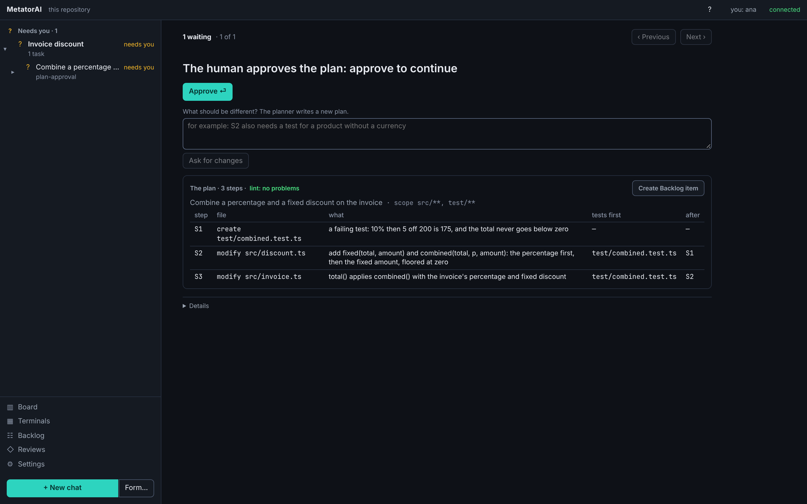

# MetatorAI

MetatorAI is a desktop app for working with AI coding agents on Claude Code or GitHub Copilot CLI. You talk to an agent in a chat. It answers from the code, edits directly what is not meant for a commit, or carries a change through a workflow with a plan, tests, gates and a review, in terminals you can watch. It stops where the decision is yours: the plan, a commit, a push, a comment on a pull request. It works in one repository or across many.



Status: pre-alpha. Commands and file formats can still change.

## Install

MetatorAI runs from a checkout and needs [Bun](https://bun.sh) 1.4 or newer and git. Your own project can use npm, pnpm, Yarn or Bun. The agents run on the Claude Code CLI (`claude`) or the GitHub Copilot CLI (`copilot`), installed and logged in.

```bash
git clone https://github.com/Siara-Maciej/MetatorAI.git ~/tools/metatorai
cd ~/tools/metatorai && bun install && (cd packages/cli && bun link)   # puts `metator` on your PATH
metator version
```

The desktop app's installers (Windows, macOS, Linux) are built by this repository's `desktop` workflow and kept as its artifacts; a `desktop-v*` tag puts them on a release. From the checkout, `cd packages/desktop && bun run tauri dev` runs the window, and `bun run dev` serves it to a browser. See [Get the desktop app](https://siara-maciej.github.io/MetatorAI/guide/desktop-app).

## One repository

```bash
cd ~/code/shop
metator setup      # config, agents, skills, workflows, host files and hooks; commit the result
metator doctor     # what a run can and cannot do here, and the fix for each
metator serve      # the local daemon the app talks to, on http://127.0.0.1:4310
```

Open the app and click **+ New chat** (or press `n`). Tell the agent what you want. For each request it suggests the lightest way that fits, and you decide:

| Way | For | What happens |
|---|---|---|
| Direct | questions, and edits not meant for a commit (debug output) | an answer with `file:line`, or an edit recorded so `metator scratch drop` takes it out again |
| Quick | a small change meant to stay | `metator quick start`: the change, the quick gate, one short review; it ends with an uncommitted diff you look at |
| Full | everything else | a workflow (`mt-feature`, `mt-bugfix`, `mt-refactor`, …): plan, your approval, tests and code, gates, review, your approval of the delivery |

The agent never commits or pushes by itself: a commit or a push runs only on your word in the chat or your **Yes** on its card. Decisions that wait for you come to **Home**, one at a time.

## Many repositories

Set up each repository, then work from the folder that holds them:

```bash
cd ~/work/shop    && metator setup
cd ~/work/billing && metator setup
cd ~/work
metator repos init     # writes metator.repos.yml from the repositories below; never overwrites
metator repos list     # each repository, whether MetatorAI is set up in it, and its worktrees
metator serve          # one daemon for the whole folder
```

The app then shows every repository's decisions on one Home, with a repository select on Terminals, Backlog, Reviews and Settings. Your own git worktrees in the folder (`git worktree add ../shop-fix`) are counted under their repository, not as new ones. In the folder, `metator status`, `inbox`, `ask` and `repos status` cover every repository; any other command runs inside one repository or with `-C <repository>`.

When applications depend on each other through APIs, describe them in a system map (`metator system discover`, `docs/metator/system.yml`). A change that crosses them becomes a system plan: one step per application, in deploy order, each step a run in its own repository that you can watch.

```bash
metator -C shop system plan new "Rename refunds"          # a draft from the map's policies
metator -C shop system plan approve rename-refunds        # you, never an agent
metator -C shop system plan run rename-refunds            # start the steps that can start
```

## Everything is also a command

The app is a window over the `metator` command, which agents and CI call too:

```bash
metator status                          # every run and what it needs now
metator inbox                           # every decision that waits for you
metator quick start --task "Round prices half-up" --files src/price.ts
metator run                             # start a full run in the terminal and follow it
metator ask "How is the discount computed?"
metator help --verbs                    # the commands a person types, by what you want to do
```

## Documentation

**[siara-maciej.github.io/MetatorAI](https://siara-maciej.github.io/MetatorAI/)**

| To | Read |
|---|---|
| Install and take a first task through | [Install](https://siara-maciej.github.io/MetatorAI/guide/install), [Start with one repository](https://siara-maciej.github.io/MetatorAI/guide/first-run) |
| Work across several repositories | [Start with many repositories](https://siara-maciej.github.io/MetatorAI/guide/many), [Folder of repositories](https://siara-maciej.github.io/MetatorAI/many/), [System plans](https://siara-maciej.github.io/MetatorAI/many/plans) |
| Use the app day to day | [The app](https://siara-maciej.github.io/MetatorAI/use/), [Chats and the three ways](https://siara-maciej.github.io/MetatorAI/use/start), [Home and the Board](https://siara-maciej.github.io/MetatorAI/use/inbox) |
| Approvals, consent and guards | [Approvals and consent](https://siara-maciej.github.io/MetatorAI/use/approvals), [Hooks and guardrails](https://siara-maciej.github.io/MetatorAI/repo/hooks) |
| Teach MetatorAI your repository | [Rules](https://siara-maciej.github.io/MetatorAI/repo/), [Gates and CI](https://siara-maciej.github.io/MetatorAI/repo/gates-ci) |
| Look up a command, a setting or a route | [Reference](https://siara-maciej.github.io/MetatorAI/reference/) |

## Contributing

```bash
bun install
bun run check        # lint, types, architecture rules, canon, unit and end-to-end tests, mutation smoke
bun run site:dev     # the documentation at http://localhost:5173/MetatorAI/
```

The code is a Bun monorepo built as ports and adapters: `core` holds the domain and use cases, plugins implement ports and import only `@metator/core`, `runtime` wires them, `cli` and `desktop` are the entry points. Architecture rules (`bun run arch`) enforce the direction in CI. Every file MetatorAI reads as data is a versioned document, and nothing is done until it is proven with unit tests, an end-to-end test on a real repository, and a green `bun run check`.

Instructions for working in this repository are in [`AGENTS.md`](AGENTS.md). Design documents (in Polish) are in [`docs/`](docs/README.md), decisions in [`docs/adr/`](docs/adr/README.md).
