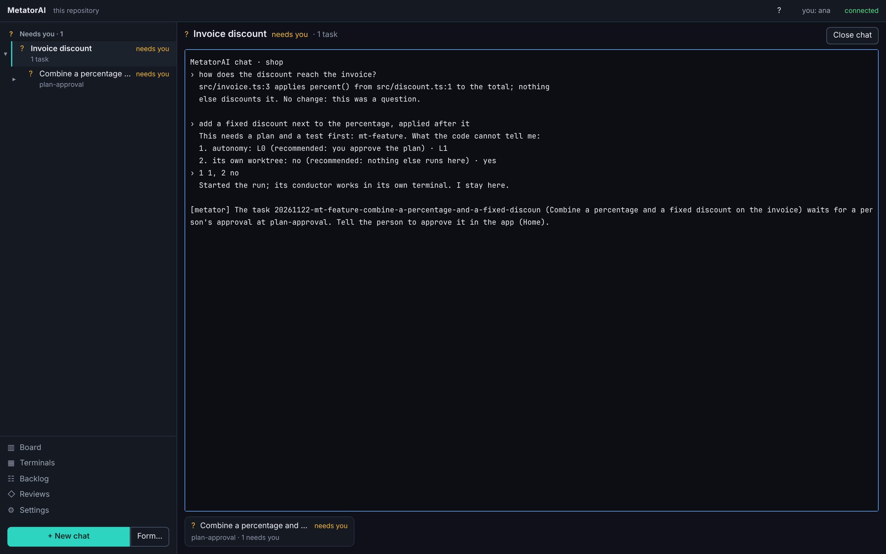

# Start with one repository

This page sets MetatorAI up in one repository and takes you through your first chat: a question, a quick change and a full run. It needs the [`metator` command](./install.md), [the desktop app](./desktop-app.md), and Claude Code (`claude`) or GitHub Copilot CLI (`copilot`) installed and logged in.

## Set up the repository

In the root of a git repository with at least one commit:

```bash
cd ~/code/shop
metator setup
```

Setup picks the AI tools itself: the ones this repository already has files for (a `.claude/` folder or `CLAUDE.md`; Copilot's files under `.github/`), or else the ones whose command is on your machine. In a terminal it asks whether to install the hooks, and about the AI tools only when nothing says which. To skip the questions:

```bash
metator setup --host claude --yes
```

```json
{"ok":true,"data":{"config":"metator.config.yml","hosts":["claude"],"hostsFrom":"option",
 "workflows":["mt-bugfix","mt-feature","mt-pr-review","mt-quick","mt-refactor","mt-review-response","mt-self-review","mt-system-change"],
 "hooks":true,
 "canon":{"mode":"install","version":"0.0.0","lock":"metator/install.lock.json","steps":{"create":49}},
 "generated":40,"gitignore":"added",
 "checks":[{"command":"meta agents-lint","passed":true},{"command":"meta skills-lint","passed":true},
           {"command":"workflow lint","passed":true},{"command":"generate --check","passed":true}],
 "next":["metator doctor","metator doctor --gates","metator serve"]}}
```

Setup does four things:

1. It reads your `package.json` scripts and writes `metator.config.yml` with the quality gates it found. An existing config is never overwritten.
2. It copies the shipped agents, skills and the eight workflows into `metator/` and `.github/metator/workflows/` (`--workflows` installs fewer).
3. It generates the files your AI tool reads (`.claude/` for Claude Code, `.github/agents/` and `.github/skills/` for Copilot) and the hooks. `--no-hooks` leaves the hooks out; without them nothing guards commits and pushes, and your word in the chat is no consent.
4. It lints what it installed.

Commit the result. `--host` takes `claude`, `copilot` or both. `hostsFrom` says where the choice came from: `option`, `config`, `found`, `asked`, or `default` (both).

## Check what a run can do here

```bash
metator doctor
```

Each check is `ok`, `warn` (a run starts but does less) or `fail` (a run cannot start), and each problem names the fix. It fails when the directory is not a git repository, when the repository has no commit, when there is no workflow, and when none of the AI hosts can start. It warns about uncommitted changes, a detached HEAD, missing gates, dependencies that are not installed, and a missing remote.

`metator doctor --gates` also runs the quick gate once. A red gate is worth fixing first: every quick and full run checks its change with it.

## Start the daemon and open the app

```bash
metator serve
```

The installed desktop app starts the daemon itself once you named the repository's folder in it ([The app](../use/index.md#the-app-starts-the-daemon-itself)), so this step is for the browser and for scripts. The daemon listens on `http://127.0.0.1:4310`. Leave it running and open the app. The top bar reads **connected**, and Home offers **Describe a task**.

## Open a chat

Click **+ New chat** at the bottom of the sidebar (or press `n`). The chat opens: a terminal in which the conversation agent, `mt-chat`, runs on your AI tool. The daemon takes the first installed host of `supervisor.hostOrder` (`copilot`, `claude`, `opencode` by default). When none is installed, no chat opens and the app says which programs it looked for.



Write in the terminal as you would talk to a colleague. For each thing you ask, the agent suggests one of three ways, and you decide.

### A question: direct

```text
› how does the discount reach the invoice?
```

The answer cites `file:line` and starts nothing. If you ask for a change that is not meant for a commit, such as a `console.log` to trace a call, the agent makes it at once and records it as a debug change: **Debug changes (N)** on Home lists it, with **Remove debug changes**, and no commit can take it by accident ([Quick and debug changes](../use/quick.md#debug-changes)).

### A small change: quick

```text
› round prices half-up in src/price.ts
  This is too small for the full workflow: do it as quick?
› yes
```

Before it asks, the agent runs `metator quick check`: a command, not the model, decides whether the change is small enough (at most 5 files and 150 changed lines by default, no new dependency, no public API, and more). On yes it starts `metator quick start`. A worker makes the change in its own terminal, the quick gate runs on the changed files, and one reviewer reads the diff once. Then Home shows **Quick change ready: look at the diff**: **Open diff** shows it, **Fine** ends the run. Nothing is committed; commit it yourself, or ask the agent to ([commit and push](../use/approvals.md#commit-and-push)).

### A larger change: full

```text
› add a combined percentage and fixed discount to the invoice
```

The agent names the workflow that fits, here `mt-feature`, says why, and asks only what the repository cannot tell it, with the recommended answer first: the autonomy, and whether the run gets its own worktree. Answer, and it starts the run. The run's conductor opens in its own terminal and the chat stays where you talk.

The run surveys the code and writes a plan. Then it stops, and **Needs you** at the top of the sidebar goes to 1. Home shows the plan in full, with **Approve** and **Ask for changes**:


**Approve**, and the run builds: tests first, then the code, then your own `lint`, `typecheck` and `test` scripts, then the review agents. **Terminals** shows its sessions while they work. The run stops again at `delivery`; read its **Changes** first, and leave notes on lines for the agent if you want ([Read the change](../use/changes.md)). Nothing is pushed until you approve the delivery, at any autonomy level.

### How to decide

| Ask yourself | Take |
|---|---|
| Do I only want to know something, or see something for a moment? | direct |
| Is it a few lines I would review in a minute, and will I keep it? | quick |
| Does it need a plan, new tests, or someone's approval before it ships? | full |

The agent suggests; you can always say "do it as quick" or "use the full workflow". When a quick change grows past the limits while it works, Home asks you: **Keep as quick** or **Continue as full**.

## When a full run is done

After you approve the delivery, the run commits its change and pushes its branch, `metator/<run id>`, to `origin`. It opens a pull request only when the task asked for one. In the sidebar a finished task is hidden behind **Show finished (N)** at the end of its chat.

The run's worktree (`.metator/wt/<run id>`) keeps its ports until you remove it:

```bash
metator run close --run <id> --remove-worktree
metator worktree prune --older-than 7      # every finished run older than seven days
```

## The same from a terminal

Every step above is also a command:

```bash
metator quick start --task "Round prices half-up" --files src/price.ts   # a quick change
metator run                                  # a full run: asks for the workflow, the task and the host
metator inbox                                # what waits for you
metator run answer q001 --choice approve     # answer; your name comes from git, or give --by
metator review changes --run <id>            # what the run changed
```

An approval is never given on an agent's word. This is what a run answers when an agent reports the plan approval as passed:

```json
{"ok":false,"error":{"code":"TRANSITION_DENIED",
 "message":"Stage \"plan-approval\" (active) does not accept PASS",
 "hint":"This approval needs a person's decision: APPROVE, FAIL, ABORT."}}
```

## Update the shipped files

After you [update MetatorAI](./install.md#update), take the newer agents, skills and workflows into the repository:

```bash
metator agents update --dry-run      # what would change
metator agents update                # apply; files you changed are kept
```

A file that both you and the new version changed is reported as a conflict and your version stays. `--theirs` takes the shipped version instead.

## Next

- [Chats and the three ways](../use/start.md): what a chat keeps, and the ways in more detail.
- [Home and the Board](../use/inbox.md): answering the questions of your runs.
- [Start with many repositories](./many.md): when your work spans several repositories.
