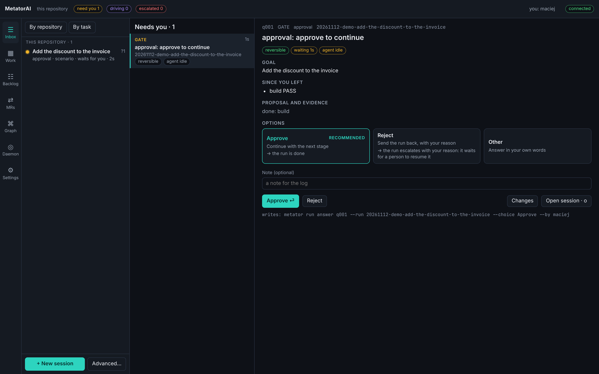

# First run

This page sets MetatorAI up in a repository and takes one task from start to delivery in the desktop app. You describe the task, approve the plan, watch the agents work, read the change and approve the push. It needs the [`metator` command](./install.md), the app, and Claude Code or GitHub Copilot installed.

## Set up the repository

Run this in the root of a git repository:

```bash
metator setup
```

Setup picks the AI tools itself: the ones this repository already has files for (a `.claude/` folder or `CLAUDE.md`; Copilot's instructions, agents, skills or prompts under `.github/`), or else the ones whose command (`claude`, `copilot`) is on your machine. In a terminal it asks one question, whether to install the hooks. It asks about the AI tools only when nothing says which, or when the repository and the machine point at different ones. Every workflow is installed; `--workflows` installs fewer. To skip the questions:

```bash
metator setup --host claude --hooks --yes
```

```json
{"ok":true,"data":{"config":"metator.config.yml","hosts":["claude"],"hostsFrom":"option",
 "workflows":["mt-bugfix","mt-feature","mt-pr-review","mt-refactor","mt-review-response","mt-self-review","mt-system-change"],
 "hooks":true,"generated":38,"gitignore":"added",
 "checks":[{"command":"meta agents-lint","passed":true},{"command":"meta skills-lint","passed":true},
           {"command":"workflow lint","passed":true},{"command":"generate --check","passed":true}]}}
```

Setup does four things:

1. It reads your `package.json` scripts and writes `metator.config.yml` with the quality gates it found. An existing config is never overwritten.
2. It copies the shipped agents, skills and workflows into `metator/` and `.github/metator/workflows/`.
3. It generates the files your AI tool reads (`.claude/` for Claude Code, `.github/agents/` and `.github/skills/` for Copilot), and the hooks when you pass `--hooks`.
4. It lints what it installed.

Commit the result. `--host` takes `claude`, `copilot` or both, and wins over what setup found. `hostsFrom` in the result says where the choice came from: `option`, `config` (an existing `metator.config.yml`), `found`, `asked`, or `default` (nothing said, so both).

`metator doctor` then tells you what a run can do here. Each check is `ok`, `warn` (a run starts but does less) or `fail` (a run cannot start), and each problem names the command that fixes it.

## Start the daemon and open the app

```bash
metator serve
```

The daemon listens on `http://127.0.0.1:4310`. Leave it running and open the desktop app ([The app](../use/index.md#start-it) says where the installers are). The chip at the top right reads **connected**, and the **Inbox** is empty.

## Describe the task

Click **+ New session** at the bottom of the sessions panel. The **Work** screen opens with a pane in which the agent `mt-orchestrator` runs on your AI tool. Write the task there:

```text
Add a subtract function next to add, with a test
```

The agent answers with one numbered message that asks what the code cannot settle, for example which workflow to use and whether the run gets its own worktree. Each point has options, with the recommended one first. Answer, for example `1 1, 2 yes`. The agent starts the run and names it. The run appears in the sessions panel and as a tab on **Work**.

## Approve the plan

The run surveys the code, writes a plan and checks it. Then it stops, and the counter **need you** in the top bar goes to 1. Open the **Inbox**.



The decision card shows the task, what was done so far and the options. To read the plan first, go to **Work** and click the stages under the tabs: the **Plan** screen lists every step with its file and the tests that come first.

Back in the **Inbox**, choose **Approve**, type your name in the last field and click the **Approve** button. To send the plan back, choose **Reject** and write the reason in the note field.

## Watch the work

After your approval the run builds. On **Work**, the run's tab shows the agents in panes, each with its state. You can watch without touching anything. When an agent needs you (a question, or a tool it may not run on its own), the question arrives in the **Inbox** like the gate did.

The build is followed by the gates (your own `lint`, `typecheck` and `test` scripts) and by the review agents.

## Read the change and approve delivery

Click the run in the sessions panel to open its **Session** screen, then **Review** in the box **Changes**. The **Changes** screen lists the files and their diffs. Click a line to leave a note. The button **Send 1 to agent** (with the number of your notes) hands them to the run.

At the `delivery` stage the run stops again. Nothing is pushed until you approve this gate in the **Inbox**, at any autonomy level.

## The same run from a terminal

Every step above is also a command, and the app, the agents and CI call the same ones.

```bash
metator run                                          # asks for the workflow, the task and the host, then drives the run
metator inbox                                        # what waits for you
metator run answer q001 --choice Approve --by alice  # answer a question
metator run board                                    # the plan and where the run stands
metator review changes --run <id>                    # what the run changed
```

Every `metator` command prints one JSON object. A gate does not open on an agent's word. This is what a run answers when an agent reports the plan approval as passed:

```json
{"ok":false,"error":{"code":"TRANSITION_DENIED",
 "message":"Stage \"plan-approval\" (active) does not accept PASS",
 "hint":"This gate needs a human decision: APPROVE, FAIL, ABORT."}}
```

[Start a task](../use/start.md#from-a-terminal) and the [command reference](../reference/commands.md) have the details.

## Update the shipped files

After you [update MetatorAI](./install.md#update), take the newer agents, skills and workflows into the repository:

```bash
metator agents update --dry-run      # what would change
metator agents update                # apply; files you changed are kept
```

A file that both you and the new version changed is reported as a conflict and your version stays. `--theirs` takes the shipped version instead.

## Next

- [The app](../use/index.md): every screen and what it is for.
- [Gates and approvals](./gates.md): where a run stops and who can open each gate.
- [Your settings](../use/settings.md): your keys, editor and look.
