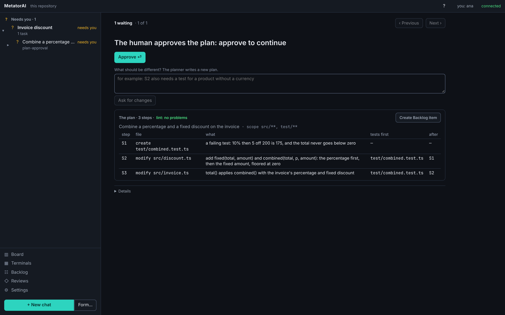

# What MetatorAI is

MetatorAI is a workflow layer around Claude Code and GitHub Copilot CLI. Your AI tool still writes the code. MetatorAI gives the work a fixed sequence of stages, checks each stage with a command, and stops where a person has to decide.

It does not replace your AI tool, your linter or your tests. It runs them.

## Three parts

| Part | What it is |
|---|---|
| The desktop app | where you work: chats with the agent, Home with the decisions that wait for you, the terminals of the agents, the changes, the backlog and the reviews ([Get the desktop app](./desktop-app.md)) |
| The daemon, `metator serve` | a local process in your repository, or in a folder of repositories. It holds the terminals, the runs and the questions; the app is a window on it |
| The `metator` command | what the app, the agents, the hooks and CI call. Everything the app does is also a command |

## Who does what

The work is split four ways, and each part is done by whoever can be held to it.

| Part | Done by | Examples |
|---|---|---|
| Decide | the model | understand the task, write the plan, write the code, find problems in a diff |
| Measure | the `metator` command | which files and tests a change reaches, which rules apply to a file, whether a plan is complete |
| Enforce | hooks that the AI tool runs | no commit or push without your consent, no reading `.env`, no edit outside the plan |
| Approve | you | the plan, a commit, a push, comments on a pull request |

A rule written in a prompt holds only while the model remembers it. A rule checked by a command or a hook holds every time, so MetatorAI moves as many rules as it can out of the prompt. A step is finished when its result passes a check, not when the model says so.

## Three ways to do a task

You talk to the conversation agent, `mt-chat`, in a chat. For each thing you ask, it takes the lightest way that fits and suggests it. You decide: name another way and it takes yours.

| Way | When | What happens |
|---|---|---|
| Direct | questions, and edits not meant for a commit (debug output, a temporary switch) | an answer with `file:line` citations, or an edit made at once and recorded as a debug change, so `metator scratch drop` takes it out again |
| Quick | a small change that is meant to stay | `metator quick start`: the change, the quick gate, one short review. It ends with an uncommitted diff you look at |
| Full | everything else | a workflow such as `mt-feature`: survey, plan, your approval, tests and code, gates, review, your approval of the delivery |

Whether a change is small enough for quick is decided by a command, not by the model ([Quick and debug changes](../use/quick.md)). The agent never commits or pushes by itself: a commit or a push runs only on your word in the chat or your **Yes** on its card ([Approvals and consent](../use/approvals.md)).

## One repository or many

MetatorAI is set up per repository. You can work in one repository, or start the daemon in a folder that holds several: the app then shows the work of all of them in one place, and a change that crosses applications becomes a system plan with one step per repository.

- [Start with one repository](./first-run.md)
- [Start with many repositories](./many.md)

## What it adds to your repository

`metator setup` writes these, and you commit them:

| Path | What |
|---|---|
| `metator.config.yml` | which AI tools you use and which of your scripts are the quality gates |
| `metator/` | the agents and skills, in one format for every AI tool |
| `.github/metator/workflows/` | the workflow specs, eight of them |
| `.claude/`, `.github/agents/`, `.github/skills/`, `.github/hooks/` | the files generated for Claude Code and Copilot |

Run state goes to `.metator/`, which setup adds to `.gitignore`.
