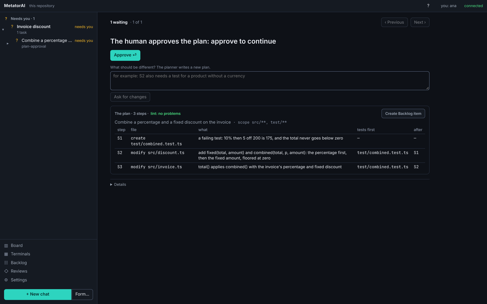
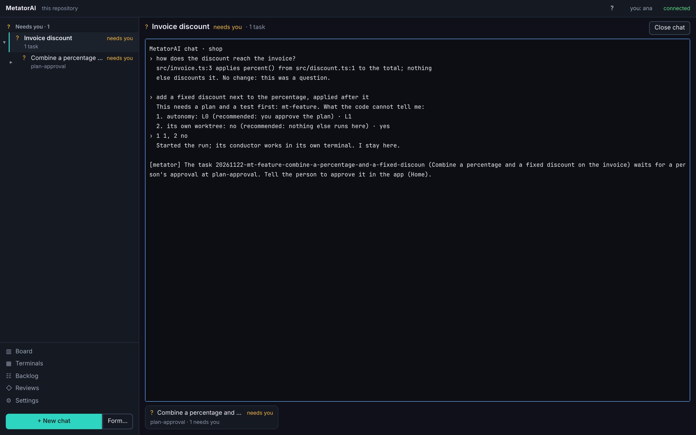
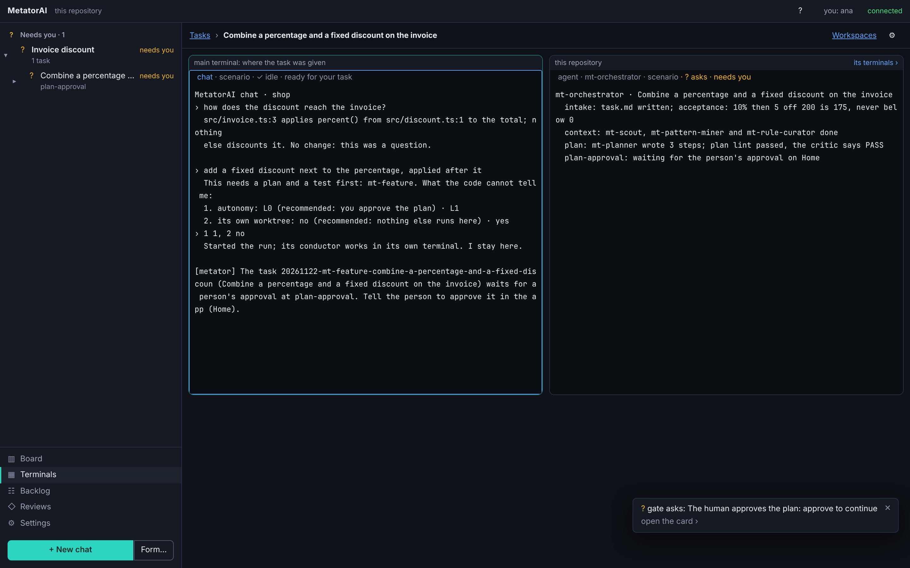

# MetatorAI

MetatorAI is a desktop app for working with AI coding agents on Claude Code or GitHub Copilot CLI. You talk to an agent in a chat. It answers from your code, makes a small change on the spot, or carries a larger one through a workflow with a plan, tests, gates and a review, in terminals you can watch. It stops where the decision is yours: the plan, a commit, a push, a comment on a pull request.

Everything runs on your machine, in your repositories.

## Two ways in

- **[Start with one repository](./guide/first-run.md)**: set the repository up, start the daemon, open the app and give the agent your first task.
- **[Start with many repositories](./guide/many.md)**: a folder that holds several repositories, one daemon and one app for all of them, and changes that cross applications.

[Install](./guide/install.md) comes first in both.

## How it works

### 1. Talk to the agent

Click **+ New chat** and say what you want. For each request the agent suggests the lightest way that fits, and you decide:

| Way | For | What happens |
|---|---|---|
| Direct | questions, and edits not meant for a commit | an answer with `file:line`, or an edit recorded so it can be taken out again |
| Quick | a small change meant to stay | build, the quick gate, one short review; it ends with a diff you look at |
| Full | everything else | a workflow: plan, your approval, tests and code, gates, review, your approval of the delivery |

### 2. Watch the agents, or do something else

Every agent works in a real terminal. **Terminals** shows a task's terminals side by side: you can read along, take the keyboard, or open a shell. You do not have to watch: the app tells you when something needs you.

### 3. Decide when it asks

**Home** shows every decision that waits for you, one at a time: the question or the plan, and its answers, with a recommended one. A commit or a push runs only on your word in the chat or your **Yes** on its card.

### 4. Read the change

**Changes** shows a run's diff. Write a note on a line and send it to the agent, the way you would review a colleague.

### 5. Reviews of pull requests

Paste a pull request's link in a chat and the agent reviews it; nothing is published before your **Yes**. **Reviews** watches it for new commits. When someone reviews your own pull request, the agent drafts the replies and plans the fixes, and sends nothing until you choose.

## Everything is also a command

The app is a window over the `metator` command, which agents and CI call too. `metator quick start` and `metator run` start work, `metator inbox` lists what waits for you, and `metator status` shows every run. See the [command reference](./reference/commands.md).

## Documentation

- [Start](./guide/index.md): what MetatorAI is, how to install it, and the two ways in.
- [Work](./use/index.md): the app day to day: chats, quick and full runs, Home, terminals, reviews.
- [Many repositories](./many/index.md): a folder of repositories, systems of applications, system plans.
- [Your repository](./repo/index.md): rules, agents, hooks, gates and intake for your own repository.
- [Reference](./reference/index.md): commands, configuration, the daemon's HTTP API, file formats, troubleshooting.
