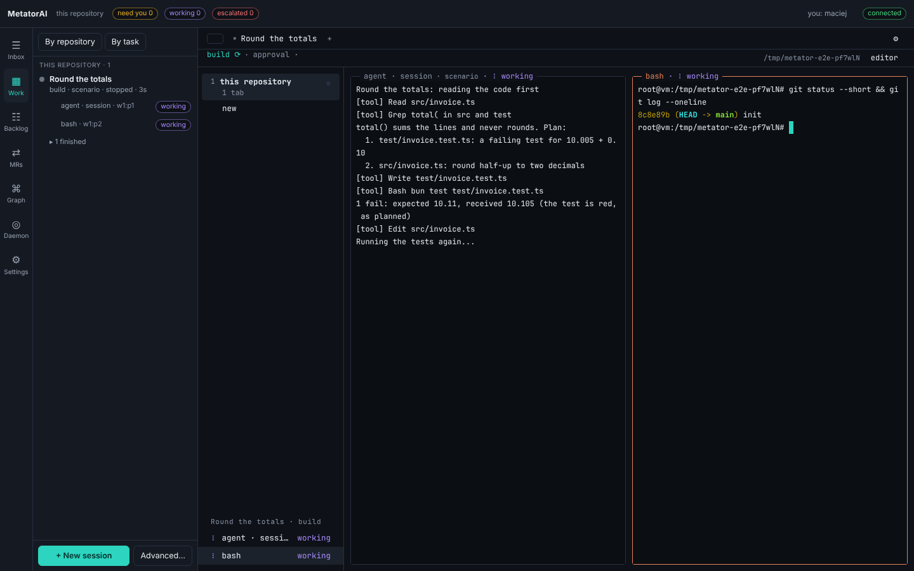
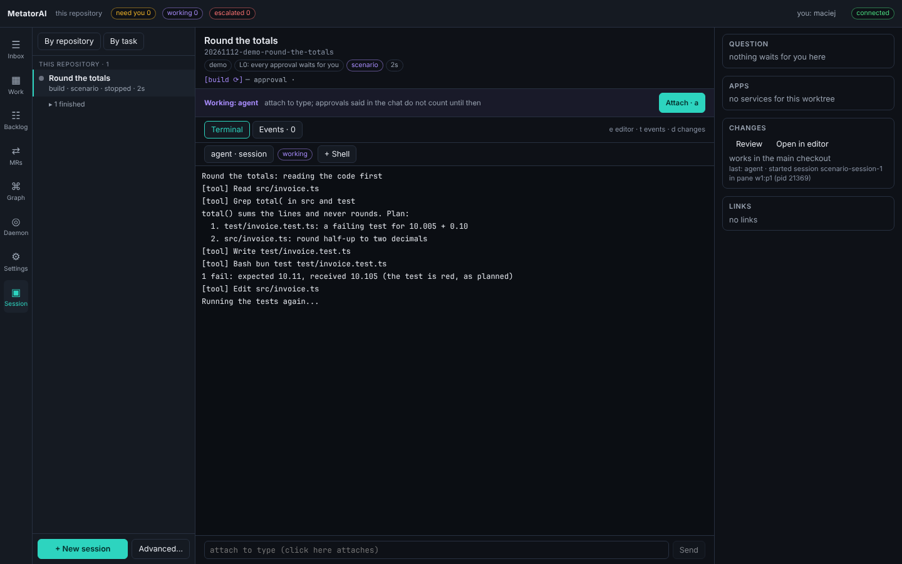
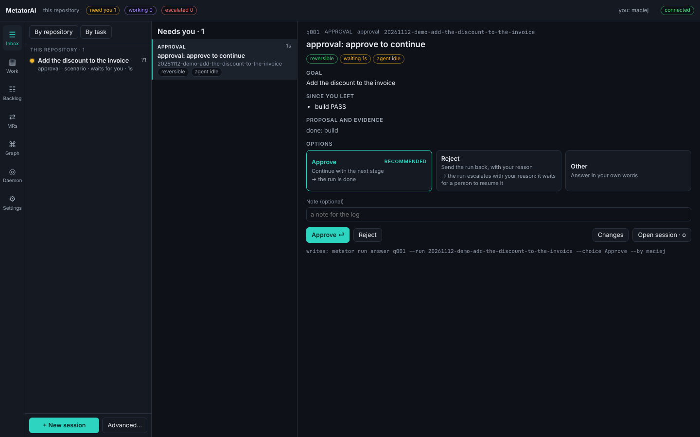
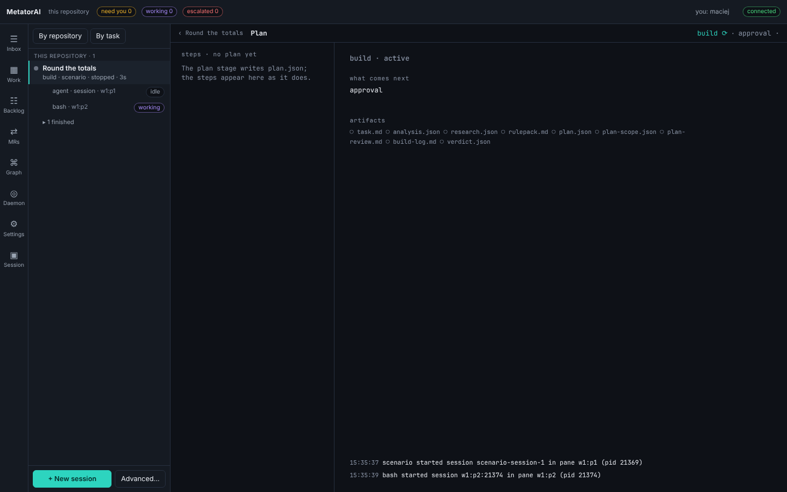
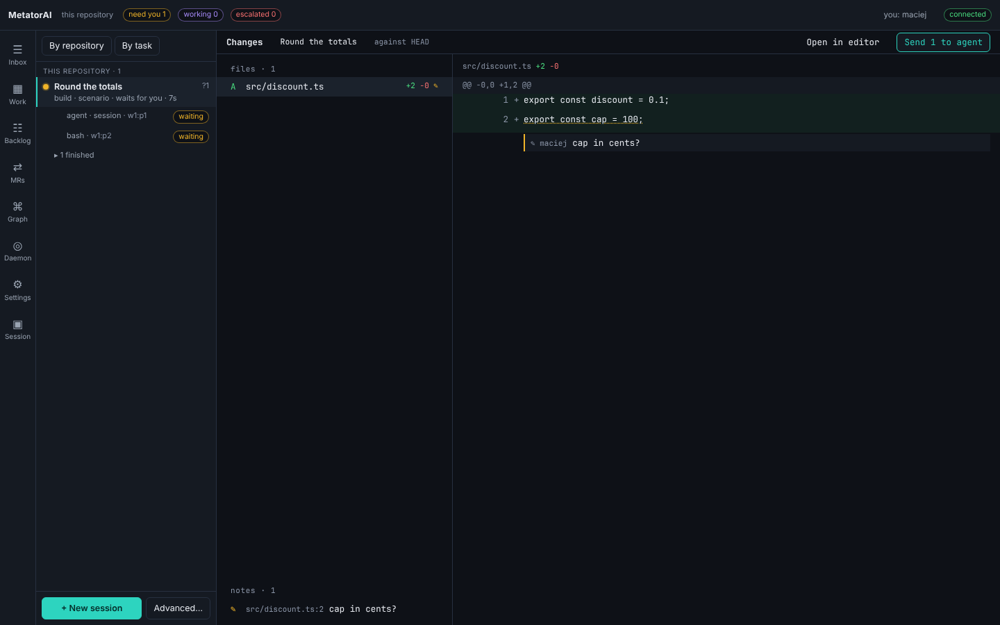
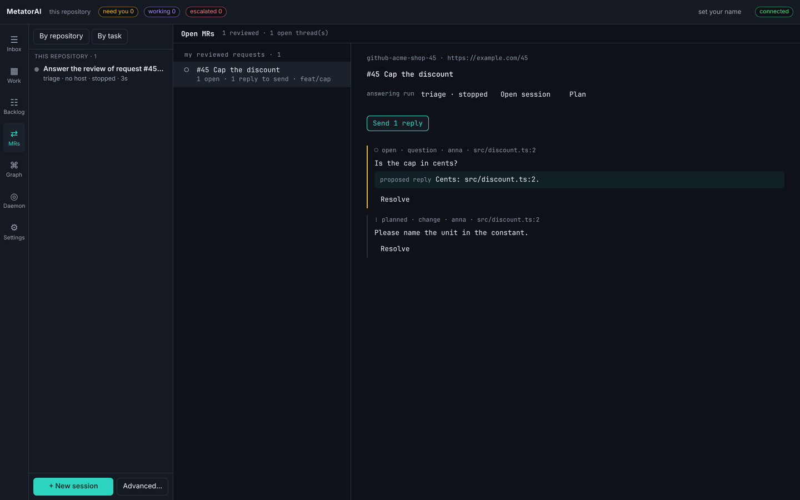

# MetatorAI

MetatorAI is a desktop app for working with AI coding agents. You describe a task. Agents plan it, write the tests and the code, and review the result in terminals you can watch. The app stops them where the decision is yours: the plan, the push, the comments on a pull request.

It works with GitHub Copilot and Claude Code. Everything stays on your machine, in your repository.



[Install](./guide/install.md) · [First run](./guide/first-run.md) · [Tour of the app](./use/index.md)

## How it works

### 1. Describe the task

Click **+ New session** and tell the agent what you want. It answers questions about the code with `file:line` references, and starts a run when you ask for a change. Each run gets its own tab and its own git worktree, so several can go on side by side.



### 2. Watch the agents, or do something else

Every agent works in a real terminal. You can read along, type into it, or open a shell next to it. You do not have to watch: the app tells you when a run needs you.

### 3. Decide when it asks

A run stops at each decision that is yours. The **Inbox** collects them from every run: what the run wants, the evidence, what each answer leads to, and a recommended answer.



### 4. See the plan and the change

**Plan** shows where a run stands: its stages, the steps of the plan, the files each stage left. **Changes** shows the diff. Write a note on a line and send it to the agent, the way you would review a colleague.





### 5. Nothing leaves your machine before you say so

The push waits for your approval. So does every comment on a pull request. When someone reviews your pull request, **MRs** shows the threads, the replies the agent proposes and the fixes it plans. It sends nothing until you press the button.



## Why the result can be trusted

The agent still writes the code. MetatorAI decides what the agent may take on trust:

| Job | Who does it | Example |
|---|---|---|
| Decide | the model | understand the task, write the plan and the code, find problems in a diff |
| Measure | the `metator` command | which tests a change reaches, which rules apply to a file, whether a plan is valid |
| Enforce | hooks your AI host runs | no edit outside the plan, no push before approval, no reading of secrets |
| Approve | you | the plan, the push, the review comments |

A step is finished when its result passes a check, not when the model says so.

## Try it

MetatorAI runs from a checkout and needs [Bun](https://bun.sh). Your own project can use npm, pnpm, Yarn or Bun.

```bash
git clone https://github.com/Siara-Maciej/MetatorAI.git ~/tools/metatorai
cd ~/tools/metatorai && bun install && (cd packages/cli && bun link)

cd ~/code/your-repo
metator setup     # reads the repository, installs rules, generates agents and hooks
metator serve     # the local daemon the app talks to
```

Then open the app and click **+ New session**. [Install](./guide/install.md) has the details.

The app is a window over the `metator` command, which agents and CI call too. Whatever the app does, a terminal can do: `metator run` starts a task and `metator inbox` lists what waits for you. See the [command reference](./reference/commands.md).

## Documentation

- [Guide](./guide/index.md): what MetatorAI is, how to install it, how a run works.
- [App](./use/index.md): a tour of the app, starting a task, answering its questions, reading the change, your settings.
- [Repository](./repo/index.md): rules, agents, gates and hooks for your own repository.
- [Reference](./reference/index.md): commands, configuration, file formats, troubleshooting.
