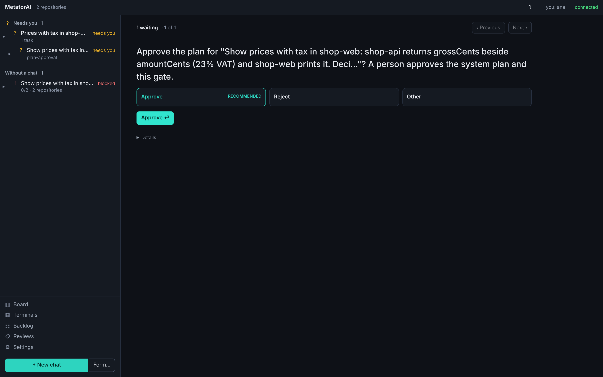

# Folder of repositories

MetatorAI is set up per repository. When you work on several, each keeps its own setup, and the folder that holds them shows all of their work in one place: one daemon, one Home, one `metator status`. This page covers the folder: its file, its worktrees, the commands that work in it, and the app on it. [Start with many repositories](../guide/many.md) is the short path through it.

## Set up each repository

```text
~/work/
├── shop/
├── billing/
└── web/
```

```bash
cd ~/work/shop    && metator setup
cd ~/work/billing && metator setup
cd ~/work/web     && metator setup
```

Each repository then has its own `metator.config.yml`, agents, skills, hooks, workflows, runs and worktrees. Nothing in one repository changes another.

## Which repository a command acts on

A command acts on the nearest folder above your working directory that contains `.git`. So `cd ~/work/billing/src && metator run status` works on `billing`. From anywhere else, name the repository with `-C`:

```bash
metator -C ~/work/billing env status
```

## Repositories on one machine

MetatorAI keeps repositories apart where they share the machine:

| Shared resource | How it is kept apart |
|---|---|
| Ports of worktrees | each worktree leases a block of ports from one registry for the whole machine, so two repositories never get the same block |
| Docker Compose | each repository and place gets its own Compose project name (`metator-<repo>-<hash>-<place>`) |
| Agents and hooks | host files (`.claude/`, `.github/`) live in each repository and apply only there |

The machine-wide state lives in `$METATOR_STATE_DIR`, else `$XDG_STATE_HOME/metator`, else `~/.local/state/metator`.

One thing is not kept apart. A `shared` service keeps the port you wrote in `metator/environment.yml` (see [Run the application](../repo/environments.md)). If two repositories each start their own shared Postgres on `5432`, the second cannot start. Give them different ports.

## A folder of repositories

Run `metator` in the folder that holds the repositories to see all of them at once:

```bash
cd ~/work
metator repos list       # each repository and whether MetatorAI is set up in it
metator repos status     # each repository's active runs, questions waiting for you, running services
metator status           # every repository's runs, by repository
```

A folder that is not a repository but holds repositories works this way without any file. To fix the list and the names, write one:

```bash
metator repos init       # writes metator.repos.yml from the repositories below; never overwrites
```

```yaml
# ~/work/metator.repos.yml
kind: RepoSet
schemaVersion: 2
repos:
  - path: shop
    worktrees:            # optional: its other checkouts in this folder
      - shop-fix
  - path: billing
  - path: services/mailer
    name: mailer          # optional: how it is shown
```

The folder file is only a list. It holds no agents, rules or workflows, and changing it never touches a repository.

## Worktrees in the folder

A folder often holds more checkouts than repositories. `git worktree add ../shop-fix fix-tax` makes a second checkout of `shop` next to it:

```text
~/work/
├── shop/          # the repository
├── shop-fix/      # a worktree of shop, on the branch fix-tax
├── shop-wip/      # another worktree of shop
├── billing/
└── web/
```

MetatorAI counts this folder as 3 repositories, not 5. It reads each checkout's `.git`: a worktree has a `.git` file that points into its repository's `.git/worktrees/`. No git command runs for this.

| Where | What it shows |
|---|---|
| `metator repos list` | 3 repositories; `shop` lists `shop-fix` and `shop-wip` under `worktrees`, each with its branch |
| `metator repos init` | `shop` with its `worktrees` in `metator.repos.yml` |
| `metator status` | `shop · 2 worktrees`, then the runs of each worktree under it as `shop (fix-tax)` |
| `metator repos status` | the runs of all of a repository's checkouts in its row |
| the app | `3 repositories` in the top bar; the repository picker lists `shop (fix-tax)` as a place to work, and `· 2 worktrees` beside it |

A worktree keeps its own runs, sessions and threads in its own `.metator`, so you can work in it as in any checkout: `cd ~/work/shop-fix && metator run new …`. The daemon serves each checkout, and shows its work under its repository. Only the repository looks for new intake issues and review requests, so they are not found twice.

Some cases:

- **The repository is elsewhere.** When the folder holds only worktrees of a repository that lives outside it (or a bare repository), they are still one repository. The first worktree, by path, stands for it.
- **Submodules** are not worktrees. A submodule listed in `metator.repos.yml` is a repository of its own.
- **MetatorAI's own worktrees** (`.metator/wt/` inside a repository, from `metator worktree new`) never show in the folder. Their runs belong to the checkout they came from.
- **An older `metator.repos.yml`** (`schemaVersion: 1`) may list a worktree as a repository. MetatorAI counts it once under its repository and says so: `shop-fix is a worktree of shop; counted once`. To make it quiet, move the path under its repository's `worktrees`, or remove the file and run `metator repos init` again.

## What runs in the folder

| Where you are | What `metator` acts on | Commands |
|---|---|---|
| inside a repository, at any depth | that repository | every command |
| the folder of repositories | all its repositories | `repos init`, `repos list`, `repos status`, `status`, `inbox`, `ask`, `report`, `serve`, `supervise`, `system discover`, `version`, `help` |
| anywhere, with `-C <path>` | the repository or folder at `<path>` | as above, for that place |

Any other command in the folder stops with a `USAGE` error that names the repositories:

```text
`metator run status` works on one repository, and ~/work is a folder of 3
Run it inside a repository (billing, shop, web) or pass `-C <repository>`; here, `metator status`, `inbox`, `repos` and `ask` cover them all.
```

```bash
metator -C shop run new --workflow mt-feature --task "Add discount"
```

In the folder, `metator ask` reads every repository and cites paths from the folder, such as `billing/src/vat.ts:7` ([Ask about the code](../use/ask.md#ask-across-repositories)), and `metator system discover` proposes a system map from all of them ([Systems of applications](./systems.md#let-metatorai-propose-the-map)).

## One daemon for the folder

```bash
cd ~/work
metator serve
```

The daemon serves every repository and worktree of the folder, on one port. Each repository keeps its own configuration: its gates, its host order, its intake rules and its review sources. The daemon looks for new intake issues and review requests in each repository (not in its worktrees, so nothing is found twice). A folder has one daemon: a second `metator serve` in the same folder, or in one of its repositories, is refused and names the first.

## The app on a folder

- The top bar shows the folder as **3 repositories**; hovering it lists them, each with its worktrees (`shop · 2 worktrees`).
- **Home** has one queue for every repository. A card's **Details** names its repository, and a question a chat asks before any run names its repository too.
- **Terminals**, **Backlog**, **Reviews** and the parts of **Settings** show one repository at a time, chosen with the **repository** select at the top. The select also lists the worktrees in the folder as places to work (`shop (fix-tax)`). The choice is shared by these places and remembered.
- **+ New chat** opens the chat in the repository the select names, and its thread is kept there. The **Form…** has a **Repository** field.
- The sidebar lists every task of every repository; a system task shows its steps under the repositories they work in. The page of a run always uses the run's own repository.


*On a folder, one Home holds the decisions of every repository.*

Sessions in a folder are on [Terminals and sessions](../use/sessions.md); `metator session tell` and `interrupt` take `--repo` there.

## Folder or system map

The folder says where checkouts are on your disk. It knows nothing about how the applications relate. If they call each other through APIs and a change in one can break another, describe that in a system map: see [Systems of applications](./systems.md).
