# How it works

MetatorAI has four parts. You work with the first two every day; the other two keep everyone honest.

| Part | What it is | Where it lives |
|---|---|---|
| **The CLI** (`metator`) | measures facts and checks work; one JSON answer per command | installed once, runs in any repository |
| **The canon** | your rules, patterns, module cards, ADRs, workflows, agents and skills | committed in your repository, reviewed like code |
| **The hooks** | `metator guard …` commands the AI host runs around every tool use | generated into `.claude/settings.json` and `.github/hooks/` |
| **The runs** | one directory per task with state, an audit log and artifacts | `.metator/runs/<id>/` (git-ignored) |

## The Metator loop


| Stage | What really happens |
|---|---|
| **Survey** | parallel subagents read measured facts: graph, affected modules, pattern index, the rules for exactly the files in scope |
| **Plan** | every step names a file, the tests to write first and an exemplar from your code (`file:line`); a new abstraction needs an ADR |
| **Gate** | `plan lint` (deterministic), then a plan critic, then you |
| **Build** | tests RED, then GREEN; hooks block any edit outside the plan and lint every file the moment it changes |
| **Verify** | review lenses in parallel; a verifier tries to refute every finding; blockers go back to the plan a bounded number of times |
| **Ship** | the PR is drafted; nothing is pushed until a person says go |

## A run is a state machine

A workflow is a YAML spec in `.github/metator/workflows/`. `metator run` executes it as a state machine; the agents only ask it to move. Here is the shipped bug-fix workflow, read from its spec:

<WorkflowDiagram id="mt-bugfix" />

What the state machine guarantees:

- A stage cannot be skipped; `run advance` accepts only the events the current stage expects.
- A human gate accepts only `metator run approve`, never an agent's `PASS`.
- A failure goes back to the stage the spec names, at most as often as the loop limit allows; then the run is escalated to you.
- Every transition is written to `log.md`, and the state to `state.json` (a versioned document).

## Who talks to whom

```text
   You ──── chat ────►  AI host (Copilot / Claude Code)
                           │  runs agents (generated from metator/agents)
                           │
          ┌────────────────┼───────────────────────────────┐
          │ before/after   │ every fact, every check       │
          │ each tool use  ▼                               │
     metator guard …   metator graph | rules | plan | gate | run | findings …
     (hooks: allow,        │
      deny, context)       ├─ reads your repository, git, your tools (lint, tests, tsc, ast-grep)
                           └─ writes .metator/ (runs, index, reports) and generated canon files
```

- **Agents never parse prose.** Every command answers with `{"ok":true,"data":…}` or `{"ok":false,"error":{code,message,hint}}`.
- **Agents never get more than they need.** An agent's `capabilities` become tool allowlists such as `Bash(metator graph:*)`.
- **Hooks are outside the model's reach.** The host runs them; the agent cannot skip or rewrite them.

## Memory in tiers

| Tier | What | Loaded |
|---|---|---|
| T0 | `AGENTS.md` / `CLAUDE.md`: a short, always-loaded summary (budgeted) | always |
| T1 | rules, module cards, ADRs, patterns, workflows, agents, skills | by file (`applyTo`), on demand or through a command |
| T2 | the import index, the pattern index, API snapshots | through commands (`graph`, `similar`, `api`) |
| T3 | the run: state, log, artifacts | by the workers of that run |
| T4 | lessons from earlier runs, with citations | when relevant |

`metator memory check` keeps the map true in CI: every knowledge file is mapped, budgets hold and citations still match the code.

## Under the hood



The CLI is built with clean architecture and proven libraries:

| Concern | Library |
|---|---|
| Dependency injection, one scope per run | awilix |
| Run state machine with pure transitions | XState |
| Dependency graph: affected files, cycles, paths | graphlib |
| Import parsing and resolution | oxc |
| Workspace packages | manypkg |
| git | simple-git |
| Validation and schemas | zod |
| Errors as values | neverthrow |

Tools you already use arrive as plugins behind small ports. See [Extending](../api/extending.md).
