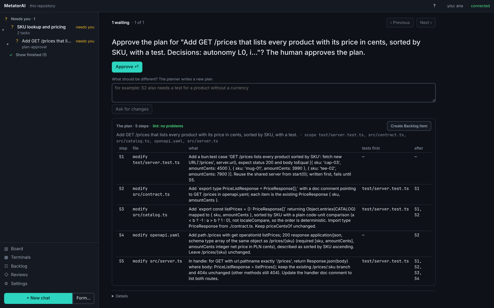
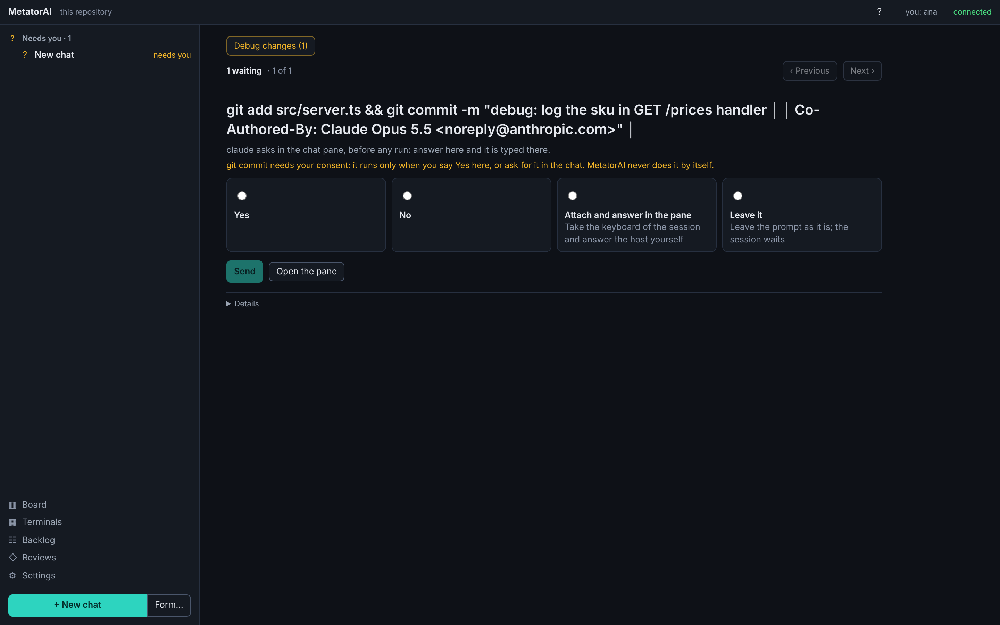
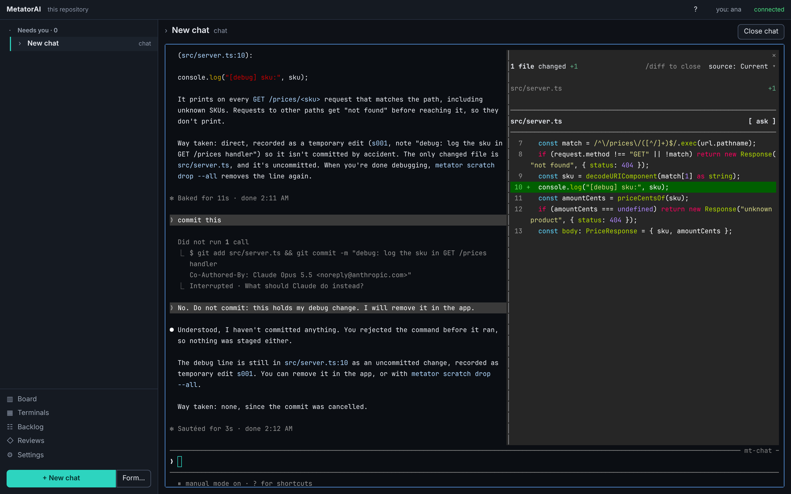

# Approvals and consent

Some things are yours to decide, and no agent can decide them for you. In a run, an **approval** is a stage that waits for a named person, such as the plan approval and the delivery. Everywhere, with or without a run, a `git commit`, `push`, `merge` or `rebase` needs your **consent**, and a few commands never run at all. This page covers both, the autonomy levels, and answers that repeat.

## Gates in a run

A workflow has three kinds of gate:

| Kind | Opened by | Examples |
|---|---|---|
| Check | a command that exits 0 | `metator plan lint`, `metator gate full` |
| Critic | a second agent whose answer ends with `VERDICT: PASS`; a missing verdict counts as a fail | the plan critic (`mt-plan-critic`), the review judge (`mt-judge`) |
| Approval | a named person | plan approval, delivery, publishing review comments |

A workflow marks each one in its spec: `gate.script` for a check, `gate.llm` for a critic, `hitl: true` for an approval. When a check or a critic fails, the run goes back to the stage the workflow names, up to its loop limit; then it is escalated to you ([Full runs](./runs.md#how-a-run-moves)).

The quality gates are your own scripts, listed under `gates` in `metator.config.yml`:

```bash
metator gate quick --base main     # the short list, scoped to files changed against main
metator gate full                  # every step: lint, typecheck, tests
```

[Gates and CI](../repo/gates-ci.md) explains how to configure them.

## Approve or reject

An approval comes to [Home](./inbox.md) as a card. A plan's card shows the plan in full, with **Approve** and **Ask for changes**: your words go back to the planner, which writes a new plan. Other approvals have **Approve** and **Reject**; a rejection needs your reason. The first time, the app asks for your name: every approval is recorded in `state.json` and `log.md` with it and the time.


*A plan-approval card: the whole plan, Approve and Ask for changes.*

From a terminal:

```bash
metator run approve plan-approval --by alice                         # go on
metator run advance fail --reason "step 3 has no test"               # send it back with the reason
metator run advance abort --reason "not needed any more"             # end the run
```

An agent that reports an approval as passed gets an error:

```json
{"ok":false,"error":{"code":"TRANSITION_DENIED",
 "message":"Stage \"plan-approval\" (active) does not accept PASS",
 "hint":"This approval needs a person's decision: APPROVE, FAIL, ABORT."}}
```

While you are attached to a run's session, you may also say yes to its approval in the session's chat; the agent records it as `metator run approve … --via chat`, and it counts only while you are attached.

## Autonomy

A run has an autonomy level. It decides which approval stages ask you.

| Level | Effect |
|---|---|
| `L0` (default) | every approval stage asks you |
| `L1` | stages the workflow marks `skipAt: [L1]` are passed by the level. In the shipped workflows that is the plan approval |
| `L2` | headless, for `mt-pr-review` in CI. Its approval stage is marked `skipAt: [L2]`; the level passes it and grants what approving it grants, the review comments |

Set the level when you start the run, or switch an `L0` run to `L1` while you approve:

```bash
metator run new --workflow mt-feature --task "Bump the retry limit" --autonomy L1
metator run approve plan-approval --by alice --choice autopilot
```

A stage passed by the level is logged that way, so the log always tells a person's decision from an automatic one:

```text
- 2026-11-11T01:41:08.932Z · plan-approval · skipped at L1 → build
```

A stage marked `neverSkip` asks a person at every level; in the shipped workflows that includes every `delivery` stage, so no level ships on its own. A workflow lists the levels it supports, and `metator run new` refuses another. `mt-quick` and `mt-review-response` support only `L0`.

## Commit and push

The guard (the `pre-tool` hook your host runs before every tool call) sorts shell commands into three levels, from one list in `metator.config.yml`, `guard.commands`. It holds the same way on Claude Code and Copilot CLI, for every agent: the chat, a run's conductor and its workers.

| Level | Default commands | What happens when an agent runs one |
|---|---|---|
| `never` | `git push --force`, `git reset --hard`, `git clean -f`, `git rebase -i`, `git filter-branch`, `rm -r` of `/`, `~`, `.` or `*`, and the rest of the list | denied with the reason. If you want it, you run it yourself |
| `ask` | `git commit`, `git push`, `git merge`, `git rebase`, `metator review approve` | runs only with your consent |
| `allow` | none | commands that `ask` would catch and that you allow anyway, for example `git commit --fixup` |

A commit is always your decision, and so is every merge: `gh pr merge`, `glab mr merge`, a merge through the code host's API or MCP tools, and a push straight to `main` or `master`. A merge asks even when `allow` lists it, and an approved push or a consent to push does not cover it; only `never` can forbid it. You give consent in one of three ways:

- **A click.** The host shows its approval prompt, and Home shows it as a card whose heading is the command (`git commit -m "…"`), with **git commit needs your consent** under it. **Yes** (the host's own choice, offered on the card) lets that one command run.
- **Your word in the chat.** Your own message that asks for it ("commit it", "push", "merge it", "zacommituj") is consent to one such command, used up by the first one, within `guard.consentMinutes` (10 by default). A question ("should we commit?"), a refusal, the agent's own words and lines MetatorAI types (`[metator] …`) are no consent.
- **A run's delivery.** In a run, approving its `delivery` stage counts as consent to that run's commit and push, never to a merge. For a merge in a run, `metator run approve merge --by alice` is your consent.


*A commit the agent asks for comes to Home as a card; it runs only on your Yes.*


*After No on the card: the command did not run, and the chat says so.*

A session without a terminal (`metator run drive`) cannot ask you, so there a command on `ask` is denied until the run's approval covers it. A commit that would take a recorded [debug change](./quick.md#debug-changes) is stopped even after "commit": say "commit anyway", or remove the change first.

Only a person changes `guard.commands`, by editing the file; an agent cannot relax it. See it at work:

```bash
echo '{"tool_name":"Bash","tool_input":{"command":"git push"}}' | metator guard pre-tool
```

```json
{"hookSpecificOutput":{"hookEventName":"PreToolUse","permissionDecision":"ask",
 "permissionDecisionReason":"`git push` needs your consent: answer here, or say it in the chat (\"push\")."}}
```

### Pull requests and comments in a run

While a run is active, creating a pull request (`gh pr create`, `glab mr create`, code host MCP tools that write) needs the run's `push` approval (a merge is a consent of its own, above), and commenting (`gh pr comment`, `gh pr review`, MCP comment tools) its `comment` approval. Approving `delivery` grants the push; approving the `approval` stage of `mt-pr-review` grants the comments. You can grant one directly with `metator run approve push --by alice` or `metator run approve comment --by alice`. A workflow lists the external actions its runs may take (`permissions.external`); `mt-self-review` and `mt-quick` list none. Outside a run, the guard leaves these calls to your host's own prompt.

### What runs without a prompt

With `guard.prompts: metator` (the default), the guard lets four kinds of calls run without your host's prompt: MetatorAI's own commands that are not your decision, commands that only read, edits inside the repository (inside the plan's scope in a run), and the repository's own checks. `guard.prompts: host` keeps your host's own prompts for everything. The full list is in [Configuration](../reference/configuration.md#guard).

These protections need the hooks. `metator setup` installs them; `metator generate --hooks` adds them later ([Hooks and guardrails](../repo/hooks.md)).

## Answers that repeat

A level covers whole stages. For one kind of question you always answer the same way, add `--always` to the answer:

```bash
metator run answer q004 --choice Deny --by alice --always
```

This writes an answer policy to `metator/answer-policies.yml`, a file you commit and review. From then on such a question is answered when it is asked, and the log says the policy answered it.

A policy cannot do everything a person can. It may deny a tool permission but never allow one. It cannot answer a decision that cannot be taken back, such as a push. It cannot reject or answer with Other, because those need your own words.

```bash
metator policy list
metator policy rm <id>      # such questions ask a person again
```
