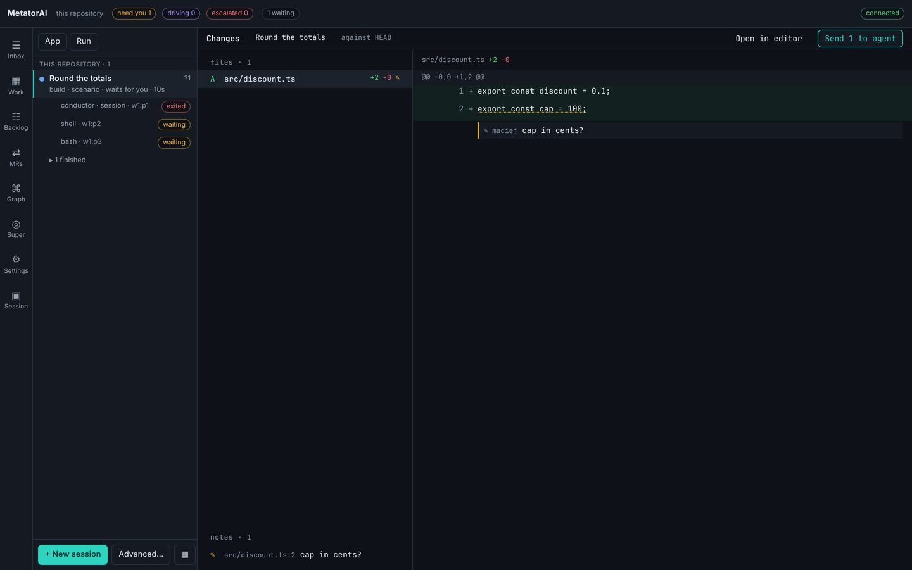

# Read the change

You can read what a run changed, leave notes on lines, and send the notes to the agent in one message. You can also open the run's worktree in your editor at a line. Nothing on this page edits the code: the agent does that, with your notes as input.

## The Changes screen

Open the **Changes** tab of a run's page (key `d`), or **Changes** on a decision card, or from **Terminals** with the prefix and `r` or **Changes** in a pane's menu.



The left column lists the changed files, each with a letter (`A` added, `M` modified, `D` deleted, `R` renamed), its added and removed line counts, and a pencil where you left notes. Click a file to see its diff on the right. The line on top says what the change is compared against.

The lines of a diff are one stop of the Tab key: the arrow keys move from line to line, and Enter opens a note on the line.

A run in its own worktree is compared with the repository's `HEAD` as it stands when you look. A run in your checkout is compared with `HEAD`. New, untracked files show whole, as added. MetatorAI's own files (`.metator/`, `.github/metator/`) are left out.

| To | Do |
|---|---|
| write a note on a line | click the line, type, **Add note** |
| write a note on the whole change | with no file chosen, **+ note on the whole change** under the list |
| send the notes | **Send N to agent** on the line on top |
| open a line in your editor | double-click the line |
| open the worktree in your editor | **Open in editor** |

A note waits as a draft until you send it. **Send N to agent** delivers every draft to the run as one message. The run's agents read it the next time they check the run's messages. The app asks for your name the first time.

The list **notes** under the files shows every note with its status:

| Status | Meaning |
|---|---|
| `draft` | written, not sent |
| `sent` | delivered to the run |
| `addressed` | the agent replied to the message, or you marked the note |

The check mark next to a sent note marks it addressed. The arrow next to an addressed note reopens it as a draft.

## Your editor

**Open in editor** and a double click use the editor named by the option `editor.command` (default `code`). VS Code and its forks reuse their window and jump to the line. Terminal editors open the file at the line. Other editors get the file. [Your settings](./settings.md#editor) shows how to change it.

## From a terminal

```bash
metator review changes --run <id>                         # the changed files, with added and removed line counts
metator review changes --run <id> --file src/invoice.ts   # that file's diff, as hunks with numbered lines
```

```bash
metator review notes add "half-down for negatives?" --run <id> --file src/invoice.ts --line 2 --side new --by maciej
metator review notes add "tests for 1000.00" --run <id> --by maciej     # a note on the whole change
metator review notes list --run <id>
metator review notes send --run <id> --by maciej
```

A note belongs to a file and a line, on the old or the new side of the diff, or to the change as a whole. To change a note's status by hand:

```bash
metator review notes status n002 --set addressed --run <id>
metator review notes status n002 --set draft --run <id>      # reopen it
```

```bash
metator open --run <id> --file src/invoice.ts --line 2     # the run's worktree in your editor
metator open --pane w1:p2                                  # a pane's directory
```

For the agents' own review of a change, see [Review a change](./review.md).
