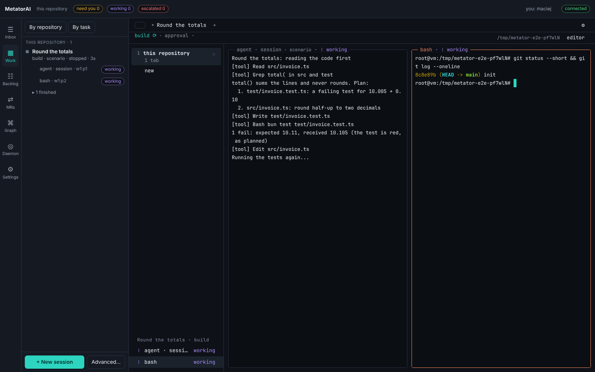
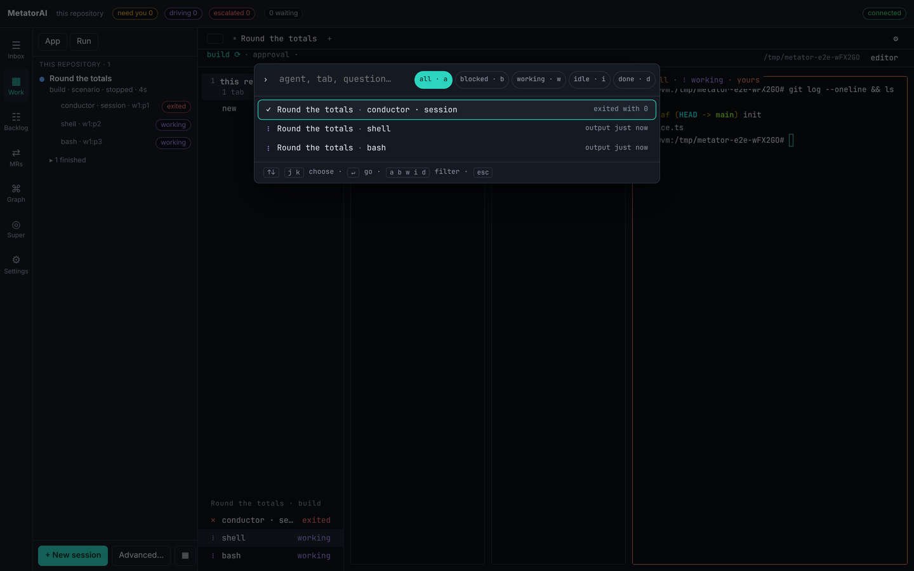

# Workbench and terminals

The **Work** screen of [the app](./index.md) is the workbench: every run and every shell in a real terminal, side by side. This page covers its tabs and panes, the keys, and how you and the agents share a terminal.

## The workbench



Each run in its worktree is a tab, and a shell can have a tab of its own. The **+** after the tabs opens the menu for a new tab. Under the tabs are the run's stages. A click on them opens the run's **Plan**. On the same line, **editor** opens the tab's worktree in your editor.

The tab's area is split into panes: the agents' terminals and your own shells. A pane's frame names the agent or the command, its host and its state, and says **yours** when you hold its keyboard. Drag a divider to resize. Double-click a pane's title to zoom it.

A pane whose process ended keeps its last output. A line under it gives the exit code, with **Retry**, which starts the same program again, and **Close tab** (or **Close pane** when the tab has other panes).

When the daemon is restarted, the terminals reconnect by themselves once it answers again.

The column on the left lists the repositories, and under them the panes of each tab with their state. A click on a pane focuses it.

A right click on a pane opens its menu: **Take the keyboard**, **Zoom**, **Split right**, **Split down**, **Copy mode**, **Plan of the run**, **Changes**, **Open in editor**, **New task from here…** (the backlog's form, pointing at this run) and **Close pane**. A right click on a tab or the tab bar offers **New tab: shell**, **New tab: task in a new worktree…**, **Backlog…**, **New shell pane here** and **Close tab**. Closing a task's tab closes its panes. The worktree stays.

## Keys

Every action also has a key: press the prefix, `ctrl+b`, then one key.

| Key after the prefix | Does |
|---|---|
| `c` | a new shell pane |
| `t` | a new tab with the agent, to start a task |
| `v`, `-` | split the pane to the right, downward |
| `h` `j` `k` `l` or the arrows | move the focus |
| `z` | zoom the pane, and back |
| `g` | go to an agent, tab or question |
| `n` | the next tab that waits for you |
| `a`, `escape` | take the keyboard of the pane's session, give it back |
| `[` | copy mode: select and search in the scrollback |
| `x` | close the pane |
| `p`, `r`, `b` | the run's plan, its changes, the backlog |
| `?` | the list of keys |

Each key is an option (`keys.*`) that you can change ([Your settings](./settings.md#keys)).

The prefix and `g` open the go-to picker. Type a part of an agent's name, a tab or a question, or filter by state with `b` (blocked), `w` (working), `i` (idle) and `d` (done). Enter goes there.



In copy mode, type to search the scrollback. Enter finds the next match and Shift+Enter the previous one. Select text with the mouse and press `y` to copy it. Escape leaves copy mode.

A shell pane takes your keys at once. In an agent's pane the app asks before it takes the keyboard: Enter takes it, Escape does not. The option `ui.attachOnType` changes that to `always` or `never`.

## Who types in a session

A session has one driver at a time: the agent, or a person who attached. Attaching takes the keyboard and puts your name on the session. In the app you attach with **Take the keyboard**, the prefix and `a`, or **Attach** on the **Session** screen.

While you are attached, your yes in the chat counts: the agent records it with your name. This never applies to a push or a pull request comment. Those are always approved outside the chat. While you hold a session, another person is refused.

From a terminal:

```bash
metator attach 20261109-feature-x --by alice     # the run's main pane, in your terminal
metator attach w1:p2 --by alice                  # one pane; `metator pane list` names them
```

`Ctrl-]` detaches and gives the session back to the agent. `--keep` keeps it yours. `metator run attach --by alice` and `metator run release` take and return the lock without opening the terminal.

## Agents in panes

Under the daemon, a run's coordinator sits in a pane of its own, the conductor pane, and starts each worker agent in another pane. You see every agent work.

The workflow still sets the stages, their agents, the gates and the limits. A worker gets its whole task once, as a card, and reports with a result file. Agents do not type into each other's panes. A worker that is blocked becomes a question in your inbox under the worker's name.

The daemon reads each pane's state from the screen and the hooks, without asking the agent:

| State | Meaning |
|---|---|
| `working` | output or a hook call in the last moments |
| `blocked` | the host's own permission prompt is on the screen; only a person answers it |
| `waiting` | a question of the run waits in the inbox |
| `idle` | the host's prompt line, or silence |
| `exited` | the process ended |

If a conductor's session ends while its run is active, the supervisor in the daemon resumes it in the same pane, a limited number of times. A session a person holds is left alone.

A tab remembers its layout, so the panes come back the same way after the daemon restarts. The daemon starts host sessions and plain shells again. A pane that ran a command (a test run, a script) is not run a second time: it shows how it ended, with **Retry**. The session of a run that is done, aborted or escalated is not started again either.

## From a terminal

```bash
metator run start        # open the run with its conductor pane
metator run workers      # who works now, in which pane, with which result so far
metator pane list        # every pane with its state
```

```bash
metator pane split w1:p2 --dir down                 # a shell below the pane
metator pane split w1:p2 --dir right --argv top     # a command beside it
```

The shell of a split is the option `terminal.shell`, or `$SHELL` when that is not set.
