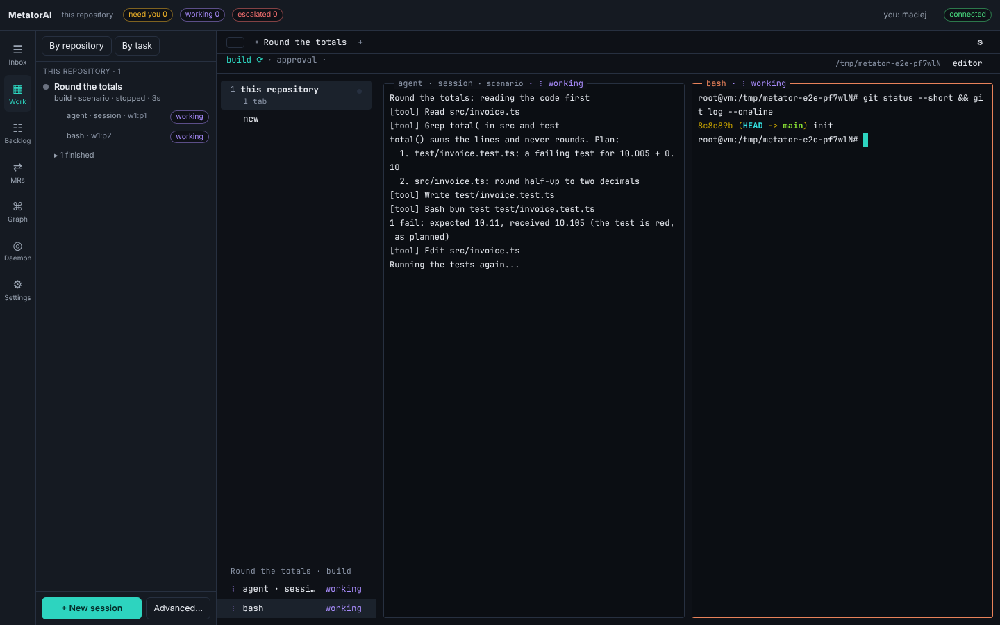
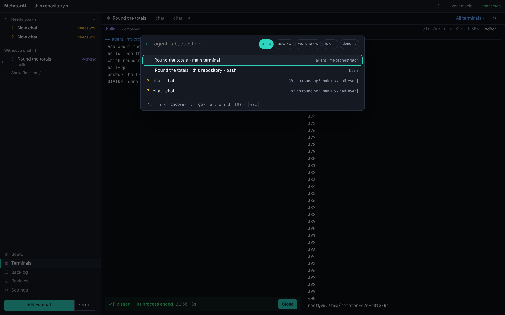

# Terminals

**Terminals** in [the app](./index.md) is the workbench: every run and every shell in a real terminal, side by side. It shows the terminals by task: the one where you gave the task, and one per repository working on it. This page covers the task's terminals, the workspaces' tabs and panes, the keys, and how you and the agents share a terminal.

## A task's terminals

**Terminals** opens on a task: the only one, or the one you pick from **Tasks** (each with its main terminal, how many repository sessions and sub-terminals it has). A bar at the top says where you are, **Tasks › Prices in the customer's currency › shop-api**, and each part leads back.

A task's view shows, side by side (two or three across, more wrap below):

- its **main terminal**: the chat where you gave the task, once its agent started the run; else the task run's own conductor;
- one tile per **repository session** working on it: the conductor of each child run, named by its repository and its step (`shop-api · price-model`).

The workers a session starts are not on this view. A session's tile has a badge, **2 sub-terminals · 1 working · 1 finished**; a click opens the session's own view: its conductor, then its sub-terminals (its workers and shells), with **Tasks › task › shop-api** back. Every tile is a live terminal: you watch, take the keyboard and type as in any pane.

A terminal whose work is over stays on the screen, read-only, with a banner on its frame: **Finished — tests pass** (its summary, or why it ended: its run finished, its result was collected, the host ended it), or, after a failure, **Ended with code 2 — …** in red with **Retry**. **Close** closes it; **Close finished (N)** in the bar closes the finished terminals: on a session's view the session's, on a task's view every one of the task, its sub-terminals too, so none stays open where no view shows it. A finished worker also counts on its session's badge (`2 sub-terminals · 2 finished`).

**Workspaces** in the bar shows the daemon's workspaces and their tabs, as below: your shells, and the chat of a run not started yet. **By task ›** there leads back.

## The workspaces



Each run in its worktree is a tab, and a shell can have a tab of its own. The **+** after the tabs opens the menu for a new tab. Under the tabs are the run's stages. A click on them opens the run's **Plan**. On the same line, **editor** opens the tab's worktree in your editor.

The tab's area is split into panes: the agents' terminals and your own shells. A pane's frame names the agent or the command, its host and its state, says **yours** when you hold its keyboard, and **needs you** while a question of that pane waits for you: the host's prompt on its screen, also in the chat where you describe a task before its run exists ([Answer questions](./inbox.md#before-a-run-exists-the-chats-questions)). Drag a divider to resize. Double-click a pane's title to zoom it.

A pane whose process ended keeps its last output. A line under it gives the exit code, with **Retry**, which starts the same program again, and **Close tab** (or **Close pane** when the tab has other panes). A pane whose work the daemon ended (its run finished, its worker was collected) has the banner described above and stays until you close it.

When the daemon is restarted, the terminals reconnect by themselves once it answers again.

The panes of a run are also listed under the run in the app's sidebar, each with its state. When the daemon has more than one workspace (the checkout, and the agents that start runs), a select at the left of the tab bar switches between them.

A right click on a pane opens its menu: **Take the keyboard**, **Zoom**, **Split right**, **Split down**, **Copy mode**, **Plan of the run**, **Changes**, **Open in editor**, **New task from here…** (the backlog's form, pointing at this run) and **Close pane**. A right click on a tab or the tab bar offers **New tab: shell**, **New run: describe it to the agent…**, **Backlog…**, **New shell pane here** and **Close tab**. Each item shows its key as you press it (`ctrl+b z`). Closing a task's tab closes its panes. The worktree stays.

## Keys

Every action also has a key: press the prefix, `ctrl+b`, then one key.

| Key after the prefix | Does |
|---|---|
| `c` | a new shell pane |
| `t` | a new tab with the agent, to start a task |
| `v`, `-` | split the pane to the right, downward |
| `h` `j` `k` `l` or the arrows | move the focus |
| `z` | zoom the pane, and back |
| `g` | go to an agent, tab or question |
| `n` | the next tab that waits for you |
| `a`, `escape` | take the keyboard of the pane's session, give it back |
| `[` | copy mode: select and search in the scrollback |
| `x` | close the pane |
| `p`, `r`, `b` | the run's Overview (with its plan), its changes, the backlog |
| `?` | the list of keys |

Each key is an option (`keys.*`) that you can change ([Your settings](./settings.md#keys)).

The key `?` outside a terminal, the prefix and `?`, or the **?** button of the top bar open the list of keys: the ones that work on every screen, and the ones of this screen as they are set now. Type in its field to filter the list. While the prefix waits for its key, the tab bar shows it (`ctrl+b …`).

The prefix and `g` open the go-to picker. Type a part of an agent's name, a tab or a question, or filter by state with `b` (asks), `w` (working), `i` (idle) and `d` (done). Enter goes there. A terminal of a task is listed by its place in the task, `Prices in the customer's currency › shop-api · price-model › mt-implementer-1`, and Enter opens the view that shows it.



In copy mode, type to search the scrollback. Enter finds the next match and Shift+Enter the previous one. Select text with the mouse and press `y` to copy it. Escape leaves copy mode.

A shell pane takes your keys at once. In an agent's pane the app asks before it takes the keyboard: Enter takes it, Escape does not. The option `ui.attachOnType` changes that to `always` or `never`.

## Who types in a session

One at a time types in a session: the agent, or a person who attached. Attaching takes the keyboard and puts your name on the session. In the app you attach with **Take the keyboard**, the prefix and `a`, or **Attach** on the run's **Terminal** tab.

While you are attached, your yes in the chat counts: the agent records it with your name. This never applies to a push or a pull request comment. Those are always approved outside the chat. While you hold a session, another person is refused.

From a terminal:

```bash
metator attach 20261109-feature-x --by alice     # the run's main pane, in your terminal
metator attach w1:p2 --by alice                  # one pane; `metator pane list` names them
```

`Ctrl-]` detaches and gives the session back to the agent. `--keep` keeps it yours. `metator run take --by alice` and `metator run release` take and return the lock without opening the terminal.

## Agents in panes

Under the daemon, the agent that coordinates a run sits in a pane of its own, labelled **agent**, and starts each worker agent in another pane. You see every agent work.

The workflow still sets the stages, their agents, the gates and the limits. A worker gets its whole task once, as a card, and reports with a result file. Agents do not type into each other's panes. A worker that is blocked becomes a question in your inbox under the worker's name.

The daemon reads each pane's state from the screen and the hooks, without asking the agent:

| State | Meaning |
|---|---|
| `working` | output or a hook call in the last moments |
| `blocked` | the host's own permission prompt is on the screen; only a person answers it |
| `waiting` | a question of the run waits in the inbox |
| `idle` | the host's prompt line, or silence |
| `exited` | the process ended |

The app shows these states in four words, the same on every screen:

| The app says | When |
|---|---|
| `working` | an agent whose pane is `working`; a shell only while it prints |
| `asks` | an agent whose pane is `blocked` or `waiting`: it asks you, on its screen or on a card |
| `idle` | nothing happens; a shell at its prompt is always `idle`, also in a run that has an open question. The agent that starts a run reads `idle · ready for your task` while it waits for you |
| `exited` | the process ended, or the pane has none |

If the coordinating agent's session ends while its run is active, the supervisor in the daemon resumes it in the same pane, a limited number of times. A session a person holds is left alone.

A tab remembers its layout, so the panes come back the same way after the daemon restarts. The daemon starts host sessions and plain shells again. A pane that ran a command (a test run, a script) is not run a second time: it shows how it ended, with **Retry**. The session of a run that is done, aborted or escalated is not started again either.

The daemon never removes a pane by itself. When a run finishes, its panes end: a process still running is stopped. `metator run collect` ends the worker's pane with the worker's one-line result, and a process that exits ends its pane with its exit code. An ended pane keeps its last screen, read-only (typing into it is refused with why), across restarts, until a person closes it: **Close** on the pane, `POST /panes/<pane>/close`, or every ended pane at once with `POST /panes/close-ended` (`{"runId": "<id>"}` for one run's). `metator run close` still closes the run's panes. A chat pane whose agent started a run with `metator run new` remembers that run (`startedRun`): it is the task's main terminal.

## From a terminal

```bash
metator run start        # open the run with its agent's pane
metator run workers      # who works now, in which pane, with which result so far
metator pane list        # every pane with its state
```

```bash
metator pane split w1:p2 --dir down                 # a shell below the pane
metator pane split w1:p2 --dir right --argv top     # a command beside it
```

The shell of a split is the option `terminal.shell`, or `$SHELL` when that is not set.
