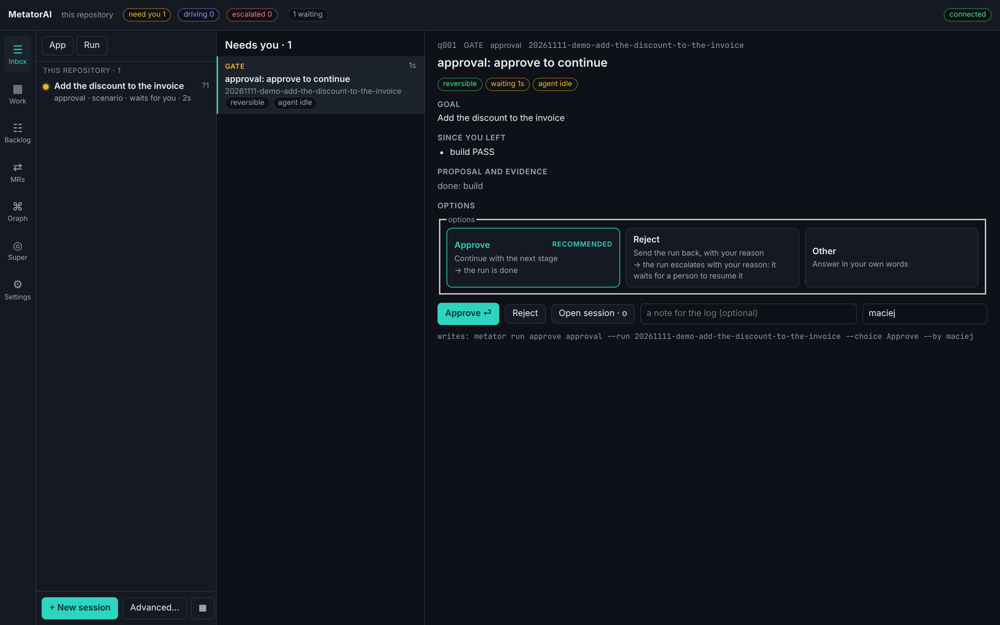

# Answer questions

A run stops when a decision belongs to you. Every open question of every run is in one queue, the inbox. This page shows how to read it and answer, in the app and from a terminal.

## What stops a run

| Source | When | What your answer does |
|---|---|---|
| `gate` | a stage that needs a person: plan approval, delivery, publishing review comments | Approve continues; Reject sends the run back with your reason |
| `agent` | an agent cannot decide from the code and asks | the answer goes back to the same agent, which continues |
| `permission` | an agent wants to run a tool that is not pre-approved | Allow runs the call; Deny refuses it, with your reason |

An agent works without asking when it runs the MetatorAI commands its definition names, reads or searches the repository, writes its artifacts into the run directory, or edits files inside the run's own worktree. Anything else asks. A push always asks.

## The Inbox screen

**Inbox** is the first screen of the app. The column **Needs you** lists the open decisions. Questions that a live drive waits on come first, because that run stands still until you answer. The rest follow, oldest first. When the daemon serves a folder of repositories, the queue covers all of them.



Each row shows the kind (`GATE`, `PERMISSION` or `QUESTION`), how long the question has waited, its text and its run. A click on a row opens its decision card on the right:

| Part | What it tells you |
|---|---|
| Header | the question id, its kind, the stage, the run and the agent |
| Chips | whether the decision can be taken back, how many files it touches, how long it has waited |
| **Goal** | the run's task |
| **Since you left** | what happened since your last answer |
| **Proposal and evidence** | the stages done so far, the artifacts to read, the checks that ran |
| **Options** | each option with what it leads to; one may be marked **RECOMMENDED** |

The card is assembled from the run's files when the question is asked. No model writes it. The recommendation comes from a fixed rule: for example, Approve is recommended at a gate when the stage before it passed.

To answer:

1. Click an option. The recommended one is chosen when the card opens.
2. With Reject or Other, write your reason or your answer in the field **a note for the log (optional)**.
3. Type your name in the last field, once. The app remembers it.
4. Click the first button. It carries the name of the option you chose, such as **Approve**. The button next to it sends the first of the other options in one click.

The line under the buttons shows the command your answer amounts to. **Open session** (or the key `o`) opens the run's **Session** screen when you want to see the terminal first. The key `g` moves to the next item of the queue.

The daemon carries out the answer. If no drive is running, it starts one again on the host the run used. What you write in your own words is passed to every later agent of the run as a decision to follow.

With nothing open the screen reads **Inbox zero**.

## Permission prompts of the host

Sometimes the AI host shows its own permission prompt in the terminal ("Allow ... to run?"). MetatorAI never types into that prompt. The daemon puts it in the inbox as a question with two choices: **Attach and answer in the pane**, which gives you the keyboard of that pane, and **Leave it**. When the prompt is gone from the screen, the inbox item closes.

## Escalated runs

A run that reaches a loop limit, or whose agent stays blocked, becomes `escalated`. It needs work from you and a yes or no is not enough. The Inbox lists escalated runs under the queue, each with **briefing** (what happened) and **terminal** (the session).

Fix the cause, then resume the run at the stage it escalated from:

```bash
metator run resume --run <id> --by alice
metator run drive --run <id> --host claude --detach
```

## Get notified

A new question raises a system notification from the app. To be told elsewhere, set `notify.command` ([Configuration](../reference/configuration.md#notifications)).

The option `supervisor.wipLimit` (default 4) sets how many runs may wait for you at once. Above it, new runs start with a warning.

## From a terminal

```bash
metator inbox                     # every open decision, in the same order as the app
metator run questions             # the open questions of one run
```

```bash
metator run answer q001 --choice Approve --by alice
metator run answer q002 --choice Reject --text "split step 3 into two" --by alice
```

`--choice` is the label of an option. `--text` carries your own words: the reason with Reject, or the answer with Other. `--by` is your name, which goes into the run's log.

The run's drive carries out the answer. If no drive is running, `metator run continue <run>` starts it again. `metator ui` shows the same queue as a full-screen view in the terminal.

### Answers that repeat

If you answer the same question the same way every time, make the answer a policy. This exists only as a command:

```bash
metator run answer q004 --choice Deny --by alice --always
```

The policy is stored in `metator/answer-policies.yml`, so the team reviews it like code. From then on such a question is answered when it is asked, and the log says the policy answered it.

A policy has limits:

- It can deny a tool. It cannot allow one.
- It cannot answer a decision that cannot be taken back, such as a push.
- It cannot answer with Other or Reject, because those need your own words.

```bash
metator policy list
metator policy rm <id>      # such questions ask a person again
```
