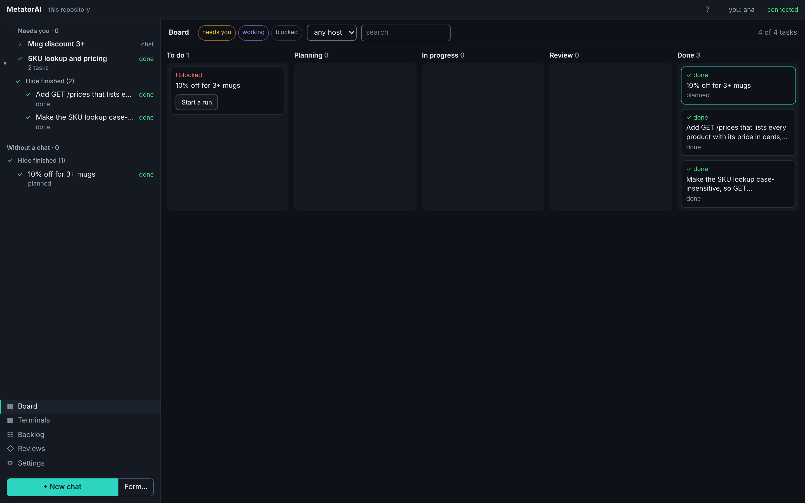

# Home and the Board

A run stops when a decision belongs to you. **Home**, the first screen of the app, shows every decision that waits for you, one at a time: approvals, agents' questions, your host's permission prompts, commits that need your consent, quick changes to look at, escalated runs and reviews. The **Board** shows every task by phase. This page covers both, in the app and from a terminal.

## What stops a run

| Source | When | What your answer does |
|---|---|---|
| `gate` | an approval, a stage that needs a person: plan approval, delivery, publishing review comments | Approve continues; Reject sends the run back with your reason |
| `agent` | an agent cannot decide from the code and asks | the answer goes back to the same agent, which continues |
| `permission` | an agent wants to run a tool that is not pre-approved | Allow runs the call; Deny refuses it, with your reason |

A gate's card is there whoever moved the run to the gate: a drive, a conductor in its pane (`metator run advance pass`) or a person at a terminal. Approve on the card passes the gate as `metator run approve` does, under your name; Reject sends the run back with your reason. A proposal of an agent you decide in the Backlog, or with `metator issue decide` or `issue rm`, leaves the queue too.

An agent works without asking when it runs the MetatorAI commands its definition names, reads or searches the repository, writes its artifacts into the run directory, or edits files inside the run's own worktree. Anything else asks. A commit or a push always needs your consent ([Approvals and consent](./approvals.md#commit-and-push)).

## Home

Home shows one decision at a time, as a big card: the question, or the plan to approve, and its answers. Above the card, **3 waiting · 1 of 3** says how many decisions wait, with **‹ Previous** and **Next ›**; `k` and `j`, or the arrow keys, do the same. The sidebar only counts them (**Needs you · N**). Each decision has its own address, `#/inbox/<repository>/<run>/<question>`: a step that asks in the sidebar, **its card on Home ›** on a step's page and **on Home ›** on a task's page open exactly that card, and **‹ Previous** and **Next ›** go on from it. Questions that a live drive waits on come first, because that run stands still until you answer. The rest follow, oldest first. When the daemon serves a folder of repositories, the queue covers all of them.


*A plan-approval card: the whole plan, Approve and Ask for changes.*

The card's face has only the question and how to answer it. An approval's question says what is decided in plain words: what is approved and for which task (`Approve the plan for "Add a combined discount"?`). Everything else is folded under **Details** at the bottom of the card:

| Part of Details | What it tells you |
|---|---|
| The ids | the question id, its kind (`APPROVAL`, `PERMISSION`, `QUESTION` or `TERMINAL`), the stage, the repository, the run, the agent and its pane |
| Chips | whether the decision can be taken back, how many files it touches, how long it has waited |
| **Goal** | the run's task, when the question does not already carry it whole |
| **Since you left** | what happened since your last answer |
| **Proposal and evidence** | the stages done so far, the artifacts to read, the checks that ran |
| **What each answer does** | each option with what it leads to |
| **Note (optional)** | a note for the log with your answer |
| **Changes**, **Open run** | the run's change, and its page |
| `writes:` | the command your answer amounts to |

Under **Proposal and evidence**, click an artifact's name to read it in a window over the card: Markdown as it is written, JSON indented. **Close** closes it. A step's Overview opens its artifacts the same way ([The run's files](./plan.md#the-runs-files)). The app reads them through the daemon, which returns only files inside the run's directory.

The card is assembled from the run's files when the question is asked. No model writes it. The recommendation comes from a fixed rule: for example, Approve is recommended at an approval when the stage before it passed.

To answer:

1. Click an option. The recommended one is chosen when the card opens, and marked **RECOMMENDED**. A question that allows several answers says **Choose one or more**: each click adds or removes an option, and nothing is chosen for you.
2. With Reject or Other a field **Reason for Reject (required)** comes under the options, and the answer cannot be sent until you have written it. A note with any other answer is under **Details**.
3. Click the button under the options, or press `Enter`. It carries the options you chose, such as **Approve**; it is the only button that sends. Choosing Reject or Other puts the cursor in its reason field. A decision is answered the same way wherever it is shown: on Home, on a task's page, on a step's Overview and beside its terminal.

The first time you answer, the app asks for your name in a dialog and remembers it.

Under **Details**, **Changes** opens the run's change ([Read the change](./changes.md)) and **Open run** (or the key `o`) the run's **Overview**, when you want to look before you decide. `g` moves to the next run that needs you. Once your answer went through, a line on top says so: **Answered: Approve. The run goes on.**, and Home shows the next decision.

The daemon carries out the answer. If no drive is running, it starts one again on the host the run used. What you write in your own words is passed to every later agent of the run as a decision to follow.

With nothing to decide, and no escalated run, Home reads **Nothing waits for you**, or **No decision waits for you** while a run stands still, and says what is true about the open runs: that they are working, or that a run has no agent working on it, with **Open a session** and **Drive in background** beside each such run. Under it are the open tasks in short, each with its word and progress, and **Describe a task** to start a new one. With no run at all only **Describe a task** is there ([Chats and the three ways](./start.md)). It says so only while the daemon answers.

A long **Since you left** on a card is cut to its newest lines; a line that came many times (a loop) is one line with its count (`×12`), and **N more lines before these** opens the rest, so the options and the answer button stay on the screen. The files a card names under **see:** open read-only.

A question an agent asks on its own terminal (`Which currency? [PLN / EUR]`) comes as a `TERMINAL` card with the question in the agent's words, a line naming the agent (its pane and stage are under **Details**), and its answers as options: an answer chosen on the card is typed into the pane for you. A host's permission prompt comes as a `PERMISSION` card. Its heading is the start of the command the host asks to run, cut to one or two lines with **…**; a click on it (or Enter) shows the whole command, monospace and wrapped, with **Copy**. The toast and a run's question box show the same start. When the command is a `git commit`, `push`, `merge` or `rebase`, the card says it **needs your consent**, and **Yes** lets that one command run ([Commit and push](./approvals.md#commit-and-push)). Both offer **Attach and answer in the pane**: it opens the run's Terminal tab on that pane, takes the keyboard under your name, puts the cursor in the pane at the question and scrolls to it; type the answer and give the keyboard back.

Either side can answer, and both see the result:

- Each question the pane asks gets its own card, one after the other.
- An answer chosen on a card is typed into the pane at once.
- An answer typed in the pane is recorded like a card answer: the words you typed (an option when they name one), under the name of the person at the pane's keyboard, else `pane:<id>`. Its card goes, and the run's Activity shows the answer.
- If the pane was answered first, a card answer that comes after is refused with "question … is already answered", and nothing is typed. While someone holds the pane's keyboard, a card answer is refused with their name: answer in the pane, or wait until they give the keyboard back.

An agent in a terminal asks you with `metator run ask "<question>" --option <a> --option <b> --wait`. The question comes as a card like any agent's question, and the command prints your answer when you give it, from the app or with `metator run answer`. `--timeout <ms>` ends the wait with `WAITING`; `metator run ask --question <id> --wait` waits again.

A plan-approval card shows the plan in full, with **Approve** and **Ask for changes**: your words go to the planner, which writes a new plan ([Change a plan](./plan.md#change-a-plan)). While the plan's lint has errors, **Approve** is closed with the reason and **Ask the planner to fix it** fills in the problems.

A confirmation says what the run did with your answer: **Rejected: the run escalated with your reason**, **Rejected: the run goes back to plan**, **The run is done**, or **The run goes on**. It goes after a few seconds, or when you go elsewhere; a refusal stays until you close it.

### Cards of a chat

What a chat leaves for you to decide comes here too:

- **A commit or a push** the agent asks for: the command as the heading and a line under it, **git commit needs your consent: it runs only when you say Yes here, or ask for it in the chat.** A reason of the guard, such as a commit that holds debug changes, is shown under the command.
- **Quick change ready: look at the diff**: **Open diff** opens the run's **Changes** and leaves the card; **Fine** ends the quick run ([Quick and debug changes](./quick.md)).
- **This grew past quick: …**: **Continue as full** or **Keep as quick**.
- **Debug changes (N)** on Home lists the [debug changes](./quick.md#debug-changes) still in your files, with **Remove debug changes**.


*A commit the agent asks for comes to Home as a card; it runs only on your Yes.*

### Review cards

Reviews of pull requests have cards on Home too, after the questions of the runs, counted in the same **N waiting**: you were asked to review a request (**Review**), a watched request got new commits or replies (**Re-review**), every finding is fixed (approve it: **Yes** or **No**), or your own request got a new review (**Analyse**). The review itself asks to publish on a card with **Yes** and **No**: one consent for every comment of the review. A button that starts an agent opens its terminal at once. **Open in Reviews** goes to the request in [Reviews](./reviews.md#the-reviews-place).

## Questions asked in the terminal

An agent can also stop at a question it wrote on its own screen, without a card. Such a run still needs you. Home shows it in its turn as a card with the task and **answers in its terminal**; **Open the run** opens the run's **Terminal** tab on the pane that asks. Attach and type the answer there ([Terminals and sessions](./sessions.md)).

## Permission prompts of the host

Sometimes the AI host shows its own permission prompt in the terminal ("Allow ... to run?"). The question names the agent in that pane (a worker by its name, such as `mt-implementer-1`, at its stage), and only that pane reads as waiting: a worker's question never makes the conductor's pane wait. The daemon reads the prompt from the screen as you see it and puts it in the inbox in one line, for example `Bash command: metator workflow list — This command requires approval`. The question also carries the whole command (`command`), without the frame your host draws around it: Claude Code puts a `│` before each line of a command that runs over several lines, and wraps a long quoted argument at words; neither is part of the command. When your host asks because MetatorAI's guard asked (a commit that holds debug changes, a commit without your consent), the question carries the guard's own words in `reason` (`this commit holds debug changes: src/server.ts. …`), and the card shows them: Claude Code does not print a hook's reason in its prompt. The `pre-tool` hook keeps that reason per pane, with a hash of the command, for ten minutes (`.metator/guard-asked/`, GuardAsked v1).

When the prompt is a numbered menu, as Claude Code's approval is (**1. Yes**, **2. Yes, and don't ask again for: …**, …, **4. No**), the card offers the menu's choices. The one you pick is typed into the pane as its number, followed by Enter. The card also offers **Attach and answer in the pane**, which gives you the keyboard of that pane, and **Leave it**. A prompt without a menu has only these last two. When the prompt is gone from the screen, the inbox item closes, whether you answered on the card or in the pane.

### Questions an agent asks in its own words

Agents are told to ask you with a card (`metator run ask`). If one ends its turn with a question in prose instead and waits at its prompt, MetatorAI catches it. This applies to a conductor, a worker, or the chat where you describe a task. The agent's last message must end with a question mark, offer choices, tell you to answer ("Tell me how to proceed."), or say that it waits for your reply. A progress report, a wait for a worker, or a summary is not a question. Neither is a greeting that lists what you can do and ends with "What would you like to work on?", or a closing "Anything else?". The run needs you, and Home shows the question as a card:

- the question in the agent's own words: the question its choices stand under, else the question its turn ends with, else the sentence that tells you to answer. When the message has no such sentence, the card shows its first sentence alone. Nothing is added to the agent's words;
- the whole message, behind **The whole message**;
- the agent's choices, then **Other** for your own words and **Leave it**.

Your choice is typed into the pane: its number, or the reply word the agent named, then Enter. The card closes when the agent works again. While the question is open, the supervisor never nudges that agent, and no other line is typed into its pane.

### Before a run exists: the chat's questions

The chat where you describe a task has no run yet, and its agent can still stop and wait for you: its host asks leave to run a command, or the agent asks in its terminal (`Which workflow? [mt-feature / mt-bugfix]`). Home shows such a question as a card of its own. It names the pane (**chat**) and, in a folder, its repository, and it offers the same choices as above. Your answer is typed into the pane. In **Terminals** the chat's frame says **needs you** until the question is answered, on the card or in the pane.

For a script, these questions are listed in `GET /inbox` under `panes`, one item per question ([Daemon HTTP API](../reference/http.md)):

```json
{ "kind": "pane", "repo": "shop-api", "paneId": "w1:p1", "label": "chat", "role": "apps", "host": "claude",
  "question": { "id": "p001", "paneId": "w1:p1", "source": "permission", "agent": "chat", "host": "claude",
    "prompt": "Bash command: metator workflow list — This command requires approval",
    "options": [{ "label": "Yes" }, { "label": "Yes, and don't ask again for: metator workflow *" }, { "label": "Yes, and switch to auto mode" }, { "label": "No, and tell Claude what to do differently (esc)" }, { "label": "Attach and answer in the pane" }, { "label": "Leave it" }],
    "multiSelect": false, "askedAt": "2026-11-20T10:00:00.000Z" } }
```

`repo` is there only when the daemon serves a folder. An agent's question in words also carries `runId` (when its pane belongs to a run) and `question.text`, the whole message. Answer with `POST /panes/<pane>/answer?repo=<repo>` and `{ "question": "p001", "choices": ["Yes"], "by": "<your name>" }`, or `{ "question": "…", "choices": [], "text": "<words>", "by": "…" }` for **Other**. Only a person may answer: a pane's own token gets 403. The daemon keeps these questions while it runs; after a restart it asks again whatever the chat still shows. `metator inbox` at a terminal lists only the questions of runs.

## Escalated runs

A run that reaches a loop limit, or whose agent stays blocked, becomes `escalated`. It needs work from you and a yes or no is not enough. Escalated runs count in the heading **Needs you** and come on Home in their turn, as a card with the task and the stage the run stopped at. In the sidebar an escalated run reads `blocked`; a click on it opens the same card.

The card shows why the run stopped (the failure its last stage recorded) and has four buttons:

- **Resume** puts the run back at the stage chosen in **Resume at** and drives it on. Remove the cause first. The list starts at the stage the run stopped at, where the run gets a fresh set of tries; the other entries are the stages it already worked. The line under the fields says what the resume will do. Write in **Note for the agent** what must be different: the first agent that works after the resume reads it, and the plan on the step's Overview lists it under **resumed**. The run's page offers the same two fields beside its **Resume**. If no drive can start, the card says why.
- **Close run…** asks for a reason and ends the run as aborted.
- **Briefing** opens the run's **Overview**, what happened in it.
- **Changes** shows its change.

The same from the terminal:

```bash
metator run resume --run <id> --to plan --note "smaller steps" --drive
metator run close --run <id> --aborted --reason "not worth fixing"
```

## Get notified

A new question raises a system notification from the app. To be told elsewhere, set `notify.command` ([Configuration](../reference/configuration.md#notifications)).

The option `supervisor.wipLimit` (default 4) sets how many runs may wait for you at once. Above it, new runs start with a warning.

## From a terminal

```bash
metator inbox                     # every open decision, in the same order as the app
metator run questions             # the open questions of one run
```

```bash
metator run answer q001 --choice Approve --by alice
metator run answer q002 --choice Reject --text "split step 3 into two" --by alice
```

`--choice` is the label of an option; upper and lower case do not matter, so `approve` is Approve. `--text` carries your own words: the reason with Reject, or the answer with Other. `--by` is your name, which goes into the run's log. Without it the name comes from `$METATOR_USER`, or else from `git config user.name`. `--run` takes a run id or the start of one, as long as only one run starts that way.

The run's drive carries out the answer. If no drive is running, `metator run continue <run>` starts it again. At a terminal `metator inbox` prints the queue as text, each question with the command that answers it.

To make an answer you always give a policy, add `--always` ([Answers that repeat](./approvals.md#answers-that-repeat)).

## The Board

**Board** in the sidebar shows the work in five columns by phase: **To do**, **Planning**, **In progress**, **Review** and **Done**.


*The Board: every task in the column of its phase.*

- Its top level shows only parent tasks, each once: a system task, a run with child runs, a run of its own, a backlog task or an agent's proposal.
- A task is in the column of its own phase. A system task is in Planning until its plan is approved, In progress while its steps run, Review at its delivery and Done at the end. A run's phase comes from its workflow and stage: understanding, planning and the plan's approval are Planning; the work is In progress; checks, reviews, delivery and publishing are Review; a done or aborted run, and one that only planned (`plan ready`), is Done.
- A card has the task's word, its name and how many of its steps are done (`3 of 6 steps done`); the needs-you and blocked counts of its steps are summed on it and in the column's header.
- Done is folded: **Show finished (N)** shows the last day, older ones behind **show N more**.

A click on a system task (or Enter) opens **its** board: the same columns with its steps and their child runs across repositories, steps not started in To do with what they wait for (a click opens [the step's detail](./plan.md#a-steps-detail), with **Plan this step**), and **Board ›** `<task>` at the top to go back (also Backspace or Escape).

Above the board you filter by repository (several at once), by the words needs you, working and blocked, by host, and by a search. Arrows move between cards. **Start a run** on a To-do task starts it. Cards cannot be dragged to another column: the engine decides the phase.
