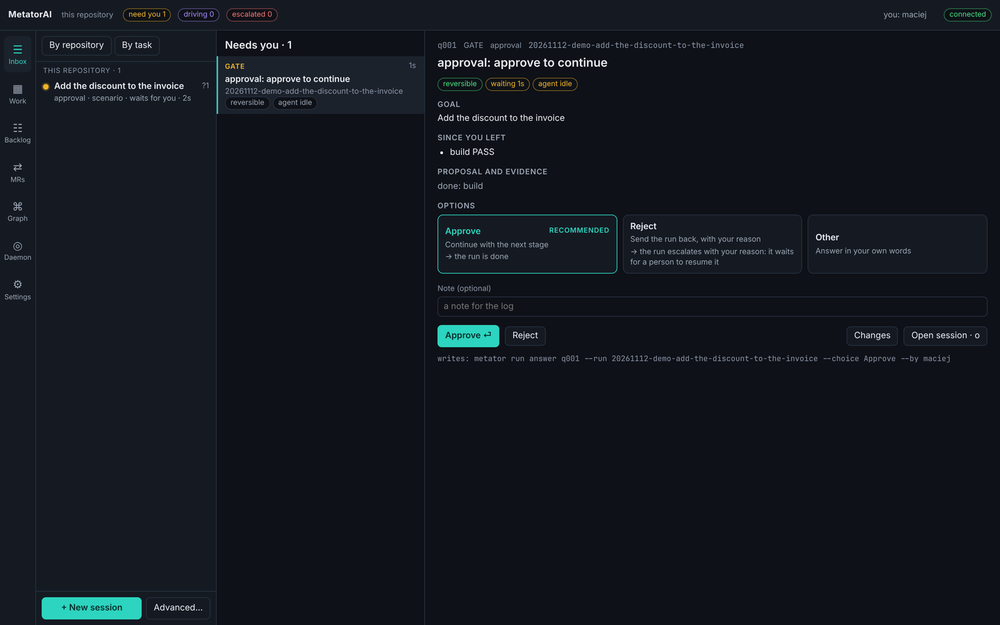

# Answer questions

A run stops when a decision belongs to you. Every open question of every run is in one queue; **Home** shows it one decision at a time. This page shows how to read it and answer, in the app and from a terminal.

## What stops a run

| Source | When | What your answer does |
|---|---|---|
| `gate` | an approval, a stage that needs a person: plan approval, delivery, publishing review comments | Approve continues; Reject sends the run back with your reason |
| `agent` | an agent cannot decide from the code and asks | the answer goes back to the same agent, which continues |
| `permission` | an agent wants to run a tool that is not pre-approved | Allow runs the call; Deny refuses it, with your reason |

A gate's card is there whoever moved the run to the gate: a drive, a conductor in its pane (`metator run advance pass`) or a person at a terminal. Approve on the card passes the gate as `metator run approve` does, under your name; Reject sends the run back with your reason. A proposal of an agent you decide in the Backlog, or with `metator issue decide` or `issue rm`, leaves the queue too.

An agent works without asking when it runs the MetatorAI commands its definition names, reads or searches the repository, writes its artifacts into the run directory, or edits files inside the run's own worktree. Anything else asks. A push always asks.

## Home

**Home** is the first screen of the app. It shows one decision at a time, as a big card: the question, or the plan to approve, and its answers. Above the card, **3 waiting · 1 of 3** says how many decisions wait, with **‹ Previous** and **Next ›**; `k` and `j`, or the arrow keys, do the same. The sidebar only counts them (**Needs you · N**). Questions that a live drive waits on come first, because that run stands still until you answer. The rest follow, oldest first. When the daemon serves a folder of repositories, the queue covers all of them.



The card's face has only the question and how to answer it. Everything else is folded under **Details** at the bottom of the card:

| Part of Details | What it tells you |
|---|---|
| The ids | the question id, its kind (`APPROVAL`, `PERMISSION`, `QUESTION` or `TERMINAL`), the stage, the repository, the run, the agent and its pane |
| Chips | whether the decision can be taken back, how many files it touches, how long it has waited |
| **Goal** | the run's task |
| **Since you left** | what happened since your last answer |
| **Proposal and evidence** | the stages done so far, the artifacts to read, the checks that ran |
| **What each answer does** | each option with what it leads to |
| **Note (optional)** | a note for the log with your answer |
| **Changes**, **Open run** | the run's change, and its page |
| `writes:` | the command your answer amounts to |

The card is assembled from the run's files when the question is asked. No model writes it. The recommendation comes from a fixed rule: for example, Approve is recommended at an approval when the stage before it passed.

To answer:

1. Click an option. The recommended one is chosen when the card opens, and marked **RECOMMENDED**. A question that allows several answers says **Choose one or more**: each click adds or removes an option, and nothing is chosen for you.
2. With Reject or Other a field **Reason for Reject (required)** comes under the options, and the answer cannot be sent until you have written it. A note with any other answer is under **Details**.
3. Click the first button, or press `Enter`. The button carries the options you chose, such as **Approve**. The button next to it sends the first of the other options in one click; when that option is Reject, it chooses it and puts the cursor in the reason field.

The first time you answer, the app asks for your name in a dialog and remembers it.

Under **Details**, **Changes** opens the run's change ([Read the change](./changes.md)) and **Open run** (or the key `o`) the run's **Overview**, when you want to look before you decide. `g` moves to the next run that needs you. Once your answer went through, a line on top says so: **Answered: Approve. The run goes on.**, and Home shows the next decision.

The daemon carries out the answer. If no drive is running, it starts one again on the host the run used. What you write in your own words is passed to every later agent of the run as a decision to follow.

With nothing to decide, and no escalated run, Home reads **Nothing waits for you** and says what is true about the open runs: that they are working, or that a run has no agent working on it (`Nothing needs you. 1 run has no agent working on it:`), with **Open a session** and **Drive in background** beside each such run. Under it are the open tasks in short, each with its word and progress, and **Describe a task** to start a new one. With no run at all only **Describe a task** is there ([Start a task](./start.md)). It says so only while the daemon answers.

A long **Since you left** on a card is cut to its newest lines; a line that came many times (a loop) is one line with its count (`×12`), and **N more lines before these** opens the rest, so the options and the answer button stay on the screen. The files a card names under **see:** open read-only.

A question an agent asks on its own terminal (`Which currency? [PLN / EUR]`) comes as a `TERMINAL` card with the question in the agent's words, a line naming the agent (its pane and stage are under **Details**), and its answers as options: an answer chosen on the card is typed into the pane for you. A host's permission prompt comes as a `PERMISSION` card. Both offer **Attach and answer in the pane**: it opens the run's Terminal tab on that pane, takes the keyboard under your name, puts the cursor in the pane at the question and scrolls to it; type the answer and give the keyboard back.

Either side can answer, and both see the result:

- Each question the pane asks gets its own card, one after the other.
- An answer chosen on a card is typed into the pane at once.
- An answer typed in the pane is recorded like a card answer: the words you typed (an option when they name one), under the name of the person at the pane's keyboard, else `pane:<id>`. Its card goes, and the run's Activity shows the answer.
- If the pane was answered first, a card answer that comes after is refused with "question … is already answered", and nothing is typed. While someone holds the pane's keyboard, a card answer is refused with their name: answer in the pane, or wait until they give the keyboard back.

An agent in a terminal asks you with `metator run ask "<question>" --option <a> --option <b> --wait`. The question comes as a card like any agent's question, and the command prints your answer when you give it, from the app or with `metator run answer`. `--timeout <ms>` ends the wait with `WAITING`; `metator run ask --question <id> --wait` waits again.

A plan-approval card shows the plan in full, with **Approve** and **Ask for changes**: your words go to the planner, which writes a new plan ([Change a plan](./plan.md#change-a-plan)). While the plan's lint has errors, **Approve** is closed with the reason and **Ask the planner to fix it** fills in the problems.

A confirmation says what the run did with your answer: **Rejected: the run escalated with your reason**, **Rejected: the run goes back to plan**, **The run is done**, or **The run goes on**. It goes after a few seconds, or when you go elsewhere; a refusal stays until you close it.

## Questions asked in the terminal

An agent can also stop at a question it wrote on its own screen, without a card. Such a run still needs you. Home shows it in its turn as a card with the task and **answers in its terminal**; **Open the run** opens the run's **Terminal** tab on the pane that asks. Attach and type the answer there ([Sessions and worktrees](./sessions.md)).

## Permission prompts of the host

Sometimes the AI host shows its own permission prompt in the terminal ("Allow ... to run?"). MetatorAI never types into that prompt. The question names the agent in that pane (a worker by its name, such as `mt-implementer-1`, at its stage), and only that pane reads as waiting: a worker's question never makes the conductor's pane wait. The daemon puts it in the inbox as a question with two choices: **Attach and answer in the pane**, which gives you the keyboard of that pane, and **Leave it**. When the prompt is gone from the screen, the inbox item closes.

## Escalated runs

A run that reaches a loop limit, or whose agent stays blocked, becomes `escalated`. It needs work from you and a yes or no is not enough. Escalated runs count in the heading **Needs you** and come on Home in their turn, as a card with the task and the stage the run stopped at. In the sidebar an escalated run reads `blocked`; a click on it opens the same card.

The card shows why the run stopped (the failure its last stage recorded) and has four buttons:

- **Resume** puts the run back at the stage it escalated from and drives it on. Remove the cause first. The run gets a fresh set of tries for that stage. If no drive can start, the card says why.
- **Close run…** asks for a reason and ends the run as aborted.
- **Briefing** opens the run's **Overview**, what happened in it, and **Changes** shows its change.

The same from the terminal:

```bash
metator run resume --run <id> --by alice --drive
metator run close --run <id> --aborted --reason "not worth fixing"
```

## Get notified

A new question raises a system notification from the app. To be told elsewhere, set `notify.command` ([Configuration](../reference/configuration.md#notifications)).

The option `supervisor.wipLimit` (default 4) sets how many runs may wait for you at once. Above it, new runs start with a warning.

## From a terminal

```bash
metator inbox                     # every open decision, in the same order as the app
metator run questions             # the open questions of one run
```

```bash
metator run answer q001 --choice Approve --by alice
metator run answer q002 --choice Reject --text "split step 3 into two" --by alice
```

`--choice` is the label of an option; upper and lower case do not matter, so `approve` is Approve. `--text` carries your own words: the reason with Reject, or the answer with Other. `--by` is your name, which goes into the run's log. Without it the name comes from `$METATOR_USER`, or else from `git config user.name`. `--run` takes a run id or the start of one, as long as only one run starts that way.

The run's drive carries out the answer. If no drive is running, `metator run continue <run>` starts it again. At a terminal `metator inbox` prints the queue as text, each question with the command that answers it.

### Answers that repeat

If you answer the same question the same way every time, make the answer a policy. This exists only as a command:

```bash
metator run answer q004 --choice Deny --by alice --always
```

The policy is stored in `metator/answer-policies.yml`, so the team reviews it like code. From then on such a question is answered when it is asked, and the log says the policy answered it.

A policy has limits:

- It can deny a tool. It cannot allow one.
- It cannot answer a decision that cannot be taken back, such as a push.
- It cannot answer with Other or Reject, because those need your own words.

```bash
metator policy list
metator policy rm <id>      # such questions ask a person again
```
