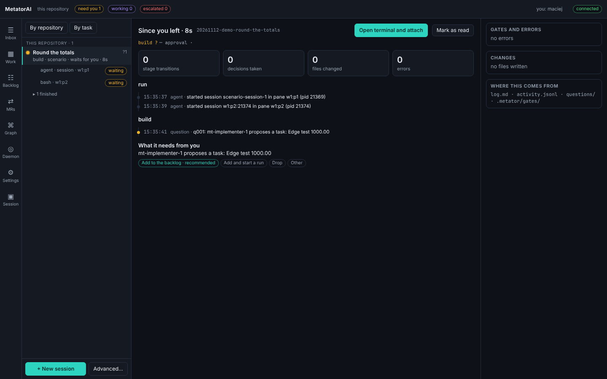

# The app

The desktop app is where you work with MetatorAI. It is a window over a local daemon, `metator serve`, which holds the runs, their terminals and the questions that wait for you. This page shows how to start the app and what each screen is for.

Everything the app does is also a `metator` command. Each page of this section shows the app first and the commands after it, under "From a terminal".

## Start it

The repository must be set up once with `metator setup` ([First run](../guide/first-run.md)). Then start the daemon in the repository, or in a folder that holds several repositories:

```bash
metator serve
```

It listens on `http://127.0.0.1:4310` and runs until you stop it. `--port <n>` picks another port. One repository has one daemon: a second `metator serve` there is refused and names the address and the process id of the first. A daemon for another repository needs its own port (`metator serve --port <other>`).

Then open the app. The installers are built by the `desktop` workflow of the MetatorAI repository on GitHub, as the artifacts `metatorai-desktop-windows-x64`, `metatorai-desktop-macos-universal` and `metatorai-desktop-linux-x64`. From a clone of MetatorAI you can run the window directly:

```bash
cd packages/desktop && bun run tauri dev     # needs Rust and the platform's webview
```

The app looks for the daemon at the default address. The word on the right of the top bar reads **connected** when it found it.

When nothing answers at that address, it reads **no daemon** and the main area shows one panel on every screen: what is wrong, the command `metator serve`, a field with the daemon's address, and **Retry**. If your daemon listens elsewhere, type its address in the field and click **Retry**; the app remembers it. The app also tries again by itself every two seconds, and the screen you were on returns as soon as the daemon answers. The same address is in **Settings**, group **app**, as **daemon url** ([Your settings](./settings.md#daemon-address-and-your-name)).


## Three levels

The app is built so that the first thing you see is simple, and the details come only when you open something:

1. **Tasks**: what is going on, and does anything wait for me. The sidebar, Home and the Board show each task with its name, one state word, its progress and how many of its steps need you.
2. **A task**: how this task goes. Its page has its flow, its steps by repository and the one thing to decide.
3. **A step**: what the agent does exactly. Its page has its terminal, its changes, its activity, its plan and its artifacts.

On the first level a thing reads one of four words:

| Word | Means |
|---|---|
| `needs you` | it asks: a decision on Home, or a question in its terminal |
| `working` | an agent works on it |
| `blocked` | it stands still and does not ask: it escalated, it waits for another step, or nothing drives it |
| `done` | it finished, also when it was closed without its work |

A blocked thing says why in one line on its task's page and its own: `escalated at build: …`, `waits for price-endpoint`, `nothing drives it: Open a session`. The finer words of a run or a pane (`asks`, `idle`, `exited`, `aborted`, `escalated`) are in its terminal and in **Details** on its page.

## The window

A thin bar on top shows your name, **you: alice**, a **?** that lists the keys, and whether the daemon answers. The app asks for your name once, in a dialog, the first time you answer, attach or decide something; a click on it changes it.

Everything else is two parts: the sidebar on the left, which stays on every screen, and the place you chose. In a window narrower than about 1000 pixels the sidebar is hidden; the button **Runs · N** in the top bar opens it over the screen.

## The sidebar

The sidebar is the first level. Every row is built the same way: the glyph of one of the four words, a name, the word at the right, and one dim line under the name. A row has no run id, no host and no age: those are on the run's page, under **Details**.

**Needs you · N** is on top: how many questions, terminal questions and escalated runs wait for you. A click opens Home, which shows them one at a time ([Answer questions](./inbox.md)).

The chats follow, and the sidebar is one tree: a chat, its tasks, their repositories, their steps.

- **A chat** (a thread) is one topic you talk about with the agent. Its row has the chat's title, one word and how many tasks it holds (`2 tasks`). The word is its most urgent task's (`needs you`, then `blocked`, then `working`, then `done`), `needs you` while the chat itself asks you something, and `chat` while no task was started in it. Chats that need you come first, then the one that changed last. A click opens the chat: its terminal fills the main area ([Chats](./desktop.md#chats)). **⋯** on its row offers **Close chat**, or **Reopen chat** for a closed one.
- **A task** under its chat is a run the chat's agent started, with everything that run started. A task is a system task (a system plan with its system run and its steps), a run that started child runs, or a run of its own. Its row has one state word, its progress (`3/6`), how many of its steps need you (`2 need you`) and how many are blocked; tasks that need you come first. **▸** unfolds a task into its own tree: the repositories it works in, each with its steps and child runs and their word, steps not started too, with what they wait for (`not started · waits for api-model, api-endpoint`). A run of its own unfolds into its panes. A click on a task opens its page; a click on a step opens the step's page, or, when the step asks on a card, that decision on Home.

**Without a chat · N** holds the tasks no chat started: a run from the form, from an intake rule, from `metator run new` in a terminal, or from CI. It shows only while there is one.

**Closed (N)**, folded, holds the chats you closed. Closing a chat ends its terminal and never stops its tasks: they go on, and stay under that chat. **▸** unfolds the group; a closed chat's row reads `closed`. Nothing is ever deleted.

Finished tasks are hidden. **Show finished (N)**, at the end of each chat and of **Without a chat**, shows them; a finished run reads `done`, and its line says how it ended (`done`, `aborted`), with the reason on hover.

Under the chats are the places that are not a task:

| Place | Shows |
|---|---|
| **Board** | every task by phase: To do · Planning · In progress · Review · Done ([The Board](#the-board)) |
| **Terminals** | a tab per run or shell, with the agents' terminals and your own in split panes ([Terminals](./desktop.md)) |
| **Backlog** | tasks for later: agents' proposals and your own ([Plan and backlog](./plan.md)) |
| **Settings** | the options, and under it **System** (the daemon, the dependencies, the system map) and **Reviews** ([Settings](#settings)) |

At the bottom, **+ New chat** (key `n`) starts a chat: a new thread with its own terminal, where you tell the agent what you want; **Form…** beside it opens a form where you choose the workflow, host, autonomy and worktree yourself, and the run it starts is **Without a chat** ([Start a task](./start.md)). With no run at all the main area offers the same: a field **Describe a task** with **Start**, which starts a chat named after your words, and **Use the form**.

When the daemon serves a folder of repositories, **Terminals**, **Backlog** and the parts of **Settings** show one repository at a time. Each has a **repository** select at the top; the choice is shared by these places and remembered. The page of a run always uses the run's own repository.

## Home

**Home** is the first screen. It shows one decision at a time: a big card with the question, or the plan to approve, and its answers. Above it, **3 waiting** says how many wait, with **‹ Previous** and **Next ›** (also `k` and `j`). Everything else about the decision is folded under **Details**: its ids, the evidence, what happened since you left, what each answer does, and the command your answer amounts to ([Answer questions](./inbox.md)).

With nothing to decide, Home lists the open tasks in short, with their word and progress (a task started in a chat has the chat's title before its name, dim: **Invoice discount · Add the discount to the invoice**), the runs nothing drives with **Open a session** and **Drive in background**, and **Describe a task** to start a new one.

## The page of a task

A system task, or a run that started child runs, has a page of its own: how the task goes. Its head has the task's name, its word, a bar of its steps done (`3 of 6 steps done`) and, when it is blocked, why. Its tabs are **Overview**, **Changes** and **Activity**; its steps have the terminals.

Its **Overview** has the one thing to decide in the task, if any: the decision card of the first of its steps that asks, the same card as on Home. Under it, for a system task, the plan's flow and its steps by repository ([A system run's plan](./plan.md#a-system-runs-plan)); for a run with child runs, its child runs by repository. A click on a step opens the step's page.

## The page of a step

A step, a child run and a run of its own have the page of a step: what the agent does exactly. A step's page starts with **Task › step**, which leads back to its task. The head has the name, the word, a bar of its stages done and the stage it is at now. **Details** in the head folds what the run is: its id, repository, workflow, autonomy, host, ports and age, its finer state, and every stage in one line.

| Tab | Key | Shows |
|---|---|---|
| **Overview** | `o` | the question that waits with its answers, the step's plan read-only, its artifacts and change, what happened since you left |
| **Terminal** | `t` | the run's live session, who types, its panes, its applications and links ([Sessions and worktrees](./sessions.md)) |
| **Changes** | `d` | the files the run changed, their diffs and your notes ([Read the change](./changes.md)) |
| **Activity** | `l` | everything the run did: the time, the type, the source and what happened |

An escalated run shows why it stopped under the head, with **Resume** and **Close run…**; one nothing drives offers **Open a session** and **Drive in background**; one that asks on a card with no session open says its question waits on Home and still offers **Open a session**, to talk to its conductor (the question stays on its card); a finished one says how it ended. **its card on Home ›** beside its question opens exactly that decision. The old address of a run's Plan tab (`#/run/<run>/plan`) opens its Overview.

### Overview of a step

When you come back to the window after ten minutes away and a run's page is open, its **Overview** opens first. It counts the stage transitions, the decisions taken and the errors since you left, lists the events by stage, and shows what the run needs from you now, with the answers as buttons. The files it counts are the run's change, the same files the **Changes** tab lists.



**Open terminal and attach** goes to the Terminal tab and gives you the keyboard. **Mark as read** starts the next "since you left" from now.

## Settings

**Settings** has three parts: **Options** ([Your settings](./settings.md)), **System** and **Reviews** ([Answer a review](./reviews.md)). The old addresses `#/overview` and `#/mrs` lead to System and Reviews.

**System** has three tabs.

**Daemon** is the daemon's own view. Four tiles show the median time from a question to its answer, the share of answers given from the decision card without opening the run, how many runs the daemon started again in the last 24 hours, and how many reminders it typed to an idle agent. Below is a table of the open runs with their host, who works, state, terminal and last activity; a click on a run's name opens it. The side column shows how the daemon looks after runs (the waiting limit, restarts, the host order) and, under **AI hosts**, each host with **installed** or **not installed**. The daemon looks the hosts up each time, so a host you install while it runs is found without a restart. You change the settings in `metator.config.yml` ([Configuration](../reference/configuration.md#supervisor)).

**Dependencies** lists each system task in one line (its status and how many steps are done) that leads to its own page, where its flow is. Below, the runs that are no step of a task: one lane per repository that has one. **Board ›** opens the Board.

**System** lists the system plans of the repository; a click opens the system task's page ([A system run's plan](./plan.md#a-system-runs-plan)). **System map** under it shows the applications and the contracts of the system as tables and is edited the same way (**Edit system map**, **Edit as text**, **Save…**). **Where the applications' code is** edits the option `system.roots` as a list: **+ Path** adds a directory, **✕** removes one, and a path that is not absolute, or is listed twice, is said under the list before **Save roots** can send it. **Discover…** reads the code and lists what the map lacks; with no map yet it shows the whole map the code suggests. Nothing is written until **Write the map**.

**Dependencies** is the graph. Each repository is a lane and each run a card with its state, stage and AI host. Finished runs of the last day stay, dimmed, so the picture of a system change is still there when it is done. A click on a card opens the run. An arrow runs from a parent run to each run it started, to the right of it, also across lanes. A dashed line joins two runs that exchanged a message or changed the same file. The **Links** box lists those pairs. For a shared file it says which run to merge first, and **Notify both** sends each of the two runs a message about the file.

## Keys

`?` lists every key, and typing in its field filters the list. Single-letter keys work when the cursor is not in a text field and no Ctrl, Cmd or Alt is held, so the system's own shortcuts stay what they are.

| Key | Does |
|---|---|
| `n` | a new chat: a thread with its own terminal and the agent |
| `g` | the next run that needs you |
| `j` `k`, `↓` `↑` | on Home, the next or the previous decision; elsewhere, move in a list: the tasks, the steps, the files |
| `o` | the overview of the run, from a decision or on a run's page |
| `t` `d` `l` | on a step's page: Terminal, Changes, Activity |
| `Backspace`, `Esc` | on a task's board: back to all tasks |
| `a` `c` | on a run's Terminal tab: attach, release to the agent |
| `e` | on a run's page: open it in the editor |
| `Esc` | closes a dialog, also from a field, and the sidebar's drawer |

The keys of **Terminals** come after a prefix ([Terminals](./desktop.md#keys)).

## Notifications

A question that was not in the queue before raises a system notification, "MetatorAI needs you", with the question's text. The first time, the system asks whether the app may notify you. On **Terminals**, a waiting question of an open tab also shows as a toast with the first two lines of the question. A click on the toast opens the question's decision card on Home; for a permission prompt of the host, which is answered in the terminal, it opens the tab and gives you the keyboard of the run's main pane. The `✕` on the toast hides it; the question stays on Home.

## The Board

**Board** shows the work in five columns by phase: **To do**, **Planning**, **In progress**, **Review** and **Done**. Done is folded: **Show finished (N)** shows the last day, older ones behind **show N more**. Its top level shows only parent tasks, each once: a system task, a run with child runs, a run of its own, a backlog task or an agent's proposal. A task is in the column of its own phase: a system task is in Planning until its plan is approved, In progress while its steps run, Review at its delivery and Done at the end. Its card has the task's word, its name and how many of its steps are done (`3 of 6 steps done`); the needs-you and blocked counts of its steps are summed on it and in the column's header. A card has no host and no age.

A click on a system task (or Enter) opens **its** board: the same columns with its steps and their child runs across repositories, steps not started in To do with what they wait for, a blocked run with why, and **Board ›** `<task>` at the top to go back (also Backspace or Escape). A run's column is the phase the daemon sends with it (`phase`), computed from its workflow and stage: understanding and planning stages and the plan's approval are Planning, the work is In progress, checks, reviews, delivery and publishing are Review, a done or aborted run is Done.

Above the board: the repositories (several at once; a task shows when any of its steps works in one), the words needs you / working / blocked, the host and a search. The filters are kept in this window. Arrows move between cards. **Start a run** on a To-do task starts it. Cards cannot be dragged to another column: the engine decides the phase.
