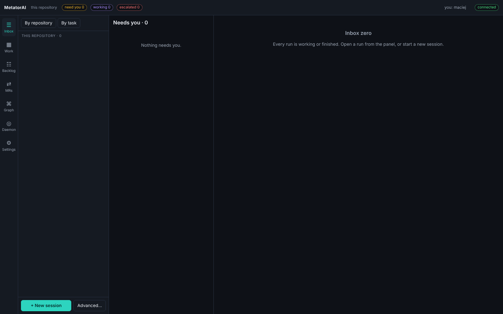
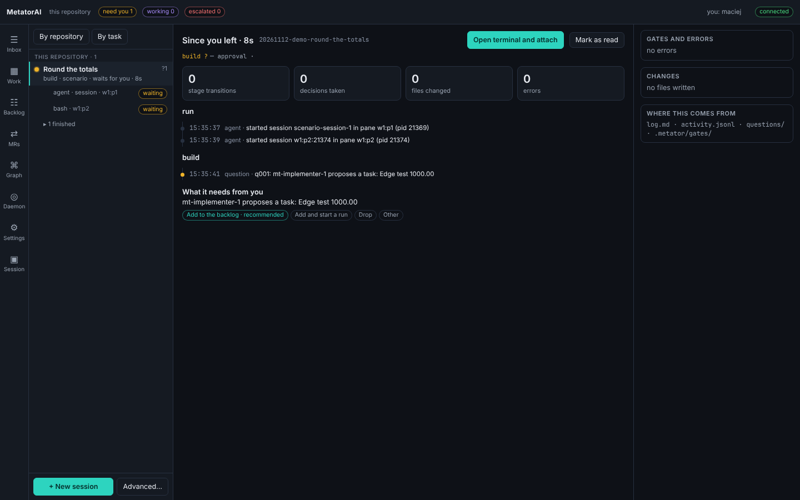

# The app

The desktop app is where you work with MetatorAI. It is a window over a local daemon, `metator serve`, which holds the runs, their terminals and the questions that wait for you. This page shows how to start the app and what each screen is for.

Everything the app does is also a `metator` command. Each page of this section shows the app first and the commands after it, under "From a terminal".

## Start it

The repository must be set up once with `metator setup` ([First run](../guide/first-run.md)). Then start the daemon in the repository, or in a folder that holds several repositories:

```bash
metator serve
```

It listens on `http://127.0.0.1:4310` and runs until you stop it. `--port <n>` picks another port. One repository has one daemon: a second `metator serve` there is refused and names the address and the process id of the first. A daemon for another repository needs its own port (`metator serve --port <other>`).

Then open the app. The installers are built by the `desktop` workflow of the MetatorAI repository on GitHub, as the artifacts `metatorai-desktop-windows-x64`, `metatorai-desktop-macos-universal` and `metatorai-desktop-linux-x64`. From a clone of MetatorAI you can run the window directly:

```bash
cd packages/desktop && bun run tauri dev     # needs Rust and the platform's webview
```

The app looks for the daemon at the default address. The chip on the right of the top bar reads **connected** when it found it. If your daemon listens elsewhere, open **Settings**, choose the group **app** and change **daemon url** ([Your settings](./settings.md#daemon-address-and-your-name)).



## The window

The top bar counts the runs: **need you** (a question waits for your answer), **driving** (an agent works) and **escalated** (the run stopped and needs work from you).

The column on the left edge switches between the screens. Next to it is the sessions panel, which stays visible on every screen. The rest of the window is the screen you chose.

## Screens

| Screen | What you do there |
|---|---|
| **Inbox** | answer the gates, permissions and questions of every run ([Answer questions](./inbox.md)) |
| **Work** | the workbench: a tab per task or shell, with the agents' terminals and your own in split panes ([Workbench and terminals](./desktop.md)) |
| **Backlog** | add tasks, decide agents' proposals, start a run on a task ([Plan and backlog](./plan.md#backlog)) |
| **MRs** | reviews of your pull requests, the proposed replies, and the buttons that send them ([Answer a review](./reviews.md)) |
| **Graph** | the active runs by repository, with what links them |
| **Super** | the daemon, the AI hosts it found, the active sessions and the supervisor's settings |
| **Settings** | every option, its value and where the value comes from ([Your settings](./settings.md)) |

A run has screens of its own. **Session** is added to the column while you look at a run.

| Screen | Shows | Opens from |
|---|---|---|
| **Session** | one run: its stages, terminal, events, open question, applications and links ([Sessions and worktrees](./sessions.md)) | a click on the run in the sessions panel |
| **Plan** | the plan's steps with their state, what comes next, the artifacts ([Plan and backlog](./plan.md)) | the stages under the tabs on **Work** |
| **Changes** | the files the run changed, their diffs and your notes ([Read the change](./changes.md)) | **Review** on the **Session** screen |

### Graph

Each repository is a lane and each active run a card with its task, stage, host and driver. A click on a card opens the session. An arrow joins a parent run to its child. A dashed line joins two runs that exchanged a message or changed the same file.

The **Links** box lists those pairs. For a shared file it says which run to merge first, and **Notify both** sends each of the two runs a message about the file.

### Super

The **Super** screen is the daemon's own view. Four tiles show the median time from a question to its answer, the share of answers given from the decision card without opening the session, how often the supervisor restarted a session in the last 24 hours, and how often it nudged an idle one. Below is a table of the active sessions with their host, driver, state and last activity. A click on a row opens the session.

The side column shows the supervisor's policy as it is in effect (the waiting limit, restarts, the host order) and the hosts installed on this machine. You change the policy in `metator.config.yml` ([Configuration](../reference/configuration.md#supervisor)).

### Briefing

When you come back to the window after ten minutes away and a **Session** screen is open, the briefing of that run opens first. It counts the stage transitions, the decisions taken, the files changed and the errors since you left, lists the events by stage, and ends with what the run needs from you now.



**Open terminal and attach** goes to the session and gives you its keyboard. **Mark as read** starts the next briefing from now.

## The sessions panel

The panel lists the runs. Runs that wait for you come first, then the ones that work, then the rest. Each row shows the task, the stage, the host, the state and the time since the run started. A `?1` on the right counts the run's open questions. A click opens the run's **Session** screen.

A run with more than one pane lists its panes under it, each with its state. A click on a pane opens the session on that pane.

**App** and **Run** at the top switch the grouping. **App** groups the active runs by repository. **Run** groups the steps of a split task under their parent run, with a count of the steps done, and lists the other runs as standalone. Finished runs are folded into one line at the bottom, such as **1 finished**.

The buttons at the bottom start work:

- **+ New session** opens a pane with the agent, and you tell it what you want.
- **Advanced…** opens a form where you choose the workflow, host, autonomy and worktree yourself.

[Start a task](./start.md) covers both. The key `n` does the same as **+ New session**, and `g` opens the next session that waits for you. Both keys work when the cursor is not in a text field.

## Notifications

A question that was not in the queue before raises a system notification, "MetatorAI needs you", with the question's text. The first time, the system asks whether the app may notify you. On **Work**, a waiting question of an open tab also shows as a toast. A click on the toast opens the tab and gives you the keyboard of the run's main pane.
