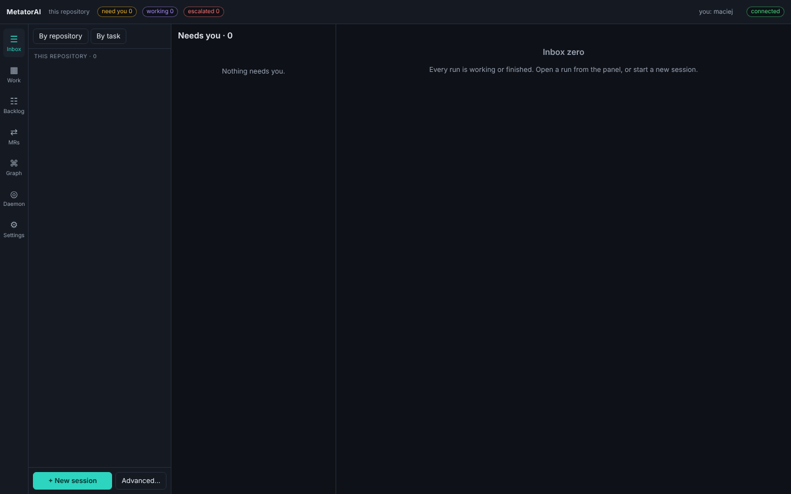

# The app

The desktop app is where you work with MetatorAI. It is a window over a local daemon, `metator serve`, which holds the runs, their terminals and the questions that wait for you. This page shows how to start the app and what each screen is for.

Everything the app does is also a `metator` command. Each page of this section shows the app first and the commands after it, under "From a terminal".

## Start it

The repository must be set up once with `metator setup` ([First run](../guide/first-run.md)). Then start the daemon in the repository, or in a folder that holds several repositories:

```bash
metator serve
```

It listens on `http://127.0.0.1:4310` and runs until you stop it. `--port <n>` picks another port. One repository has one daemon: a second `metator serve` there is refused and names the address and the process id of the first. A daemon for another repository needs its own port (`metator serve --port <other>`).

Then open the app. The installers are built by the `desktop` workflow of the MetatorAI repository on GitHub, as the artifacts `metatorai-desktop-windows-x64`, `metatorai-desktop-macos-universal` and `metatorai-desktop-linux-x64`. From a clone of MetatorAI you can run the window directly:

```bash
cd packages/desktop && bun run tauri dev     # needs Rust and the platform's webview
```

The app looks for the daemon at the default address. The word on the right of the top bar reads **connected** when it found it.

When nothing answers at that address, it reads **no daemon** and the main area shows one panel on every screen: what is wrong, the command `metator serve`, a field with the daemon's address, and **Retry**. If your daemon listens elsewhere, type its address in the field and click **Retry**; the app remembers it. The app also tries again by itself every two seconds, and the screen you were on returns as soon as the daemon answers. The same address is in **Settings**, group **app**, as **daemon url** ([Your settings](./settings.md#daemon-address-and-your-name)).



## The window

A thin bar on top shows your name, **you: alice**, a **?** that lists the keys, and whether the daemon answers. The app asks for your name once, in a dialog, the first time you answer, attach or decide something; a click on it changes it.

Everything else is two parts: the sidebar on the left, which stays on every screen, and the place you chose. In a window narrower than about 1000 pixels the sidebar is hidden; the button **Runs · N** in the top bar opens it over the screen.

## The sidebar

The sidebar is the whole dashboard. Every row is built the same way: the state's glyph, a name, the state's word at the right, and one dim line under the name.

**Needs you · N** is on top: how many questions, terminal questions and escalated runs wait for you. A click opens the Inbox, which lists them ([Answer questions](./inbox.md)).

**Tasks · N** follows: one row per parent task, whatever repositories it works in. A task is a system task (a system plan with its system run and its steps), a run that started child runs, or a run of its own. Its row has one state word, its progress (`3/6`) and how many of its steps need you (`2 need you`); tasks that need you come first. **▸** unfolds a task into its own tree: the repositories it works in, each with its steps and child runs and their state, steps not started too, with what they wait for (`not started · waits for api-model, api-endpoint`). A run of its own unfolds into its panes. A click on a run opens its page; a click on a system task opens its board. Finished tasks fold into **Finished · N** at the end; a finished run says how it ended (`done`, `aborted`) instead of a stage.

A run reads one of six words, and a task reads the strongest of its runs:

| Word | Means |
|---|---|
| `needs you` | it asks: on a card in the Inbox, or in its terminal |
| `escalated` | it stopped and needs work from you |
| `working` | an agent works on it |
| `done` | it finished; drawn in green until you open it, quiet after |
| `aborted` | it was closed without its work (`⊘`); the reason is on hover |
| `idle` | nothing happens and nothing is asked: stopped, or nothing works on it |

The app remembers which finished runs you opened in the window's own storage; another browser or computer starts with every finished run as `done`.

Under the runs are the places that are not a run:

| Place | Shows |
|---|---|
| **Terminals** | a tab per run or shell, with the agents' terminals and your own in split panes ([Terminals](./desktop.md)) |
| **Board** | every piece of work by phase: To do · Planning · In progress · Review · Done ([The Board](#the-board)) |
| **Backlog** | tasks for later: agents' proposals and your own ([Plan and backlog](./plan.md)) |
| **Reviews** | reviews of your pull requests, the proposed replies, and the buttons that send them ([Answer a review](./reviews.md)) |
| **Overview** | the daemon with its figures, hosts and settings, and under **Dependencies** what links the runs |
| **Settings** | the options ([Your settings](./settings.md)) |

At the bottom, **+ New run** opens a pane with the agent, and you tell it what you want; **Form…** beside it opens a form where you choose the workflow, host, autonomy and worktree yourself ([Start a task](./start.md)). With no run at all the main area offers the same: a field **Describe a task** with **Start**, and **Use the form**.

When the daemon serves a folder of repositories, **Terminals**, **Backlog**, **Reviews**, **Overview** and **Settings** show one repository at a time. Each has a **repository** select at the top; the choice is shared by these places and remembered. The page of a run always uses the run's own repository.

## The page of a run

A run has one page with five tabs. The head is the same on every tab: the task, the run id, the tabs, what the run is (workflow, autonomy, host, ports, age) and its stages in one line. An escalated run shows why it stopped under the head, with **Resume** and **Close run…**; a finished one says how it ended.

| Tab | Key | Shows |
|---|---|---|
| **Overview** | `o` | what happened since you left, the question that waits with its answers, the run's change |
| **Terminal** | `t` | the run's live session, who types, its panes, its applications and links ([Sessions and worktrees](./sessions.md)) |
| **Plan** | `p` | the plan's steps with their state, what comes next, the artifacts ([Plan and backlog](./plan.md)) |
| **Changes** | `d` | the files the run changed, their diffs and your notes ([Read the change](./changes.md)) |
| **Activity** | `l` | everything the run did: the time, the type, the source and what happened |

### Overview of a run

When you come back to the window after ten minutes away and a run's page is open, its **Overview** opens first. It counts the stage transitions, the decisions taken and the errors since you left, lists the events by stage, and shows what the run needs from you now, with the answers as buttons. The files it counts are the run's change, the same files the **Changes** tab lists.


**Open terminal and attach** goes to the Terminal tab and gives you the keyboard. **Mark as read** starts the next "since you left" from now.

## Overview

**Overview** has two parts.

**Daemon** is the daemon's own view. Four tiles show the median time from a question to its answer, the share of answers given from the decision card without opening the run, how many runs the daemon started again in the last 24 hours, and how many reminders it typed to an idle agent. Below is a table of the open runs with their host, who works, state, terminal and last activity; a click on a run's name opens it. The side column shows how the daemon looks after runs (the waiting limit, restarts, the host order) and, under **AI hosts**, each host with **installed** or **not installed**. The daemon looks the hosts up each time, so a host you install while it runs is found without a restart. You change the settings in `metator.config.yml` ([Configuration](../reference/configuration.md#supervisor)).

**Dependencies** lists each system task in one line (its status and how many steps are done) that leads to its own page, where its flow is. Below, the runs that are no step of a task: one lane per repository that has one. **Board ›** opens the Board.

**System** lists the system plans of the repository; a click opens the system task's page ([A system run's plan](./plan.md#a-system-runs-plan)). **System map** under it shows the applications and the contracts of the system as tables and is edited the same way (**Edit system map**, **Edit as text**, **Save…**). **Where the applications' code is** edits the option `system.roots` as a list: **+ Path** adds a directory, **✕** removes one, and a path that is not absolute, or is listed twice, is said under the list before **Save roots** can send it. **Discover…** reads the code and lists what the map lacks; with no map yet it shows the whole map the code suggests. Nothing is written until **Write the map**.

**Dependencies** is the graph. Each repository is a lane and each run a card with its state, stage and AI host. Finished runs of the last day stay, dimmed, so the picture of a system change is still there when it is done. A click on a card opens the run. An arrow runs from a parent run to each run it started, to the right of it, also across lanes. A dashed line joins two runs that exchanged a message or changed the same file. The **Links** box lists those pairs. For a shared file it says which run to merge first, and **Notify both** sends each of the two runs a message about the file.

## Keys

`?` lists every key, and typing in its field filters the list. Single-letter keys work when the cursor is not in a text field and no Ctrl, Cmd or Alt is held, so the system's own shortcuts stay what they are.

| Key | Does |
|---|---|
| `n` | a new run: the pane with the agent |
| `g` | the next run that needs you |
| `j` `k`, `↓` `↑` | move in a list: the decisions, the tasks, the steps, the files |
| `o` | the overview of the run, from a decision or on a run's page |
| `t` `p` `d` `l` | on a run's page: Terminal, Plan, Changes, Activity |
| `a` `c` | on a run's Terminal tab: attach, release to the agent |
| `e` | on a run's page: open it in the editor |
| `Esc` | closes a dialog, also from a field, and the sidebar's drawer |

The keys of **Terminals** come after a prefix ([Terminals](./desktop.md#keys)).

## Notifications

A question that was not in the queue before raises a system notification, "MetatorAI needs you", with the question's text. The first time, the system asks whether the app may notify you. On **Terminals**, a waiting question of an open tab also shows as a toast with the first two lines of the question. A click on the toast opens the question's decision card in the Inbox; for a permission prompt of the host, which is answered in the terminal, it opens the tab and gives you the keyboard of the run's main pane. The `✕` on the toast hides it; the question stays in the Inbox.

## The Board

**Board** shows the work in five columns by phase: **To do**, **Planning**, **In progress**, **Review** and **Done** (the last day; older ones behind **show N more**). Its top level shows only parent tasks, each once: a system task, a run with child runs, a run of its own, a backlog task or an agent's proposal. A task is in the column of its own phase: a system task is in Planning until its plan is approved, In progress while its steps run, Review at its delivery and Done at the end. Its card says how many of its steps are done (`3 of 6 steps done`), and the needs-you and escalated counts of its steps are summed on it and in the column's header.

A click on a system task (or Enter) opens **its** board: the same columns with its steps and their child runs across repositories, steps not started in To do with what they wait for, and **Board › <task>** at the top to go back (also Backspace or Escape). A run's column is the phase the daemon sends with it (`phase`), computed from its workflow and stage: understanding and planning stages and the plan's approval are Planning, the work is In progress, checks, reviews, delivery and publishing are Review, a done or aborted run is Done.

Above the board: the repositories (several at once; a task shows when any of its steps works in one), the states needs you / escalated / working, the host and a search. The filters are kept in this window. Arrows move between cards. **Start a run** on a To-do task starts it. Cards cannot be dragged to another column: the engine decides the phase.
