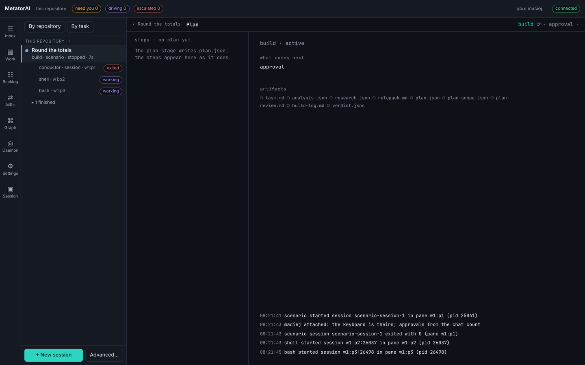
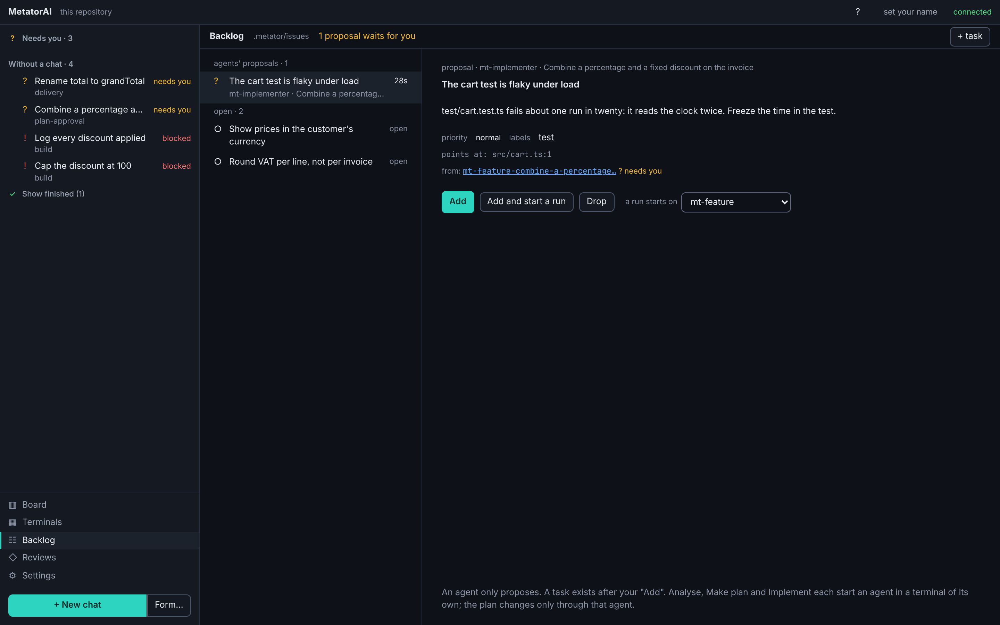

# Plan and backlog

The **Plan** screen shows where one run stands and what is left. The **Backlog** screen is the repository's list of tasks that are not runs yet. This page covers both, in the app and from a terminal.

## See where a run stands

Open the **Plan** tab of a run's page (key `p`), or from **Terminals**: click the stages under the tabs, or press the prefix and `p`.



| Part | Shows |
|---|---|
| Stages, in the head | each stage with its state; hover for who worked it, when, and its verdict |
| **steps**, left | the plan's steps with their state, file and worker, and a count of the ones done |
| **waits for you**, left | the open questions, oldest first |
| The chosen step, right | its file, the tests that come first, the exemplar, the rules, and the steps it comes after |
| **what comes next** | the stages still to come, and the last results of the quick and the full gate |
| **artifacts** | the files the stages produce, and whether each is there |
| **workers** | the run's worker agents, each with its stage, pane and result so far |
| Timeline, bottom | the last events of the run |

Click a step to see it. **Show the pane** opens the step's worker in **Terminals**.

When a question waits, it is at the top with its answers as buttons, the recommended one highlighted. A click answers it. For a permission prompt of the host the button is **Answer in the pane**.

No model writes this screen. It is computed from the run's files when you look:

- A step is `done` when a worker reported done and named the step's file or id.
- A step is `in-progress` when the activity shows a tool call on its file.
- A step is `blocked` when a worker reported blocked or failed and named the step.

Before the plan stage has written `plan.json`, the list of steps is empty. A plan written as Markdown (`plan.md`) is shown as text instead.

The **artifacts** are the files this run's workflow produces, never another workflow's.

## A system run's plan

A system run's Plan tab shows its **system plan** instead: the change across repositories. On top are its status, its approval (with who approved it, or **approved … before it changed: approve again** once someone edited it after the approval), its lint and **Approve**. **Approve** waits while the lint has errors, and says the first one. Below are the **deploy order**, wave by wave, and the steps grouped by repository, each with what it does, the steps it comes after, its status, and the run it started with that run's state and stage. A click on a run opens it.

**Edit system plan** and **Edit as text** work as for a run's plan. A step that already has a run is history: its fields are read-only and it cannot be removed. New steps can be added (**+ Step**, with the application they run in). An approved plan that is edited goes back to draft and must be approved again.

In the sidebar a system run's steps sit under it, whatever repository they run in; a step of another repository names it (`step 2/2 · shop-web · plan · …`). The total comes from the system plan, so a step that has not started yet still counts.

## Change the run's plan

Until the run passes the gate where a person approves the plan (`plan-approval` in `mt-feature`), you can change the plan in the app. A bar over the steps shows the plan's lint (`lint: 2 errors · 1 warning`); each problem also stands under the step and the field it is about.

- **Edit plan** turns the steps into fields: the task and the scope, then for each step its action, file, intent, exemplar (`file:line`), rules, the tests written first and the steps it comes after. **↑** and **↓** move a step (or **Alt+↑** and **Alt+↓** while a field of the step has the focus), **✕** removes it, and **+ Step** adds one at the end with the next id.
- **Edit as text** shows the plan as JSON instead. **As fields** and **As text** switch between the two while you edit.
- **Check** lints your draft without saving. A draft that is not valid JSON says so, with the line, before anything is sent.
- **Save…** first lists what the save changes (`step added: S3`, `step S1 changed: intent`, `steps reordered`) and whether the plan still has errors; **Save** then asks for your name the first time and writes it. Lint errors do not stop a save; the gates still check them. A plan that does not fit its format is not saved, and the app points at the fields.
- Every save records who made it and what changed (`plan edited by ana: step added: S3`) in the run's activity, and writes the edit scope again.
- If the plan changed since you opened it (an agent or another person saved first), the save is refused and the bar says **The plan changed since you opened it**: **Reload** drops your edits and shows the plan as it is now; **Keep my edits** keeps them and saves them over the new version on your next **Save**.
- After the approval gate, or when the run is done, the plan is read-only and the bar says why.

When the approval question is open, its card in the Inbox shows the plan's lint as it is now and a link **Review / edit the plan** to this tab.

Agents never edit a plan through the app; they write the plan file their stage names.

## The run's files

The **artifacts** list opens any text file of the run directory (`.md`, `.json`, `.yml`, `.txt`, `.log`): the plan, the build log, a worker's result, the log. Files the workflow will write but has not yet are listed as expected. Only files inside the run directory open, at most 512 KiB of each.

## Backlog

The backlog is in `.metator/issues/`, one small file per task. Agents never add, edit, close or drop a task. They can only propose one.



The **Backlog** screen lists **agents' proposals** first, then the **open** tasks, with the finished ones folded at the bottom. The chosen task shows its text, priority, labels, references and run, with the buttons that apply to it:

| Button | On | Does |
|---|---|---|
| **+ task** | the top bar | opens a form: title, what and why, priority, labels |
| **Start a run** | an open task | starts a run with the task's title and text, in a new worktree, and opens its page. The select **a run starts on** beside the buttons names the workflow: `mt-feature` when the repository has it, else its first one |
| **Done**, **Drop** | an open task | closes it as done, or as not going to be done |
| **Add** | a proposal | makes it a task |
| **Add and start a run** | a proposal | makes it a task and starts a run on it |
| **Drop** | a proposal | discards it |

The app asks for your name the first time. Every change to the backlog carries it. When the daemon refuses an action, the reason stays at the top of the task until you close it.

### Proposals from agents

An agent that notices something outside its task, such as a flaky test or a missing edge case, can propose a task. The proposal appears on the **Backlog** screen and as a question in your inbox, with the agent's name and three answers: **Add to the backlog**, **Add and start a run**, or **Drop**.

A proposal cannot be started before someone decides it. Every task records who proposed it, what it points at, and who decided.

To switch proposals off, set the option `issues.proposeFromAgents` to `false`. Agents then mention such things in their summary instead.

Tasks can also arrive from GitHub, GitLab or Jira on their own: see [Automatic intake](./intake.md).

## From a terminal

```bash
metator run board                 # the latest run
metator run board --run <id>      # one run
```

The board is the data of the **Plan** screen as JSON: `stages`, `plan`, `waiting`, `artifacts`, `gates` and `next`, with `planFile` (the plan's file) and, for a run that carries out a system plan, `system`. `--timeline <n>` sets how many recent events it includes (default 30).

```bash
metator issue add "ADR for rounding" --body "Half-up or half-even." --priority high --labels adr,billing --by maciej
metator issue list                # proposals first, then in progress, then open by priority
metator issue show i001
metator issue start i001 --workflow mt-feature
metator issue close i001 --by maciej     # done
metator issue rm i002 --by maciej      # not going to be done
```

Commands that change a task take `--by <name>`; without it the name comes from `$METATOR_USER`, or else from `git config user.name`. `issue start` makes the issue `in-progress` and remembers the run. A task whose run is still active is not started a second time: the command is refused and names the run. The run works in a new worktree unless you pass `--no-worktree`. When tracked files have uncommitted changes, the start is refused and names them: commit or stash them, or pass `--allow-dirty` to start from the last commit without them. In the app, the refusal comes with the button **Start from the last commit**, which does the same. `metator issue list --run <id>` lists the tasks tied to a run: started from it, proposed in it, or pointing at it.

```bash
metator issue decide i002 --add --by maciej
metator issue decide i002 --drop --by maciej
```
