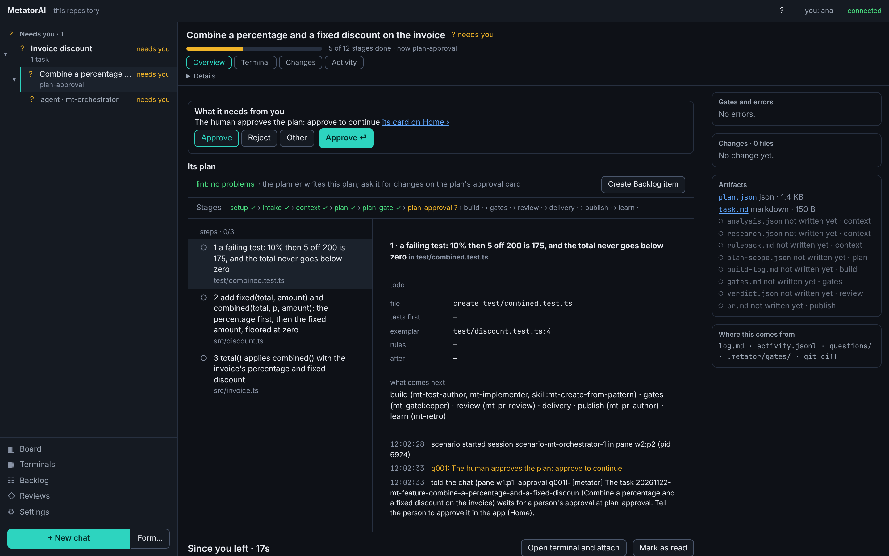

# Plan and backlog

A step's plan shows where one run stands and what is left; it is on the step's **Overview**. The **Backlog** screen is the repository's list of tasks that are not runs yet. This page covers both, in the app and from a terminal.

## See where a run stands

Open the **Overview** of a step's page (key `o`): under what the run needs from you is **Its plan**, read-only. From **Terminals**, click the stages under the tabs, or press the prefix and `p`. There is no Plan tab; its old address (`#/run/<run>/plan`) opens the Overview.



| Part | Shows |
|---|---|
| Stages, in the head | each stage with its state; hover for who worked it, when, and its verdict |
| **steps**, left | the plan's steps with their state, file and worker, and a count of the ones done |
| **waits for you**, left | the open questions, oldest first |
| The chosen step, right | its file, the tests that come first, the exemplar, the rules, and the steps it comes after |
| **what comes next** | the stages still to come, and the last results of the quick and the full gate |
| **workers** | the run's worker agents, each with its stage, pane and result so far |
| Timeline, bottom | the last events of the run |

Click a step to see it. **Show the pane** opens the step's worker in **Terminals**.

When a question waits, it is at the top with its answers as buttons, the recommended one highlighted. A click answers it. For a permission prompt of the host the button is **Answer in the pane**.

The step's **artifacts**, the files its stages produce and whether each is there, are beside it on the Overview. No model writes the plan's view. It is computed from the run's files when you look:

- A step is `done` when a worker reported done and named the step's file or id.
- A step is `in-progress` when the activity shows a tool call on its file.
- A step is `blocked` when a worker reported blocked or failed and named the step.

Before the plan stage has written `plan.json`, the list of steps is empty. A plan written as Markdown (`plan.md`) is shown as text instead.

The **artifacts** are the files this run's workflow produces, never another workflow's.

## A system run's plan

A system run's page is the task's page. Its Overview shows the one thing to decide in the task, if any, then the **system plan**: its status, its approval, its lint, and its flow: a column per wave of the deploy order, a lane per repository, one node per step (dashed while it has not started, with what it waits for), an arrow from each step to the steps that wait for it, and the critical path drawn heavier. A node is in the colour of its child run, with its stage; a click opens the step's detail (below). In a narrow window the nodes narrow to fit; past their narrowest the flow scrolls sideways in its own box. Below are the steps grouped by repository, each with what it does, the steps it comes after, its status and the run it started. Two steps of the same repository in one wave run side by side, each in a worktree of its own.

### A step's detail

A click on a step's tile, in the flow or on the task's Board, opens what the step already has: its summary, its application, the contracts it changes (`expand prices-api`), the steps it comes after, and the files of its application that the system analysis lists, or **files: not known until planned**. One word says where it stands: `pending`, `planning`, `planned`, `running`, `done` or `blocked`.

**Plan this step** asks for that step's own plan now, before the whole task runs: its planner starts in the step's repository, in a terminal the app opens at once, and stops once you approve the plan (the run then reads **plan ready**). The detail then shows the plan, one line per file, with **Its terminal** and a link to its run. When the step runs later, its run starts from that plan instead of planning again. The system planner never plans every step up front; a step is planned only when you ask. A plan run that was aborted gives the button back.

**Create Backlog item**, above the system plan, puts the plan in the Backlog without running it (see [Plans in the Backlog](#plans-in-the-backlog)).

The head of the task's page has a bar of its steps done (`1 of 2 steps done`) and, when the task is blocked, why: the step that escalated (`price-endpoint: escalated at delivery: …`) or what a step waits for. Under **Details** a line names the system plan and the child run it is blocked by, with a link to it.

## Change a plan

A plan is not edited by hand: its planner writes it, and you tell the planner what should be different. A step's Overview shows its plan read-only, with its lint (`lint: 2 errors · 1 warning`) and each problem under the step it is about.

At the plan's approval the card on Home, and on the task's page, shows the plan **in full**, without a click: for a run, its steps with their files, the tests written first and what each step waits for; for a system plan, its flow, with its steps per repository folded under it (**6 steps in 3 repositories**). Its two actions stand above the plan, so they are on the screen without scrolling:

- **Approve** approves the plan, and the run goes on.
- **Ask for changes** takes your words (`S2 also needs a test for a product without a currency`) and sends them as the gate's Reject with your words as the reason: the run goes back to its planner, which writes a new plan.
- While the lint has errors, **Approve** is closed and the card says why; **Ask the planner to fix it** fills the box with the lint's problems.
- When the planner has written a new version, the card and the step's Overview show **Changed since the previous plan**: the steps added, removed or changed, by id.

## The run's files

The **artifacts** list opens any text file of the run directory (`.md`, `.json`, `.yml`, `.txt`, `.log`): the plan, the build log, a worker's result, the log. Files the workflow will write but has not yet are listed as expected. Only files inside the run directory open, at most 512 KiB of each.

## Backlog

The backlog is in `.metator/issues/`, one small file per task. Agents never add, edit, close or drop a task. They can only propose one.


The **Backlog** screen lists **agents' proposals** first, then the **open** tasks, with the finished ones folded at the bottom. A task's parts sit right under it. Each row ends in one word: `open`, `analysed`, `stale`, `plan ready`, `plan stale`, `waits`, `working`, `done` or `dropped`. The chosen task shows its text, priority, labels, references and run, its analysis and its plan, its parts, and the buttons that apply to it:

| Button | On | Does |
|---|---|---|
| **+ task** | the top bar | opens a form: title, what and why, priority, labels |
| **Analyse** | an open task | an agent reads the code for the task, in a terminal the app opens at once, and records its analysis on the task. **Re-analyse** once it has one |
| **Make plan** | an open task | a run of the task's workflow that stops once you approve its plan; its conductor's terminal opens at once. Closed while the analysis is stale |
| **Implement** | an open task | starts a run on the task in a new worktree and opens its terminal: from its plan when it has one. **Review plan, then implement** when the plan is stale. Closed while the task waits for other tasks |
| **Done**, **Drop** | an open task | closes it as done, or as not going to be done |
| **Add** | a proposal | makes it a task |
| **Add and start a run** | a proposal | makes it a task and starts a run on it |
| **Drop** | a proposal | discards it |

The select **a run starts on** beside the buttons names the workflow: `mt-feature` when the repository has it, else its first one. A task with a plan starts on its plan's workflow unless you choose another. When a button is closed, the line under the buttons says why.

### Analysis and plan

A task's **Analysis** is Markdown an agent wrote, with a section of deterministic facts MetatorAI added: the files it cites, the packages they belong to, how many files depend on them, and similar code. Ask for one with **Analyse**, or in a chat: say *analyse* to the chat agent, and it answers in the chat and records the same text as a Backlog task.

The analysis and the plan each have a badge that says whether they still describe the code:

| Badge | Means |
|---|---|
| `fresh` | nothing it cites has changed |
| `stale: invoice.ts, tax.ts +2` | a file it cites changed, or a file of a package it is about, since it was made (committed or not, in this checkout). **Make plan** is closed until you **Re-analyse**; a stale plan is reviewed before it is built |
| `old: 15 days` | older than `backlog.staleDays` (default 14). Only a warning |

**Make plan** plans and stops: the run's conductor writes the plan, you approve it on its card, and the run ends as **plan ready**. The plan is then on the task, with a summary and a link to its run. **Implement** with a fresh plan starts at the build; the stages before are recorded as done from that plan. With a stale plan it starts at the plan's review: the plan's lint, the plan critic, then your approval. A plan changes only through its planner, never in an editor.

### Plans in the Backlog

A plan you do not want to run yet can live in the Backlog. **Create Backlog item**, on a run's plan (its Overview) and above a system plan, makes one task from it: the run's task as its title, the plan's summary as its text, the plan attached, and the chat the plan was made in. A system plan also gets one part per step, each waiting for the parts its step depends on. Once made, the button reads **Open its Backlog item**.

A task with parts shows them with one word each and what each waits for (`waits for Price model`), and how many are done (`1 of 3 done`). Start each part on its own: a part does not start while a part it waits for is not done. The task itself has no **Make plan** or **Implement**; it is done by itself when every part is done. A dropped part counts as done.

When you start a task whose chat is closed, or that has none, a new chat opens for it with the old chat's summary and the task's analysis and plan.

The app asks for your name the first time. Every change to the backlog carries it. When the daemon refuses an action, the reason stays at the top of the task until you close it.

### Proposals from agents

An agent that notices something outside its task, such as a flaky test or a missing edge case, can propose a task. The proposal appears on the **Backlog** screen and as a question in your inbox, with the agent's name and three answers: **Add to the backlog**, **Add and start a run**, or **Drop**.

A proposal cannot be started before someone decides it. Every task records who proposed it, what it points at, and who decided.

To switch proposals off, set the option `issues.proposeFromAgents` to `false`. Agents then mention such things in their summary instead.

Tasks can also arrive from GitHub, GitLab or Jira on their own: see [Automatic intake](../repo/intake.md).

## From a terminal

```bash
metator run board                 # the latest run
metator run board --run <id>      # one run
```

The board is the data of a step's plan view as JSON: `stages`, `plan`, `waiting`, `artifacts`, `gates` and `next`, with `planFile` (the plan's file) and, for a run that carries out a system plan, `system`. `--timeline <n>` sets how many recent events it includes (default 30).

```bash
metator issue add "ADR for rounding" --body "Half-up or half-even." --priority high --labels adr,billing --by maciej
metator issue list                # proposals first, then in progress, then open by priority
metator issue show i001
metator issue start i001 --workflow mt-feature
metator issue close i001 --by maciej     # done
metator issue rm i002 --by maciej      # not going to be done
```

Commands that change a task take `--by <name>`; without it the name comes from `$METATOR_USER`, or else from `git config user.name`. `issue start` makes the issue `in-progress` and remembers the run. A task whose run is still active is not started a second time: the command is refused and names the run. The run works in a new worktree unless you pass `--no-worktree`. When tracked files have uncommitted changes, the start is refused and names them: commit or stash them, or pass `--allow-dirty` to start from the last commit without them. In the app, the refusal comes with the button **Start from the last commit**, which does the same. `metator issue list --run <id>` lists the tasks tied to a run: started from it, proposed in it, or pointing at it.

```bash
metator issue decide i002 --add --by maciej
metator issue decide i002 --drop --by maciej
```

### Analysis and plan from a terminal

```bash
metator issue analyze --title "Round prices half up" --text - <<'EOF'
Prices round in src/price.ts:12; the cart calls it at src/cart.ts:30.
EOF
metator issue analyze --issue i003 --text -       # analyse a task again (stdin, as above)
metator issue plan i003 --session                 # its plan only; --workflow to choose one
metator issue start i003 --session                # from its plan: at build, or at its review when stale
metator issue from-plan --run <run>               # a task from a run's plan; a system run's plan gets one part per step
metator system plan step-plan <plan> <step>       # one step's plan, in its repository
metator run new --workflow mt-feature --task "..." --until plan
metator run new --workflow mt-feature --task "..." --plan-from <run> [--plan-review]
```

`issue analyze` is what the chat agent and the guide run to record an analysis: the text with `path:line` citations, on stdin. MetatorAI hashes every cited file that exists, names the workspace packages they belong to, notes the commit, and adds the section **Deterministic facts** (the cited files, the packages, how many files depend on each, similar code). `issue show` and `issue list` give each task `freshness` (`fresh`, `stale` with `changed`, or `old` with `days`), `children`, `waitsFor` and, for a task with parts, `progress`. Only this checkout counts: a change on another branch or in another worktree does not make an analysis stale.

`issue plan` is refused while the analysis is stale. Its run (`mt-feature`, or `mt-bugfix` for a task labelled `bug`) works in this checkout and stops with the status `planned` once the plan is approved; its plan is copied to the task then. Without `--session` the run is made and waits for you (`metator run start --run <id>` opens its conductor); the app's buttons always open it. `issue start` takes the plan: from `build` when the plan still holds, from the plan's review when it does not, with every stage before recorded as `plan from <run>`. A part does not start while a task it waits for is neither done nor dropped (`issue i003 waits for i002 (open): start it when they are done`), and a task with parts is not started itself. A part of a system plan starts its step, as `system plan run` would, from the step's own plan when it has one.

A task started from a terminal belongs to the chat it was made in while that chat is open; otherwise a new chat is made for it, which says where it comes from (`from.issue`, `from.thread`).
