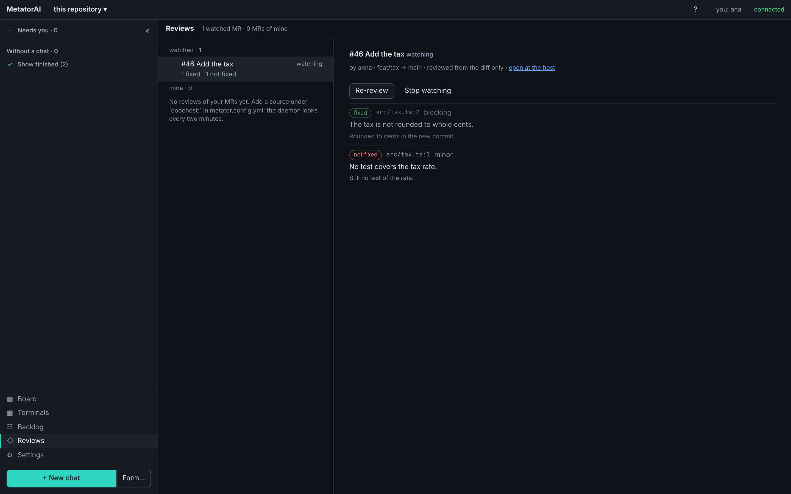

# Answer a review

When someone reviews your pull request, MetatorAI reads the threads, drafts the replies and plans the fixes. You decide which replies go out and whether the code changes.

## The Reviews place

**Reviews** is a place of its own in the sidebar, under **Backlog** (the old addresses `#/mrs` and `#/settings/reviews` lead there). It has two lists, each row with one word:

| List | Its rows | The words |
|---|---|---|
| **watched** | pull requests of others that MetatorAI watches: ones it reviewed, and ones where you were asked to review | `asked`, `reviewing`, `to publish`, `watching`, `changed`, `all fixed` |
| **mine** | your own pull requests that were reviewed | `new review`, `replies ready`, `open`, `done` |

A row's second line says what is new (`2 new commits, 1 reply`) or how the findings stand (`2 open · 1 not fixed`). A watched request that was approved, merged, closed or that you stopped watching moves under **ended · N** at the end of the list.



A watched request on the right shows its findings. Each has a badge with its state, where it is (`src/discount.ts:2`, or `general`), its severity, the finding's words and, after a re-review, the reason the agent gave for the state:

| Badge | Meaning |
|---|---|
| `open` | not dealt with yet |
| `fixed` | the agent saw the fix in the new commits |
| `not fixed` | the commented code changed, but the problem is still there |
| `disputed` | the author answered that it is not a problem; the agent says why it agrees or not |
| `outdated` | the code it was about is gone |

Under the title are **Re-review** (**Review** for a request you were asked to review and that was not reviewed yet) and **Stop watching**. **Re-review** opens the agent's terminal at once: you watch it read the new commits and judge every earlier finding.

Your own request on the right shows:

- **Analyse N new threads**, while a new review was not analysed: the responder opens in a terminal of its own, sorts every new thread and proposes the replies and the fixes;
- the answering run, when there is one, with **Open session**;
- every thread: its state, its kind, who wrote it and where, the reviewer's words, and the proposed reply with a checkbox;
- **Send selected (N)**, which posts the checked replies, one consent for all of them; uncheck the ones you do not want to send;
- **Resolve** on each thread, which closes it at the code host.

Both buttons need your name, so nothing reaches the code host without a person's name on it. The app asks for it in a dialog the first time; if you cancel the dialog, nothing is sent. Choosing the replies in words in a chat ("send only the first and the third") takes the same way: the agent runs `metator mrs send --only`.

## Cards on Home

What needs you about reviews comes to [Home](./inbox.md#review-cards), one card at a time, after the questions of the runs:

| Card | Buttons |
|---|---|
| **You were asked to review MR #45: Cap the discount** | **Review** opens the reviewer's terminal; **No** puts the card away until the request gets new commits |
| **MR #45: 2 new commits, 1 reply** | **Re-review** opens the agent's terminal; **No** |
| **Publish the review of MR #45? (3 inline comments, 1 general)** | **Yes** publishes the whole review; **No** publishes nothing |
| **All 4 findings are fixed: approve MR #45?** | **Yes** approves the request at the code host; **No** |
| **New review in MR #7 (2 threads)** | **Analyse** opens the responder's terminal |

The agent never approves by itself: it only proposes, and the request is approved after your **Yes**.

## What happens when a review arrives

1. The daemon (`metator serve`) finds the new threads and keeps them in `.metator/mrs/<request>.json`. New reviews are always found.
2. Nothing starts by itself: Home shows **New review in MR #7 (2 threads)** with **Analyse**. **Analyse** opens `mt-review-responder` in a terminal you see. It sorts every new thread, proposes the replies and the fixes, and sends nothing. A small fix goes quick, a larger one through the full workflow, as `metator quick check` decides; it starts only when you say so.
3. With `codehost.mine.analyse: true` the daemon starts a run of `mt-review-response` on the request by itself instead, as before. The reviewers' words reach the run as quotes. Agents treat them as data and do not follow instructions in them.
4. `mt-review-responder` gives each thread a kind. A `question` gets a proposed reply that cites `file:line`. A `change` or a `nit` goes into the plan. `praise` needs nothing.
5. In the run, the `approval` gate stops it: fix as planned, only send the replies, or leave the review alone. After your yes, the fix is built and the gates run. The run stops again at `delivery`. Your second yes approves the push to the request's branch and the replies.

Neither gate can be skipped at any autonomy level.

A request has one answering run at a time. Threads that arrive while it runs are kept and wait for the next one.

| Thread state | Meaning |
|---|---|
| `open` | nothing done yet |
| `answered` | a reply was sent |
| `planned` | the answering run's plan covers it |
| `fixed` | the change is pushed |
| `resolved` | closed at the host |

A `planned` thread becomes `fixed` on the daemon's next scan after the answering run finished.

## Configure the sources

The screen stays empty until the repository names its sources. One list, `codehost.sources`, serves both [Automatic intake](./intake.md#connect-the-source) and reviews. Each source says which tool reads it: an MCP server (`mcp:<name>`, a server under `mcp:`) or `gh`, GitHub's CLI with its own login. GitLab is read through MCP only. Tokens never go into `metator.config.yml`: they stay in the MCP server's configuration or in `gh auth login`.

```yaml
# metator.config.yml
mcp:
  github:
    command: npx
    args: ["-y", "@modelcontextprotocol/server-github"]
    env: { GITHUB_PERSONAL_ACCESS_TOKEN: "${GITHUB_TOKEN}" }
codehost:
  sources:
    - { id: shop, kind: github, repo: acme/shop, via: "mcp:github", author: maciej }
  review: { autoPublish: false, watch: true, everyMs: 120000 }
  mine: { analyse: false }
reviews:
  everyMs: 120000
```

| Key | Default | Meaning |
|---|---|---|
| `codehost.sources[].id` | | the source's name; an intake rule names it in `source` |
| `codehost.sources[].kind` | | `github`, `gitlab` (or `jira`, for intake) |
| `codehost.sources[].repo` | | `owner/name` on GitHub, the project path on GitLab |
| `codehost.sources[].via` | | `mcp:<server>`, or `gh` (GitHub only) |
| `codehost.sources[].author` | | your requests are this author's; every open request when left out |
| `codehost.mine.analyse` | `false` | a new review on your request starts `reviews.workflow` by itself |
| `reviews.everyMs` | `120000` | how often the daemon looks, in milliseconds |
| `reviews.workflow` | `mt-review-response` | the workflow a new review starts |

A config of version 14 or older still loads: its `reviews.sources` and the sources of its intake rules move to `codehost.sources`, and the file is written that way the next time a setting is saved.

`--reviews-ms <n>` on `metator serve` sets another interval for both your requests and the watched ones, and `--reviews-ms 0` turns both off.

## Get notified

With `notify.command` set, a scan that finds new review threads runs the command once. The line it gets reads like this:

```text
Review on #45 Cap the discount: 2 new threads
```

See [Configuration](../reference/configuration.md#notifications).

## From a terminal

```bash
metator mrs scan                          # read the hosts now
metator mrs list                          # your reviewed requests: open threads, new ones, replies to send, the run, the cards
metator mrs show github-acme-shop-45      # every thread: who, where, its kind, the proposed reply, its state
```

A request's id is the source kind, the repository and the number, such as `github-acme-shop-45`.

To record what you make of a thread yourself, which only the command does:

```bash
metator mrs triage github-acme-shop-45 --thread T1 --kind question --reply "Cents: src/discount.ts:2."
```

To send the proposed replies, all of them or only some, and close a thread at the host:

```bash
metator mrs send github-acme-shop-45 --by maciej              # every proposed reply not sent yet
metator mrs send github-acme-shop-45 --by maciej --only T1,T3 # only these threads
metator mrs send github-acme-shop-45 --by maciej --skip T2     # all but this one
metator mrs resolve github-acme-shop-45 --thread T1 --by maciej
metator mrs analyse github-acme-shop-45                       # Analyse, through the daemon: the responder in a pane
```

Both commands refuse to run without `--by`: what leaves your machine is sent under a name you typed.
