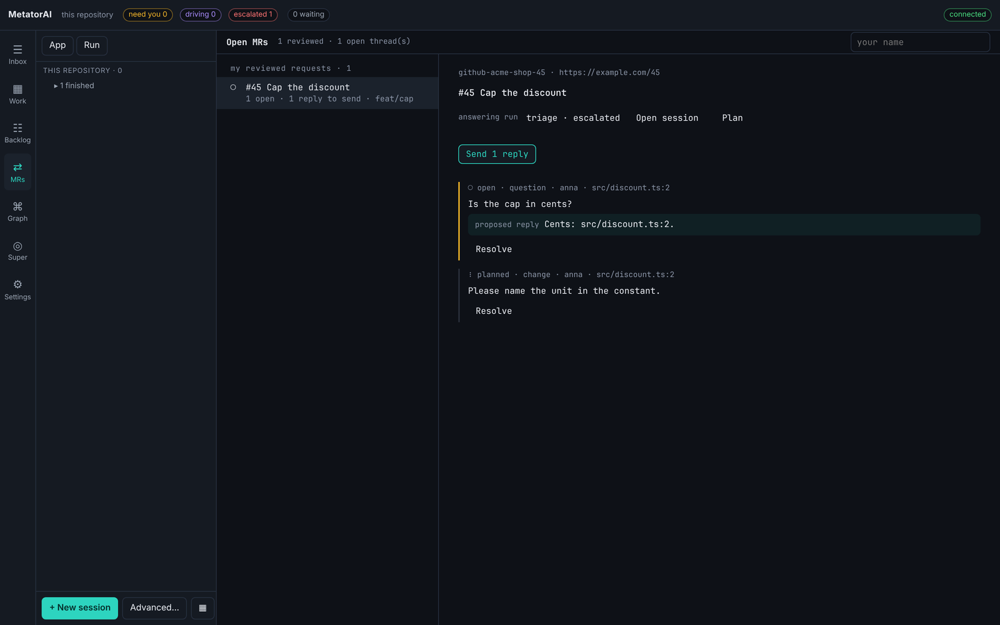

# Answer a review

When someone reviews your pull request, MetatorAI reads the threads, drafts the replies and plans the fixes. You decide which replies go out and whether the code changes.

## The MRs screen

The **MRs** screen lists your reviewed requests on the left, each with its number of open threads and of replies to send.



The chosen request on the right shows:

- the answering run with its stage and state, and **Open session** and **Plan** to go to it;
- **Send N replies**, which posts every proposed reply that was not sent yet;
- every thread: its state, its kind, who wrote it and where, the reviewer's words, and the proposed reply;
- **Resolve** on each thread, which closes it at the code host.

Type your name in the field at the top right first. Both buttons refuse to act without it, so nothing reaches the code host without a person's name on it.

The approval of the answering run waits in your [Inbox](./inbox.md).

## What happens when a review arrives

1. The daemon (`metator serve`) finds the new threads and keeps them in `.metator/mrs/<request>.json`.
2. It starts a run of `mt-review-response` on the request. The reviewers' words reach the run as quotes. Agents treat them as data and do not follow instructions in them.
3. `mt-review-responder` gives each thread a kind. A `question` gets a proposed reply that cites `file:line`. A `change` or a `nit` goes into the plan. `praise` needs nothing.
4. The run stops at the `approval` gate. You decide: fix as planned, only send the replies, or leave the review alone.
5. After your yes, the fix is built and the gates run. The run stops again at `delivery`. Your second yes approves the push to the request's branch and the replies.

Neither gate can be skipped at any autonomy level.

A request has one answering run at a time. Threads that arrive while it runs are kept and wait for the next one.

| Thread state | Meaning |
|---|---|
| `open` | nothing done yet |
| `answered` | a reply was sent |
| `planned` | the answering run's plan covers it |
| `fixed` | the change is pushed |
| `resolved` | closed at the host |

A `planned` thread becomes `fixed` on the daemon's next scan after the answering run finished.

## Configure the sources

The screen stays empty until the repository names its sources. The code host is read through an MCP server ([Automatic intake](./intake.md#connect-the-source)). Then say where your requests are:

```yaml
# metator.config.yml
mcp:
  github:
    command: npx
    args: ["-y", "@modelcontextprotocol/server-github"]
    env: { GITHUB_PERSONAL_ACCESS_TOKEN: "${GITHUB_TOKEN}" }
reviews:
  everyMs: 120000
  sources:
    - { kind: github, repo: acme/shop, author: maciej }
```

| Key | Default | Meaning |
|---|---|---|
| `everyMs` | `120000` | how often the daemon looks, in milliseconds |
| `sources[].kind` | | `github` or `gitlab` |
| `sources[].repo` | | `owner/name` on GitHub, the project path on GitLab |
| `sources[].author` | | only this author's requests; every open request when left out |
| `sources[].mcp` | the kind's name | the MCP server to use |
| `workflow` | `mt-review-response` | the workflow a new review starts |

`--reviews-ms <n>` on `metator serve` sets another interval, and `--reviews-ms 0` turns the scan off.

## Get notified

With `notify.command` set, a scan that finds new review threads runs the command once. The line it gets reads like this:

```text
Review on #45 Cap the discount: 2 new threads
```

See [Configuration](../reference/configuration.md#notifications).

## From a terminal

```bash
metator mrs scan                          # read the hosts now
metator mrs list                          # your reviewed requests: open threads, replies to send, the run
metator mrs show github-acme-shop-45      # every thread: who, where, its kind, the proposed reply, its state
```

A request's id is the source kind, the repository and the number, such as `github-acme-shop-45`.

To record what you make of a thread yourself, which only the command does:

```bash
metator mrs triage github-acme-shop-45 --thread T1 --kind question --reply "Cents: src/discount.ts:2."
```

To send the proposed replies and close a thread at the host:

```bash
metator mrs send github-acme-shop-45 --by maciej
metator mrs resolve github-acme-shop-45 --thread T1 --by maciej
```

Both commands refuse to run without `--by`.
