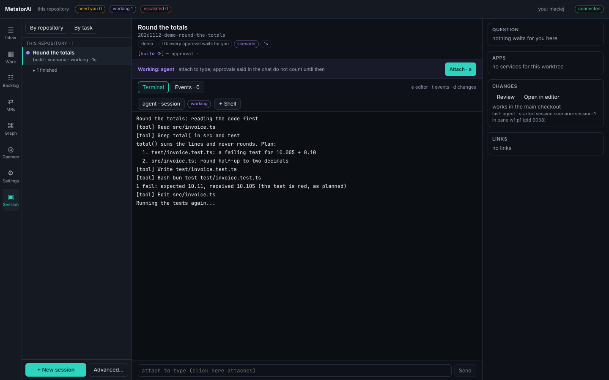

# Sessions and worktrees

A session is a conversation in an AI host's terminal, and a run has one for its agent. This page shows how to watch a run's session in the app and take its keyboard, what a worktree gives a run, and the commands that stop, continue, hand over and clean up runs.

## The Terminal tab of a run

A click on a step or a run of its own in the sidebar opens its page on its **Terminal** tab; a finished run, and a task's page, open on **Overview**.



The head is the same on every tab of a step's page: **Task › step** back to its task, the name, its word (`needs you`, `working`, `blocked`, `done`), a bar of its stages done with the stage it is at, and the tabs **Overview**, **Terminal**, **Changes** and **Activity**, with the shown one marked. **Details** in the head folds the rest: the run id, chips for the repository, the workflow, the autonomy level with what it means (**L0: every approval waits for you**), the AI host, the worktree's ports, the time since the run started and its finer state, and the line of every stage, with the current one marked.

The bar under the head says who types. With **Working: agent** you watch. Click **Attach** (key `a`) to take the keyboard; the app asks for your name the first time. **Release to agent** (key `c`) gives it back. With **Working: nobody** no agent works on the run and no session is open.

An escalated run has no one at work, so under the head, on every tab, a bar shows why it stopped, with **Resume** and **Close run…**, the same two actions as its card on Home. A finished run shows **Done** or **Aborted** with one line on how it ended.

When the agent asks on its own screen, with no card in the Inbox, a line above the terminal says **The agent asks in its terminal**, with **Show the pane** when another pane is the one that asks. Attach and type the answer. While you are attached, your yes in the chat counts as an approval ([Terminals](./desktop.md#who-types-in-a-session)).

Below that bar:

- The terminal shows the run's main pane. The row above it lists the run's panes, each with its state. Click one to see it. **+ Shell** opens a shell pane of your own in this run.
- Opening this tab starts nothing. A run that is driven in the background, or that nothing works on yet, has no terminal: the screen says **No session runs for this run**. A run nothing works on has a bar under its head, on every tab, with **Open a session** (its agent, the conductor, in a terminal you can watch and take) and **Drive in background** (no terminal, as `metator run drive --detach`), and a **host** choice when several are installed. Starting a run's agent asks for your name the first time. An escalated run has **Resume** there instead, and a finished one nothing. Once a session lives, its terminal shows by itself.
- A worker whose process finished its work (exit code 0) reads `finished` with ✓, and its pane offers only **Close pane**; a process that ended with any other code reads `exited` in red, with **Retry**.
- The run's events are on the **Activity** tab (key `l`): the time, the type, the source and what happened.
- The line at the bottom sends one line of text to the session. A click into it attaches you first.

The boxes on the right:

| Box | Shows |
|---|---|
| **Question** | the run's open question with a button per option. A click on a plain option answers. Reject and Other first ask for the reason, and a question with several answers lets you choose them, then **Send**. Empty when nothing waits |
| **Apps** | the services of the worktree's environment, with their state and their ports by name |
| **Changes** | **Open changes** opens the run's **Changes** tab ([Read the change](./changes.md)); **Open in editor** opens the worktree; below are the branch and the path |
| **Links** | the parent run and the steps, files this run shares with another run (with which to merge first), and messages from other runs |

**Terminals** shows the same panes side by side ([Terminals](./desktop.md)). A run whose drive process died shows the chip **drive died** here.

A run whose conductor's pane lives, asks nothing and has no drive behind it is moved on by the conductor: its page says **The conductor moves this run on at `<stage>`: talk to it in its terminal**, with **Open the terminal**. With no conductor alive, the bar says **Nothing drives this run** and offers **Open a session** and **Drive in background**.

## What a worktree gives a run

A run that edits your working tree blocks you, and two runs in one tree disturb each other. A git worktree gives a run its own checkout on its own branch. The agent offers it when you start a task, and the **Form…** form has it ticked by default ([Start a task](./start.md)).

For a run with a worktree, MetatorAI:

1. creates a worktree at `.metator/wt/<run>` on a new branch `metator/<run>`, branched from `HEAD` (or from `--base`);
2. reserves a block of 20 ports for it that no other worktree holds;
3. links the run directory into the worktree, so agents and hooks find the run at the same path;
4. sets up dependencies, so tests and linters can run there.

For the dependencies, the main checkout's `node_modules` are copied when the lockfiles match. Otherwise your package manager installs in the worktree. A project without a lockfile is installed without writing one, so no lockfile appears in the run's change. A `package.json` that lists no dependencies needs no install, and none runs. A failed install is a warning and the run still starts.

### Ports

Each worktree gets its block from the range 41000 to 48999. When MetatorAI starts your application in a worktree (`metator env up`), every process gets these variables:

| Variable | Value |
|---|---|
| `METATOR_WORKTREE` | the worktree's id |
| `METATOR_PORT_BASE` | the first port of the block |
| `METATOR_PORT_COUNT` | the size of the block |

Base your port settings on `METATOR_PORT_BASE`, for example `PORT=$((METATOR_PORT_BASE + 0))` for the API and `+ 1` for the web app. Two copies of your application then never share a port. See [Run the application](../repo/environments.md).

## From a terminal

### Start a run in a worktree

```bash
metator run new --workflow mt-feature --task "Add combined discount" --worktree
metator run new --workflow mt-bugfix --task "Fix rounding" --worktree --base main
```

A worktree starts from the last commit. When tracked files have uncommitted changes, `run new --worktree` refuses and names them: commit or stash them, or pass `--allow-dirty` to start without them. `metator issue start` behaves the same. In the app, the **Form…** form and **Start a run** on the Backlog show the refusal with the button **Start from the last commit**, which starts the run without your changes. Runs that [intake](./intake.md) starts never ask: they start from the last commit. Untracked files do not stop a run. A run in your checkout, without `--worktree`, refuses on uncommitted changes when its workflow requires `clean-tree`; `--allow-dirty` starts it with them, and they become part of its change. `run new` also refuses in a directory that is not a git repository, and `run new --worktree` in a repository with no commit.

`--no-setup` skips the dependencies, and you can set them up later:

```bash
metator worktree setup --run <id>
metator doctor --run <id>        # what this run can and cannot do in its worktree
```

Inside a worktree, `metator run ...` without `--run` means that worktree's run. `metator run` and `metator issue start` offer a worktree too.

### See every run

```bash
metator status      # every run: its stage, what waits for you, whether an agent works on it
metator inbox       # only the questions that wait for you
```

At a terminal `metator status` prints each run with its stages, what it needs now and the command that does it, followed by your [`metator ask`](./ask.md) conversations. In a script it prints the same data as one JSON line (`--json` gives only that line at a terminal too). The desktop app shows the same runs in a window.

### Watch, stop and continue

```bash
metator run activity --tail 8     # the last events: stages, agents, tools, questions, gates
metator run stop                  # the drive process ends; the run stays at its stage
metator run continue <run>        # drive it again and watch
```

A run has one driver at a time. A second `metator run drive` is refused while the first is alive. An open question is not asked twice when you continue.

If the machine restarts or the drive process is killed, `metator status` marks the run as died. One command starts every such drive again, at the stage it stood:

```bash
metator run revive
```

It does nothing when no drive died, so you can schedule it at boot.

### When the daemon stops

The agents' sessions in Terminals survive the daemon (`metator serve`). When it stops, with Ctrl+C, SIGTERM or even SIGKILL, every agent's pane is **paused**, not ended. The pane keeps its host session id and its last screen; the daemon saves every pane's screen to disk every 5 seconds (`--screens-ms`). On its next start the daemon resumes each paused session in the same pane (`claude --resume <session>`, or your host's own resume), with the screen it left above what it prints now. Panes of a run that is no longer active are not resumed. A pane whose host exited by itself is ended, as before.

```bash
metator serve --no-restore        # start, but leave the sessions paused
metator run continue --run <id>   # continue the task: every paused pane, and what carried each run
```

`metator run continue` with a daemon running continues the whole task: the run, every run under it (the steps of a system run in their repositories, the runs started with `--parent`), and the chat where you gave the task. Each paused pane is resumed. Each active run that nothing carries gets back what carried it: its conductor's session, or else its background drive (a system run waiting at `status`, for example). An escalated run is left for you to resume. It prints what it resumed, what drives it started and what it skipped, with why, and each run's activity says so. Without a daemon, it drives the run again as before. `POST /runs/<run>/continue` with `{ "by": "<name>" }` does the same; `POST /panes/<pane>/continue` continues one paused pane.

A paused pane's terminal shows its last screen, read-only, until it is continued.

A host's own resume brings the conversation back, not the turn it was in: Claude Code shows "Interrupted · What should Claude do instead?" and waits. So once a resumed conductor or worker is idle at its prompt, and nobody holds the run's keyboard, the daemon types one line into it, once per resume:

- a conductor: ``[metator] Your session was resumed after the daemon stopped (daemon-stopped, at <time>). Continue where you stopped: check `metator run status` and your workers (`metator run workers`).``
- a worker: ``[metator] Your session was resumed after the daemon stopped. Continue your card where you stopped and report with `metator run result`.``

While you hold the keyboard the line waits until you release it. The run's activity records it (`told the resumed session in pane …`), and the supervisor does not also nudge that session. The chat where you gave the task gets no such line; it is told when its task is done or waits for you.

### The chat learns about its task

When a run you started from a chat (the pane where you described the task) is done, is closed, stops for you, or waits for your approval, the daemon types one line into that chat's agent, such as `[metator] The task 20261120-… (Prices in the customer's currency) is done. Tell the person what was done.` It does so once for each event, and only while the agent is idle at its prompt; until then the line waits. The run's activity records each line.

### Hand a run over

```bash
metator run handoff       # writes handoff.md: stage, approvals, artifacts, recent log, how to resume
metator run brief         # what happened since you last looked
```

### Close a run

```bash
metator run close --run <id>
metator run close --run <id> --remove-worktree
metator run close --run <id> --aborted --reason "superseded"
```

`run close` writes `summary.json`. `--remove-worktree` also removes the run's worktree and frees its ports. `--aborted` ends a run that is still active or escalated, and stops the process that drives it.

If you removed a run's worktree by hand, `metator run drive` stops with `the worktree of run <id> is gone`. Put it back with `git worktree prune && git worktree add <path> <branch>`, or close the run with `--aborted`.

### Manage worktrees

```bash
metator worktree list                     # branch, ports, run status, uncommitted work
metator worktree new spike --ports 5      # a worktree without a run
metator worktree rm spike
metator worktree prune --older-than 7     # worktrees of finished runs older than 7 days
metator worktree prune --dry-run
```

Removing a worktree keeps its `metator/<id>` branch, so committed work stays. `prune` skips worktrees with uncommitted work and lists them.

::: warning
`metator worktree rm <id> --force` and `metator run close --remove-worktree --force` delete uncommitted work in that worktree. Without `--force` both refuse.
:::

### Conflicts between runs

Two runs that change the same file clash when their branches merge. The app shows such a pair in the **Links** box of both runs and under **Overview**, **Dependencies**. From a terminal:

```bash
metator worktree conflicts
metator worktree conflicts --notify
```

The output lists each active run's changed files and the pairs of runs that share one. `mergeFirst` names the run that started earlier: merge it, then rebase the other. `--notify` sends both runs a message about the shared file.

Runs can also tell each other what they did:

```bash
metator run message <to> --from <run> --topic shared-file --text "Invoice gained a dueDate field" --ref src/invoice.ts --by alice
metator run messages --run <to>
```

The receiving run's agents read the message as data about another run's work. They do not treat it as an instruction.
