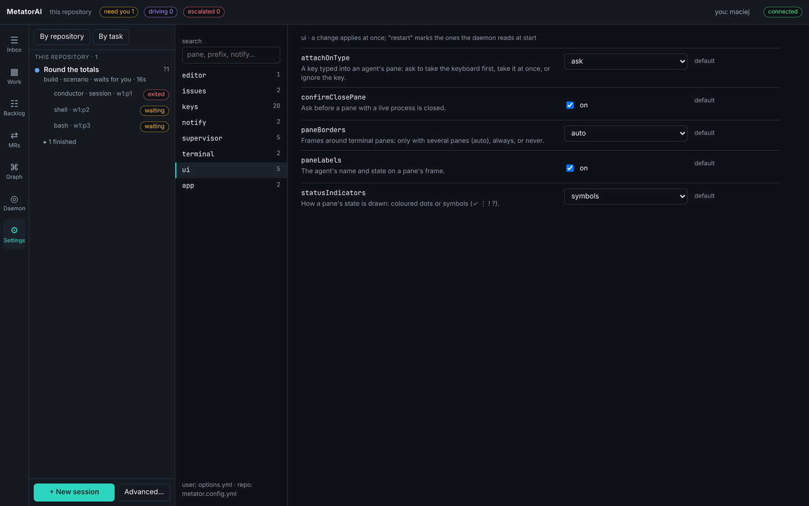

# Your settings

Your own configuration is separate from the repository's. It holds how the app looks and behaves for you, your keys, your editor and shell, and MCP servers only you use. It lives in one file in your home directory and applies to every repository. This page shows how to change it in the app and from a terminal.

The repository's configuration, `metator.config.yml`, is described in [Configuration](../reference/configuration.md).

## The Settings screen



The left column has a search field and the groups of options, named by the first part of the option's key: `ui`, `keys`, `notify`, `terminal`, `editor` and the repository's groups. The number next to a group counts its options. An amber number before it counts the ones a file sets.

Click a group to see its options, or type in **search** to find options by key or description in every group.

Each row is one option: its name, what it does, its value, and where the value comes from.

| Next to the value | Means |
|---|---|
| **default** (grey text) | no file sets the option; the built-in default applies |
| **user** | your own file sets it |
| **repo** | the repository's `metator.config.yml` sets it |
| **run** | a run overrides it for itself |

Change a value in place: tick a box, pick from a list, or type and leave the field. The change is saved at once. A value the daemon refuses is not kept: the field goes back to the value that holds, and the reason stays at the top of the list until you close it. A row whose value is not the default has a button, **default**, which removes the value from the file and shows the default in the field. A chip **restart** marks an option that the daemon reads only when it starts.

The app writes your own options to your file and the repository's options to `metator.config.yml`. The bottom of the left column names both files.

## Your file

Your options are in `~/.config/metator/options.yml`. If `XDG_CONFIG_HOME` is set, the file is `$XDG_CONFIG_HOME/metator/options.yml`.

After `metator config set ui.paneBorders always --scope user` on a machine without the file, it reads:

```yaml
# Your MetatorAI options (`metator config set <key> <value>`); a wrong value is a warning, not an error.
kind: UserOptions
schemaVersion: 2
options:
  ui.paneBorders: always
```

`options:` holds one entry per option key. `mcp:` holds [your own MCP servers](#your-own-mcp-servers). You can edit the file by hand. A wrong value stops nothing: the default applies and `metator config list` reports the value.

## Scopes

Every option belongs to you or to the repository, and can be set only where it belongs.

| Scope | File | Holds |
|---|---|---|
| `user` | `~/.config/metator/options.yml` | your options (`ui`, `keys`, `terminal`, `editor`, most of `notify`), on every repository |
| `repo` | `options:` in `metator.config.yml` | the repository's options, shared with the team |
| `run` | the run's `state.json` | a repository option, overridden for one run |

Values are laid over the defaults in this order: user, then repo, then run. For a repository option, a run's value wins over the repository's. Your options cannot be set by a repository or a run, so nothing overrides them. Setting an option at the wrong scope is refused:

```json
{"ok":false,"error":{"code":"USAGE","message":"ui.paneBorders is a user option; set it with --scope user"}}
```

## Change options from a terminal

```bash
metator config list                                    # every option: value, source, description
metator config list --changed                          # only the ones a file sets
metator config get ui.paneBorders                      # one option, its default and what each scope holds
metator config set ui.paneBorders always --scope user
metator config set keys.zoom "prefix+f, prefix+z" --scope user     # a list: values separated by commas
metator config unset ui.paneBorders --scope user       # back to the default
```

`--scope` is required with `set` and `unset`. For a run, add `--run <id>`: `metator config set supervisor.wipLimit 1 --scope run --run <id>`.

`metator config list` shows every key with its description. The sections below describe the options that change what you see and do today.

## Look of the workbench

| Option | Values | Default | Does |
|---|---|---|---|
| `ui.paneBorders` | `auto`, `always`, `off` | `auto` | frames around terminal panes: only when a tab has several panes, always, or never |
| `ui.paneLabels` | `true`, `false` | `true` | the title on a pane's frame, with the agent's name and state |
| `ui.statusIndicators` | `symbols`, `dots` | `symbols` | a pane's state as a symbol (`✓` `⋮` `!` `?`) or as a dot |
| `ui.confirmClosePane` | `true`, `false` | `true` | ask before a pane with a live process is closed |
| `ui.attachOnType` | `ask`, `always`, `never` | `ask` | a key typed into an agent's pane: ask to take the keyboard, take it at once, or ignore the key |
| `notify.channel` | `off` or any other value | `app` | `off` hides the toast that the workbench shows for a waiting question |

## Terminal

| Option | Default | Does |
|---|---|---|
| `terminal.shell` | empty | the shell of new shell panes; when empty, a split uses `$SHELL` |
| `terminal.scrollbackLines` | `5000` | the lines a pane keeps for scrolling, copy mode and search (200 to 100000) |

## Editor

`editor.command` (default `code`) is the command behind every **Open in editor** and behind `metator open`. It gets the run's worktree, and the file and line when you open one ([Read the change](./changes.md#your-editor)).

```bash
metator config set editor.command zed --scope user
```

## Keys

On the workbench every action is the prefix and one key ([Workbench and terminals](./desktop.md#keys)). `keys.prefix` is the prefix, `ctrl+b` by default. Each action has its own option, such as `keys.zoom` or `keys.splitRight`. The group **keys** on the Settings screen lists them all with their bindings.

A binding is written as `prefix+<key>`. An action can have several bindings: in the app, separate them with commas.

```bash
metator config set keys.prefix ctrl+a --scope user
metator config set keys.zoom "prefix+f" --scope user
```

## Your own MCP servers

A repository names its MCP servers under `mcp:` in `metator.config.yml`. Servers you alone use go under `mcp:` in your file, in the same form:

```yaml
kind: UserOptions
schemaVersion: 2
options: {}
mcp:
  notes:
    command: notes-mcp          # started by command
    args: [stdio]
    env: { NOTES_TOKEN: "${NOTES_TOKEN}" }
  tracker:
    url: https://mcp.example.com/mcp     # or reached by URL
```

MetatorAI itself uses your servers together with the repository's (for automatic intake, for reviews of your requests and in `metator doctor`). When both name a server the same, yours is used. `metator doctor` warns when a server's command is not installed.

Your servers stay in your file. `metator generate` writes only the repository's servers into `.mcp.json`, which is committed. For an agent in Copilot CLI or Claude Code to use one of your own servers, add it to that host's own user configuration.

Write `${VAR}` in `env`, never a token.

## Daemon address and your name

The group **app** on the Settings screen holds two values that belong to this window and are kept by the app, not in a file:

| Field | Does |
|---|---|
| **daemon url** | the address of the `metator serve` this app talks to; `http://127.0.0.1:4310` by default |
| **your name** | who attaches, answers and approves from this app |

The app also asks for your name, in a dialog, the first time you answer, attach, add a note or decide a task, and remembers it. The top bar shows it as **you: alice**; a click there changes it. The name goes into the run's log next to every decision. From a terminal the same name is the `--by` option.

To open the app on another daemon once, add `?daemon=http://127.0.0.1:4310` to the app's address.
